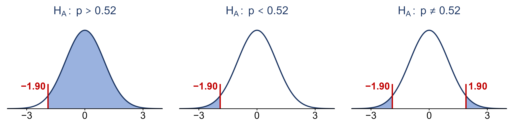

```{r setup, include=FALSE}
knitr::opts_chunk$set(echo = TRUE)
library(knitr)
library(kableExtra)
library(ggplot2)
library(ggthemes)
library(ggpubr)
library(latex2exp)
library(gganimate)

path = 'Data/'

fmt <- function(x, d = 2) formatC(x, format = 'f', digits = d)
tab <- function(df, ...) kable(df, format = 'html', row.names = FALSE, escape = FALSE, ...) %>%
  kable_classic(full_width = FALSE, html_font = "Cambria") %>%
  kable_styling(bootstrap_options = 'striped')
near <- function(a, b, tol = 5e-4) abs(a - b) < tol
zt <- function(z) round(pnorm(z), 4)     # a z-table lookup, four decimals

NAVY <- "#1F3864"; SHADE <- "#8FAADC"; RED <- "#C00000"
```

```{r lecture22-setup, include=FALSE}
# every number in the Lecture 22 sections is checked here; the slides' numbers are the same
# ones asserted in assets/make_lecture22_figures.R

# the taste test: under H0 each cup is named right with probability 0.5
stopifnot(choose(8, 0:8) == c(1, 8, 28, 56, 70, 56, 28, 8, 1), 2^8 == 256,
          near(0.5^8, 0.0039, 1e-4),
          choose(6, 0:6) == c(1, 6, 15, 20, 15, 6, 1), sum(choose(6, 4:6)) == 22,
          near(1 - pbinom(3, 6, 0.5), 22 / 64, 1e-12), round(22 / 64, 4) == 0.3438)

# the poll (hypothetical): other polls say 52% for Candidate X; ours finds 490 of 1,000 likely voters
se_p <- round(sqrt(0.52 * 0.48 / 1000), 4); z_p <- round((0.490 - 0.52) / se_p, 2)
se_h <- round(sqrt(0.25 / 1000), 4); z_h <- round((0.490 - 0.5) / se_h, 2)
stopifnot(1000 * 0.52 >= 15, 1000 * 0.48 >= 15, round(0.52 * 0.48, 4) == 0.2496,
          se_p == 0.0158, z_p == -1.90, zt(-1.90) == 0.0287, round(1 - zt(-1.90), 4) == 0.9713,
          round(2 * zt(-1.90), 4) == 0.0574, se_h == 0.0158, z_h == -0.63, zt(-0.63) == 0.2643)

# coin flips (Bartos et al. 2025): 178,079 of 350,757 landed on the side they started on
n_f <- 75036 + 203440 + 72281; x_f <- 178079
ph_f <- round(x_f / n_f, 4); se_f <- round(sqrt(0.5 * 0.5 / n_f), 6)
z_f <- round((ph_f - 0.5) / se_f, 1)
stopifnot(n_f == 350757, ph_f == 0.5077, se_f == 0.000844, z_f == 9.1,
          n_f * 0.5 >= 15, round(1 / (ph_f - 0.5)) == 130)
# the same 50.8% from only 1,000 flips
se_k <- round(sqrt(0.25 / 1000), 4); z_k <- round((0.508 - 0.5) / se_k, 2)
stopifnot(se_k == 0.0158, z_k == 0.51, zt(0.51) == 0.6950, round(1 - zt(0.51), 4) == 0.3050)

# Lecture 23: cell phones and brain cancer (OpenStax Example 9.21): 172 of 420,019, p0 = 0.00034
n_c <- 420019; x_c <- 172; p0_c <- 0.00034
ph_c <- round(x_c / n_c, 7); se_c <- round(sqrt(p0_c * (1 - p0_c) / n_c), 8)
z_c <- round((ph_c - p0_c) / se_c, 2)
stopifnot(near(ph_c, 0.0004095, 1e-12), near(se_c, 0.00002845, 1e-12), z_c == 2.44, round(n_c * p0_c, 1) == 142.8,
          round(n_c * (1 - p0_c)) == 419876, zt(2.44) == 0.9927, round(1 - zt(2.44), 4) == 0.0073)
# Lecture 23 practice: 136 of 400 skip breakfast, p0 = 0.30
se_b <- round(sqrt(0.3 * 0.7 / 400), 4); z_b <- round((136 / 400 - 0.3) / se_b, 2)
stopifnot(136 / 400 == 0.34, se_b == 0.0229, z_b == 1.75, zt(1.75) == 0.9599,
          round(1 - zt(1.75), 4) == 0.0401)

# Lecture 24: first statistics test (OpenStax Example 9.16), sigma unknown, so t with df = 9
sc <- c(65, 65, 70, 67, 66, 63, 63, 68, 72, 71)
se_s <- round(3.197 / sqrt(10), 3); t_s <- round((67 - 65) / se_s, 2)
stopifnot(mean(sc) == 67, round(sd(sc), 3) == 3.197, se_s == 1.011, t_s == 1.98,
          round(qt(0.95, 9), 3) == 1.833, round(qt(0.975, 9), 3) == 2.262,
          1 - pt(t_s, 9) > 0.025, 1 - pt(t_s, 9) < 0.05)
# Lecture 24 practice: first-time brides (OpenStax Example 9.17), 53 of 100, p0 = 0.5, two-sided
z_y <- round((0.53 - 0.5) / sqrt(0.25 / 100), 2)
stopifnot(sqrt(0.25 / 100) == 0.05, z_y == 0.60, 100 * 0.5 >= 15, zt(0.60) == 0.7257,
          round(2 * (1 - zt(0.60)), 4) == 0.5486)
# Lecture 24 practice: goggles (OpenStax Example 9.14), sigma = 0.8 known, so z
se_g <- round(0.8 / sqrt(15), 4); z_g <- round((16 - 16.43) / se_g, 2)
stopifnot(se_g == 0.2066, z_g == -2.08, zt(-2.08) == 0.0188)
# Lecture 24 practice: P-values and decisions
stopifnot(round(1 - zt(1.52), 4) == 0.0643, round(pt(-2.30, 15), 4) == 0.0181,
          zt(-2.10) == 0.0179, round(2 * zt(-2.10), 4) == 0.0358)

# try it out
stopifnot(sum(choose(10, 7:10)) == 176, round(176 / 1024, 3) == 0.172,
          zt(-2.10) == 0.0179, round(2 * zt(-2.10), 4) == 0.0358)
```

<!--
  SCOPE OF THIS PAGE (Oct 26 2026). Week 10 per Course_Schedule.Rmd (the date source of truth):
    Mon Oct 26   Lecture 22  the t interval concluded (seal whiskers, on the Week 9 page) and choosing a
                             minimum sample size (also on the Week 9 page); introduction to
                             significance tests (the taste test, this page); Lecture 22 stopped
                             at its slide 9, so it is trimmed to slides 1-8
                             lecture_slides/Week 10/2026/Week10_Lecture22_Slides_10_26_2026.pptx
    Wed Oct 28   Lecture 23  significance tests and P-values (Lecture 22 slides 9-16 carried over),
                             testing a population proportion with OpenStax Example 9.21 (cell
                             phones and brain cancer) and a breakfast practice (this page). The
                             coin-flip example was cut from the slides and stays here as reading.
                             lecture_slides/Week 10/2026/Week10_Lecture23_Slides_10_28_2026.pptx
                             Lecture 23 stopped at its slide 9 (test statistics and P-values), so
                             it is trimmed to slides 1-9.
    Fri Oct 30   Lecture 24  making a decision (with a P-value practice), then Lecture 23 slides 12-13 (testing a proportion,
                             cell phones) and testing a population mean (this page): OpenStax
                             Example 9.16 (first statistics test), with practice from Examples
                             9.17 (brides, two-sided) and 9.14 (goggles, lower-tailed)
                             lecture_slides/Week 10/2026/Week10_Lecture24_Slides_10_30_2026.pptx

  This page replaced the 2024 Week 10 page (git show 27a60f5:docs/lecturemenu10.Rmd). Its review of
  confidence intervals and sample size now lives on the Week 9 page. Its "Introduction to tests of
  significance" is rebuilt here, slowly, from the tools students already have: parameters and
  estimates (Week 1), the binomial (Week 7), sampling distributions and the CLT (Week 8), z-scores and
  normal areas (Weeks 6 and 9). The notation and the five steps follow Jarred's 2024 notes (2024
  Lecture 21, git show 27a60f5:docs/lecturemenu11.Rmd). Textbook: OpenStax Introductory Statistics 2e,
  Sections 9.1-9.5. The taste test and the Candidate X poll (Jarred's idea, midterm season) are
  hypothetical; the coin flips are Bartos et al. (2025). The poll is also slide 11 of Lecture 23.
-->

# From estimating to testing

For the last two weeks we have been **estimating** parameters: a confidence interval answers the question
*"what is $p$ (or $\mu$), give or take?"* A lot of questions are not asked that way. They come as a
**claim**, and we want to know whether the data back it up:

* A new drug claims to lower blood pressure. Does it, or did the patients' readings just happen to drop?
* The polling averages say a Senate candidate has 52% support. A new poll finds less. Has support
  really dropped, or is the new poll just a different sample?
* Your roommate says they can tell Coke from Pepsi. Can they, or are they guessing?

Each claim is about a **parameter**: the drug's average effect $\mu$, the candidate's support $p$, your
roommate's chance $p$ of naming a cup correctly. We never see the parameter. We see an **estimate**
from a sample, and estimates bounce around from sample to sample (Week 8: two polls of the same state
give two different answers). So the real question is always:

> **Is the difference between what we saw and what the claim says too big to be ordinary sampling
> variation?**

A **significance test** (also called a **hypothesis test**) is the tool that answers it. A result that
is decidedly **not** due to ordinary variation, that is, not due to chance or coincidence, is called
**statistically significant**.

# The logic of a significance test

## In plain words: a courtroom

A significance test works like a criminal trial.

* The defendant is **presumed innocent**. Nobody has to prove innocence; innocence is the starting
  assumption. In a test, the starting assumption is the boring explanation, "nothing interesting is
  going on", and it is called the **null hypothesis**.
* The prosecution has a **suspicion**: the defendant did it. In a test, the suspicion is called the
  **alternative hypothesis**. The burden of proof is on the suspicion, not on the boring explanation.
* The jury asks: **if the defendant really were innocent, how likely is evidence like this?** If that
  is very unlikely (beyond reasonable doubt), they convict. In a test, that probability is the
  **P-value**, and "beyond reasonable doubt" is a cutoff we pick in advance, the **significance
  level** $\alpha$.
* A jury that does not convict says **"not guilty"**, never "innocent". Weak evidence does not prove
  innocence. In a test, we either **reject** the null hypothesis or **do not reject** it. We never
  "accept" it.

Hold on to that picture. Everything below is the same four ideas with numbers attached.

## Working it through: can you taste the difference?

Your roommate claims they can tell Coke from Pepsi. You set up a blind test: 8 times, you flip a coin to
decide which soda to pour, and they taste the cup and name it. They get **all 8 right**. Impressive, or
lucky?

### Step 1: name the parameter, and the two stories

The parameter is $p$, your roommate's true, long-run chance of naming a cup correctly. We cannot see
$p$; we only see this one test, where they got $\hat{p} = 8/8 = 1$. There are two stories about $p$:

* **Story 1, "just guessing":** they cannot really tell, so each cup is a coin flip, and $p = 0.5$.
  This is the **null hypothesis**, written $H_0: p = 0.5$.
* **Story 2, "they can taste it":** they do better than guessing, $p > 0.5$. This is the
  **alternative hypothesis**, written $H_A: p > 0.5$.

Notice that the hypotheses are about $p$, the parameter, not about $\hat{p}$. We already **know**
$\hat{p} = 1$; there is nothing to test about it. The question is what it tells us about $p$.

### Step 2: suppose $H_0$ is true. What results would we expect?

Here is the key move. We cannot prove story 2 directly, so we **assume story 1** and work out what it
predicts. If they are only guessing, then the number of cups they get right, $X$, is a count of
successes in 8 independent trials that each succeed with probability 0.5. That is a binomial random
variable from Week 7:
$$X \sim \text{Binom}(8,\ 0.5) \qquad\text{when } H_0 \text{ is true}$$

A helpful way to see this distribution: imagine **256 people who cannot taste the difference** each
take the 8-cup test, guessing every time. Since $2^8 = 256$, the binomial formula
$P(X = k) = \binom{8}{k}(0.5)^k(0.5)^{8-k} = \binom{8}{k}/256$ says that, on average, exactly
$\binom{8}{k}$ of them score $k$:

```{r, echo=FALSE, fig.width=8, fig.height=3.6, fig.align='center', fig.alt = "Bar chart of how many of 256 pure guessers get each score on an 8-cup taste test, from 0 to 8 correct. The bars rise and fall symmetrically: 1, 8, 28, 56, 70, 56, 28, 8 and 1 guessers. The tallest bar is at 4 correct. Only the single guesser at 8 correct, the far right bar, is highlighted, matching the roommate's score."}
gd <- data.frame(k = 0:8, n = choose(8, 0:8), hit = 0:8 >= 8)
ggplot(gd, aes(factor(k), n, fill = hit)) +
  geom_col(width = 0.75) +
  geom_text(aes(label = n), vjust = -0.4, size = 4.5) +
  scale_fill_manual(values = c(`FALSE` = SHADE, `TRUE` = RED), guide = 'none') +
  scale_y_continuous(expand = expansion(mult = c(0, 0.12))) +
  labs(x = 'cups named correctly out of 8', y = 'guessers (out of 256)',
       title = 'If H0 is true: 256 people guessing their way through 8 cups') +
  theme_classic(base_size = 14)
```

This is what "just guessing" looks like. Most guessers land near 4 out of 8, which makes sense: the
mean of a binomial is $np = 8(0.5) = 4$. Some get 5 or 6 by luck. Getting **all 8** happens to about
**1 guesser in 256**.

### Step 3: how surprising is what we actually saw?

Now compare the data with the prediction. The probability, **if $H_0$ is true**, of a result at least as
extreme as the one we saw is called the **P-value**. "At least as extreme" means at least as far in the
direction $H_A$ points to, which here is "as many correct, or more":
$$\text{P-value} = P(X \geq 8 \mid H_0 \text{ true}) = \binom{8}{8}(0.5)^8 = \frac{1}{256} \approx 0.0039$$
The bar $\mid$ is read **"given"**: the probability is worked out in the world where $H_0$ is true.
That is the same conditional probability idea from Week 6.

A P-value of 0.0039 says: **if your roommate were only guessing, a result this good would happen less
than half a percent of the time.**

### Step 4: two explanations, and a decision

There are only two ways to explain a result with a small P-value:

1. **Something unusual happened.** Your roommate was guessing and got very lucky: they are the 1 in 256.
2. **The assumption behind the calculation is wrong.** $H_0$ is false; they really can taste the
   difference.

Both are possible. The test does not tell us which one is true. It tells us how hard we would have to
believe in luck to keep believing $H_0$. The smaller the P-value, the harder that gets, and at some point
explanation 2 becomes the more reasonable one.

Where is that point? It is a choice, made **before** looking at the data, called the **significance
level** $\alpha$. By convention $\alpha = 0.05$, i.e. "if a result this extreme would happen less than 5%
of the time by luck alone, we stop believing it was luck". The decision rule is:

* If the P-value $< \alpha$: **reject $H_0$**. The result is statistically significant; the data are
  evidence for $H_A$.
* If the P-value $\geq \alpha$: **do not reject $H_0$**. The result is not statistically significant;
  the data are not strong enough evidence for $H_A$.

Here $0.0039 < 0.05$, so we reject $H_0$: the data are evidence that your roommate can taste the
difference. The textbook's memory device: **"if the P-value is low, the null must go."**

### A second taster

A friend makes the same claim, but takes a shorter 6-cup test and gets **4 of 6** right. Under
$H_0: p = 0.5$, their score is $X \sim \text{Binom}(6,\ 0.5)$. Picture 64 guessers ($2^6 = 64$):

```{r, echo=FALSE, fig.width=8, fig.height=3.6, fig.align='center', fig.alt = "Bar chart of how many of 64 pure guessers get each score on a 6-cup taste test, from 0 to 6 correct: 1, 6, 15, 20, 15, 6 and 1 guessers. The bars at 4, 5 and 6 correct are highlighted, holding 15 plus 6 plus 1, or 22, of the 64 guessers."}
gd6 <- data.frame(k = 0:6, n = choose(6, 0:6), hit = 0:6 >= 4)
ggplot(gd6, aes(factor(k), n, fill = hit)) +
  geom_col(width = 0.75) +
  geom_text(aes(label = n), vjust = -0.4, size = 4.5) +
  scale_fill_manual(values = c(`FALSE` = SHADE, `TRUE` = RED), guide = 'none') +
  scale_y_continuous(expand = expansion(mult = c(0, 0.12))) +
  labs(x = 'cups named correctly out of 6', y = 'guessers (out of 64)',
       title = 'If H0 is true: 64 people guessing their way through 6 cups') +
  theme_classic(base_size = 14)
```

"At least as extreme" as 4 correct means 4, 5 or 6 correct, the shaded bars:
$$\text{P-value} = P(X \geq 4 \mid H_0 \text{ true}) = \frac{15 + 6 + 1}{64} = \frac{22}{64} \approx 0.34$$
About a third of pure guessers do this well, so 4 of 6 is not surprising at all if your friend is
guessing. $0.34 \geq 0.05$: **do not reject $H_0$**. This does **not** prove your friend is guessing
("not guilty", not "innocent"). It says this test gives no real evidence that they can taste the
difference. A longer test might.

One more thought. If all 256 guessers from the first picture took the 8-cup test, about one of them
would score 8 for 8 and be convinced they have a gift. A small P-value means **either** rare luck **or**
a false $H_0$, and from one test we cannot be sure which. That is why surprising results get repeated
before anyone believes them.

# The notation

Significance tests bring a lot of new symbols. Most of them are old ideas with new names.

```{r, echo=FALSE}
tab(data.frame(
  Symbol = c('$\\theta$', '$\\theta_0$, e.g. $p_0$, $\\mu_0$', '$\\hat{\\theta}$, e.g. $\\hat{p}$, $\\bar{x}$',
             '$H_0: \\theta = \\theta_0$', '$H_A: \\theta > \\theta_0$', '$H_A: \\theta < \\theta_0$',
             '$H_A: \\theta \\neq \\theta_0$', '$z_{obs}$',
             '$P(Z \\geq z_{obs} \\mid H_0 \\text{ true})$', '$\\alpha$'),
  `Read as` = c('"theta"', '"theta-naught", "p-naught", "mu-naught"', '"theta-hat", "p-hat", "x-bar"',
                '"H-naught: theta equals theta-naught"', '"H-A: theta is greater than theta-naught"',
                '"H-A: theta is less than theta-naught"', '"H-A: theta is not equal to theta-naught"',
                '"z observed"', '"the probability Z is at least z observed, given H-naught is true"',
                '"alpha"'),
  Meaning = c('a parameter, any parameter: stands for $p$ or $\\mu$ when we talk about tests in general',
              'the value of the parameter that $H_0$ claims, a number like 0.5 or 28 g',
              'the estimate of $\\theta$ from our sample (Weeks 1 and 8)',
              'the null hypothesis: "no effect", the parameter equals the claimed value',
              'an upper-tailed alternative: we suspect the parameter is bigger',
              'a lower-tailed alternative: we suspect the parameter is smaller',
              'a two-sided alternative: we suspect it is different, in either direction',
              'the test statistic: how many standard errors $\\hat{\\theta}$ is from $\\theta_0$',
              'the P-value of an upper-tailed test',
              'the significance level, the cutoff for the P-value, usually 0.05'),
  check.names = FALSE))
```

The subscript 0 always marks "the value from the null hypothesis". In the taste test, $\theta$ is $p$,
$\theta_0 = p_0 = 0.5$, and $\hat{\theta} = \hat{p}$.

# Writing the hypotheses

Hypotheses come first, before any data are looked at. A good order to write them in:

1. **Start with $H_A$**: what do we suspect, or hope to find evidence for? "They can taste the
   difference" becomes $H_A: p > 0.5$.
2. **Then write $H_0$** as "that effect is not there", with an equals sign: $H_0: p = 0.5$.

Rules that always hold:

* Both hypotheses are about a **parameter** ($p$ or $\mu$), never an estimate. $H_0: \hat{p} = 0.5$
  makes no sense: we already know $\hat{p}$.
* $H_0$ always contains the **equals sign**, and $H_A$ never does.
* $H_A$ must come from the question, **not from the data**. Looking at the data first and then
  pointing $H_A$ the way the data went is a form of bias: it makes the evidence look stronger than it
  is.

The direction of $H_A$ decides which kind of test it is:

```{r, echo=FALSE}
tab(data.frame(
  `Alternative` = c('$H_A: \\theta > \\theta_0$', '$H_A: \\theta < \\theta_0$', '$H_A: \\theta \\neq \\theta_0$'),
  `Name` = c('upper-tailed (one-sided)', 'lower-tailed (one-sided)', 'two-sided'),
  `Use it when the question says` = c('"more than", "better", "increased", "at least"',
                                      '"less than", "worse", "decreased", "fewer"',
                                      '"different", "changed", "is it fair?"'),
  check.names = FALSE))
```

## Example: stating hypotheses

For each story, decide what the parameter is, write $H_A$ first (the suspicion), then $H_0$ (no effect),
give $\theta_0$ and say which tail.

(a) *The taste test.* Your roommate swears they can tell Coke from Pepsi with their eyes closed. You
decide to put it to the test: behind their back, you flip a coin to choose which soda goes in each cup,
hand them the cups one at a time, and write down whether they name each one correctly. Someone who is
just guessing would be right about half the time. Does your roommate do better than guessing?

*Answer:* $p$ = their chance of naming a cup right. $H_A: p > 0.5$, $H_0: p = 0.5$, with $p_0 = 0.5$:
**upper-tailed**. Only "better than guessing" would support the claim.

(b) *The spinning coin.* A friend says that a penny spun on its edge on a table does not land heads half
the time, the way a flipped penny does. Neither of you knows which way it should lean: the two faces are
stamped differently, so the coin might fall toward heads or toward tails. You plan to spin it many times
and count the heads. Is a spun penny fair?

*Answer:* $p$ = the chance a spun penny lands heads. We do not suspect a direction, only "not fair":
$H_A: p \neq 0.5$, $H_0: p = 0.5$, with $p_0 = 0.5$: **two-sided**.

(c) *The chip bag.* Every bag of your favorite chips says "Net weight 28 g". Lately the bags seem to have
more air and fewer chips, and you suspect the company is quietly under-filling them. You buy a bag from
several different stores and weigh the chips in each one. Do the bags hold less than 28 g on average?

*Answer:* $\mu$ = the mean weight of chips in all bags of this brand. $H_A: \mu < 28$, $H_0: \mu = 28$,
with $\mu_0 = 28$ g: **lower-tailed**. Only an under-filled bag would cheat the customer.

(d) *The coffee machine.* The campus coffee shop's machine is set to pour 12 oz into a medium cup. If it
pours too little, customers complain; if it pours too much, the shop wastes coffee and cups overflow.
Each month the manager measures a sample of medium pours to check that the machine is still set
correctly. Is the machine's mean pour off from 12 oz?

*Answer:* $\mu$ = the mean amount the machine pours into a medium cup. A problem in either direction
matters: $H_A: \mu \neq 12$, $H_0: \mu = 12$, with $\mu_0 = 12$ oz: **two-sided**.

# Measuring "how surprising": the test statistic

For the taste test we could list every possible score and add up the binomial probabilities. With
hundreds or thousands of observations that gets impractical, but we already have a better tool: the
**sampling distribution** and the **central limit theorem** from Week 8.

Recall what the CLT told us about $\hat{p}$: over all possible samples of size $n$, the values of
$\hat{p}$ pile up in a roughly normal shape, centered at the true $p$, with standard error
$SE = \sqrt{p(1-p)/n}$. In a significance test we **assume $H_0$ is true**, so the true $p$ is $p_0$.
That pins down the whole pile:
$$\text{if } H_0 \text{ is true:}\qquad \hat{p} \;\approx\; N\!\left(p_0,\ \sqrt{\frac{p_0(1-p_0)}{n}}\right)$$
Notice where every number comes from. The **center** $p_0$ comes from $H_0$, not from the data. The
standard error also uses $p_0$, because we are describing the world where $H_0$ is true. The data enter
only once, as the single $\hat{p}$ we observed, which we then place on that curve.

To see how far out on the curve it lands, we turn it into a $z$-score, exactly as in Weeks 6 and 9
(observation minus mean, divided by standard deviation). This $z$-score is the **test statistic**:
$$z_{obs} = \frac{\hat{\theta} - \theta_0}{SE} \qquad\text{for a proportion:}\qquad
z_{obs} = \frac{\hat{p} - p_0}{\sqrt{p_0(1 - p_0)/n}}$$
It measures **how many standard errors the estimate is from the value $H_0$ claims**. If $H_0$ is true,
$z_{obs}$ comes from the standard normal $N(0, 1)$, so values near 0 are ordinary and values beyond
about $\pm 2$ are rare. The P-value is then an area under the standard normal curve, found with the
$z$-table just as in Week 9.

This is the same machinery as a confidence interval, pointed in a different direction:

```{r, echo=FALSE}
tab(data.frame(
  ` ` = c('Question', 'Normal curve centered at', 'Uses', 'Result'),
  `Confidence interval` = c('What is the parameter, give or take?', 'the estimate $\\hat{\\theta}$',
                            '$\\hat{\\theta} \\pm z \\times SE$', 'a range of believable values for $\\theta$'),
  `Significance test` = c('Is the claim $\\theta = \\theta_0$ believable?', 'the claimed value $\\theta_0$',
                          '$z_{obs} = (\\hat{\\theta} - \\theta_0)/SE$', 'a P-value, then reject or do not reject $H_0$'),
  check.names = FALSE))
```

## Example: has the candidate's support dropped?

It is midterm season (Election Day is Tuesday, November 3). Suppose the polling averages put Candidate X
in a Senate race at **52%** support among likely voters. Your campaign suspects X's support is actually
lower. You run your own poll of a random sample of $n = 1{,}000$ likely voters, and **490** say they will
vote for X: $\hat{p} = 0.490$.

49% is lower than 52%. But Week 8 taught us that two polls of the same state give different answers
just because they reach different people. Is a 3-point gap **bigger than ordinary poll-to-poll
variation**? That is exactly a significance test.

1. **Assumptions.** A random sample of likely voters, and a large enough sample:
   $np_0 = 1000(0.52) = 520$ and $n(1-p_0) = 480$, both well above 15.
2. **Hypotheses.** $p$ = the proportion of **all** likely voters who support X. We suspect it is lower
   than the polls say, so $H_A: p < 0.52$ and $H_0: p = 0.52$, with $p_0 = 0.52$: **lower-tailed**.
3. **Test statistic.** If $H_0$ is true, polls of 1,000 voters give values of $\hat{p}$ centered at 0.52
   with
   $$SE = \sqrt{\frac{0.52 \times 0.48}{1000}} = \sqrt{0.0002496} \approx `r fmt(se_p, 4)`$$
   so
   $$z_{obs} = \frac{0.490 - 0.52}{`r fmt(se_p, 4)`} \approx `r fmt(z_p, 2)`$$
   Our poll is 1.9 standard errors below what $H_0$ predicts.
4. **P-value.** $P(Z \leq `r fmt(z_p, 2)` \mid H_0 \text{ true}) = `r fmt(zt(-1.90), 4)`$, from the
   $z$-table. If X's support really were 52%, only about 3 polls in 100 would come out this low.
5. **Decision.** $`r fmt(zt(-1.90), 4)` < 0.05$: **reject $H_0$**. The poll is evidence that X's support
   is below 52%.

Here is the same reasoning as a picture. The curve shows where $\hat{p}$ from a poll of 1,000 voters would
land **if $H_0$ were true**; the red line is where ours landed, and the shaded area is the P-value.

```{r, echo=FALSE, fig.width=9, fig.height=3.8, fig.align='center', fig.alt = "A normal curve showing where p-hat from a poll of 1,000 voters would land if the true support were 0.52: centered at 0.52, running from about 0.47 to 0.57. A second axis underneath shows the same points as z-scores from -3 to 3. A red line marks the observed p-hat of 0.490 at z = -1.90, and the small lower tail to its left is shaded, with area 0.0287, the P-value."}
gx <- seq(0.52 - 4 * se_p, 0.52 + 4 * se_p, length.out = 600)
gd <- data.frame(x = gx, y = dnorm(gx, 0.52, se_p))
ggplot(gd, aes(x, y)) +
  geom_area(data = subset(gd, x <= 0.490), fill = RED, alpha = 0.45) +
  geom_line(colour = NAVY, linewidth = 1) +
  geom_vline(xintercept = 0.490, colour = RED, linewidth = 1.2) +
  geom_vline(xintercept = 0.52, colour = NAVY, linetype = 'dashed') +
  annotate('text', x = 0.4885, y = max(gd$y) * 0.55, hjust = 1, colour = RED, size = 4.5, fontface = 'bold',
           label = paste0('our poll: p-hat = 0.490\nz = ', fmt(z_p, 2), '\nP-value = ', fmt(zt(-1.90), 4))) +
  annotate('text', x = 0.5225, y = max(gd$y) * 1.02, hjust = 0, colour = NAVY, size = 4.5,
           label = 'p0 = 0.52, from H0') +
  scale_x_continuous(breaks = seq(0.47, 0.57, by = 0.01),
                     sec.axis = sec_axis(~ (. - 0.52) / se_p, name = 'z', breaks = -3:3)) +
  labs(x = 'p-hat from a poll of 1,000 likely voters, if H0: p = 0.52 is true', y = NULL) +
  theme_classic(base_size = 14) +
  theme(axis.text.y = element_blank(), axis.ticks.y = element_blank(), axis.line.y = element_blank())
```

Read the two axes together: the top axis is in the units of the problem (proportions of voters), the
bottom axis is the same picture in standard errors. The test statistic is just the poll's position on
the bottom axis.

**A different claim, the same poll.** The headline question on election night is whether X is
**losing**, i.e. below 50%. That is a different $H_0$: $H_0: p = 0.5$, $H_A: p < 0.5$. Now
$SE = \sqrt{0.25/1000} \approx `r fmt(se_h, 4)`$ and
$z_{obs} = (0.490 - 0.5)/`r fmt(se_h, 4)` \approx `r fmt(z_h, 2)`$, so the P-value is
$P(Z \leq `r fmt(z_h, 2)`) = `r fmt(zt(-0.63), 4)`$. **Do not reject $H_0$.** The same 49% that is good
evidence against "52%" is weak evidence against "50%", because 0.490 sits only 0.63 standard errors below
0.5. A test always answers a question about one specific value $\theta_0$: change $\theta_0$ and you change
the question. This is why poll reports say a race is "within the margin of error".

## Which tail is the P-value?

"At least as extreme" always means "at least as far in the direction $H_A$ points to". So the shape of
$H_A$ decides which area of the curve is the P-value. To see how much it matters, take our poll
($z_{obs} = `r fmt(z_p, 2)`$ against $p_0 = 0.52$) and work out the P-value for all three alternatives:

```{r, echo=FALSE, out.width='95%', fig.align='center', fig.alt = "Three standard normal curves, each with the poll's z observed of -1.90 marked. Left, for the alternative p greater than 0.52: everything above -1.90 is shaded, almost the whole curve. Middle, for p less than 0.52: only the small lower tail below -1.90 is shaded. Right, for p not equal to 0.52: both tails, below -1.90 and above 1.90, are shaded."}

```

* **Lower-tailed**, $H_A: p < 0.52$: the area **below** $z_{obs}$,
  $P(Z \leq `r fmt(z_p, 2)` \mid H_0 \text{ true}) = `r fmt(zt(-1.90), 4)`$, read straight from the table.
* **Two-sided**, $H_A: p \neq 0.52$: a poll far out in **either** direction counts as extreme, so the
  P-value is **both** tails, twice the one-tail area:
  $2 \times `r fmt(zt(-1.90), 4)` = `r fmt(2 * zt(-1.90), 4)`$.
* **Upper-tailed**, $H_A: p > 0.52$: the area **above** $z_{obs}$,
  $P(Z \geq `r fmt(z_p, 2)` \mid H_0 \text{ true}) = 1 - `r fmt(zt(-1.90), 4)` = `r fmt(1 - zt(-1.90), 4)`$.
  A poll **below** 52% is no evidence at all that support is **above** 52%, and the huge P-value says so.

At $\alpha = 0.05$, only the lower-tailed test rejects $H_0$. The two-sided test, with the same data, does
not (0.0574): it spreads its doubt over both directions, so it needs a little more evidence. This is why
$H_A$ has to come from the question before the poll is run. Choosing the tail after seeing which way the
poll went would make any result look more convincing than it is.

# Example: do coins land the way they started?

A physics model of coin tossing (Diaconis, Holmes and Montgomery, 2007) predicts that a flipped coin
lands on the **same side it started on** a little more than half the time, about 51%, because a real
flip wobbles. Bartoš et al. (2025) tested it: 48 people flipped coins 350,757 times, recording the side
facing up before and after every flip (and filming it).

```{r, echo=FALSE}
tab(data.frame(`Who flipped` = c('students, for a thesis project', 'coin-flipping marathons (up to 12 hours)',
                                 'volunteers recruited online', '**total**'),
               Flips = c('75,036', '203,440', '72,281', '**350,757**'), check.names = FALSE))
```

$X$ = 1 if a flip lands on the side it started on, and 0 otherwise. In all, **178,079** of the
$n = 350{,}757$ flips did. Test the model's prediction at $\alpha = 0.05$, using the five steps.

1. **Assumptions.** The flips are a random sample of how people flip coins, and $n$ is large: $np_0$ and
   $n(1-p_0)$ are both about 175,000, far more than enough for the normal curve to apply.
2. **Hypotheses.** $p$ = the chance a flip lands on its starting side. The model predicted the direction
   before any flips were made, so $H_A: p > 0.5$ and $H_0: p = 0.5$, with $p_0 = 0.5$:
   **upper-tailed**.
3. **Test statistic.**
   $\hat{p} = 178{,}079 / 350{,}757 \approx `r fmt(ph_f, 4)`$ and
   $SE = \sqrt{0.5 \times 0.5 / 350{,}757} \approx `r fmt(se_f, 6)`$, so
   $$z_{obs} = \frac{`r fmt(ph_f, 4)` - 0.5}{`r fmt(se_f, 6)`} \approx `r fmt(z_f, 1)`$$
   The estimate sits about **9 standard errors** above $p_0$.
4. **P-value.** $P(Z \geq `r fmt(z_f, 1)` \mid H_0 \text{ true}) \approx 0$. The $z$-table stops at 3.49,
   and 9.1 is far beyond it.
5. **Decision.** The P-value is far below 0.05: **reject $H_0$**. The data are strong evidence that flips
   land on their starting side more than half the time, just as the model predicted.

Here is what step 3 looks like on the sampling distribution. The curve is where $\hat{p}$ would land if
$H_0$ were true; the red line is where it actually landed.

```{r, echo=FALSE, fig.width=9, fig.height=3.6, fig.align='center', fig.alt = "A normal curve showing where p-hat would land if the true proportion were 0.5 and n = 350,757: it is centered at 0.500 and almost all of it lies between 0.4975 and 0.5025. A second axis underneath shows the same points as z-scores from -3 to 3. A red line marks the observed p-hat of 0.5077, far to the right of the curve, at z = 9.1, where the curve's height is essentially zero."}
gx <- seq(0.4970, 0.5085, length.out = 600)
ggplot(data.frame(x = gx, y = dnorm(gx, 0.5, se_f)), aes(x, y)) +
  geom_line(colour = NAVY, linewidth = 1) +
  geom_vline(xintercept = ph_f, colour = RED, linewidth = 1.2) +
  annotate('text', x = ph_f - 0.0001, y = max(dnorm(gx, 0.5, se_f)) * 0.75, hjust = 1,
           label = paste0('observed p-hat = ', fmt(ph_f, 4), '\nz = ', fmt(z_f, 1)),
           colour = RED, size = 4.5, fontface = 'bold') +
  scale_x_continuous(breaks = seq(0.4975, 0.5075, by = 0.0025),
                     sec.axis = sec_axis(~ (. - 0.5) / se_f, name = 'z',
                                         breaks = c(-3, 0, 3, 6, 9))) +
  labs(x = 'p-hat, if H0: p = 0.5 is true (n = 350,757)', y = NULL) +
  theme_classic(base_size = 14) +
  theme(axis.text.y = element_blank(), axis.ticks.y = element_blank(), axis.line.y = element_blank())
```

# Significant is not the same as important

A 50.8% same-side rate instead of 50% is about **1 extra same-side landing in every 130 flips**. Nobody
could notice that in a coin toss before a football game. So how can it be "significant"?

Because significance depends on the **sample size**. The standard error has $\sqrt{n}$ on the bottom,
so with 350,757 flips the curve of believable $\hat{p}$ values is extremely narrow, and even a tiny
difference lands far out in the tail. Suppose instead only 1,000 flips had been made, with the same
50.8% (508 same-side). Then $SE = \sqrt{0.25/1000} \approx `r fmt(se_k, 4)`$,
$z_{obs} = (0.508 - 0.5)/`r fmt(se_k, 4)` \approx `r fmt(z_k, 2)`$, and the P-value is
$1 - `r fmt(zt(0.51), 4)` = `r fmt(1 - zt(0.51), 4)`$: **not** significant.

```{r, echo=FALSE, fig.width=9, fig.height=3.4, fig.align='center', fig.alt = "Two normal curves, each showing where p-hat would land if p were 0.5, drawn on the same p-hat axis from 0.45 to 0.55. Left, n = 1,000: a wide curve, and the observed 0.508 sits near the middle at z = 0.51 with P-value 0.305. Right, n = 350,757: a very narrow spike at 0.5, and the observed 0.5077 sits completely outside it at z = 9.1."}
mk <- function(se, ph, lab) {
  gx <- seq(0.45, 0.55, length.out = 2000)
  ggplot(data.frame(x = gx, y = dnorm(gx, 0.5, se)), aes(x, y)) +
    geom_line(colour = NAVY, linewidth = 0.9) +
    geom_vline(xintercept = ph, colour = RED, linewidth = 1.1) +
    labs(title = lab, x = 'p-hat', y = NULL) +
    theme_classic(base_size = 13) +
    theme(axis.text.y = element_blank(), axis.ticks.y = element_blank(), axis.line.y = element_blank())
}
ggarrange(mk(se_k, 0.508, paste0('n = 1,000:  z = ', fmt(z_k, 2), ',  P = ', fmt(1 - zt(0.51), 3))),
          mk(se_f, ph_f, paste0('n = 350,757:  z = ', fmt(z_f, 1), ',  P ≈ 0')), nrow = 1)
```

Same estimate, opposite conclusions. "Statistically significant" means **"probably not chance"**. It
does not mean "big" or "important". Whether a difference matters is a question about the context, and a
confidence interval (which shows **how big** the effect is) answers it better than a P-value does.

# The five steps of a significance test

Every test in the rest of the course follows the same five steps:

1. **Assumptions.** The data come from a random sample or a randomized experiment, plus any conditions
   on sample size or on the shape of the population.
2. **Hypotheses.** $H_0: \theta = \theta_0$ and $H_A$ (upper-tailed, lower-tailed or two-sided),
   written before looking at the data.
3. **Test statistic.** $z_{obs} = (\hat{\theta} - \theta_0)/SE$, computed as if $H_0$ were true: how many
   standard errors the estimate is from $\theta_0$.
4. **P-value.** The probability, if $H_0$ is true, of a test statistic at least as extreme as $z_{obs}$,
   in the tail or tails that $H_A$ points to.
5. **Decision.** If the P-value $< \alpha$, reject $H_0$ (statistically significant); otherwise do not
   reject $H_0$. Then say what it means in the context of the question.

"Do not reject $H_0$" is not the same as "accept $H_0$". Not rejecting $H_0$ does not prove it true; the
data just are not strong enough evidence against it.

## Practice: P-values and decisions

For each test, write the P-value as a probability given $H_0$ is true. Then use its value to make a decision.

| Test | Hypotheses | Test statistic | $\alpha$ | P-value |
|:--|:--|:--|:--|:--|
| (a) | $H_0: p = 0.40$, $H_A: p > 0.40$ | $z_{obs} = 1.52$ | 0.05 | 0.0643 |
| (b) | $H_0: \mu = 12$, $H_A: \mu < 12$ | $t_{obs} = -2.30$, $df = 15$ | 0.01 | 0.0181 |
| (c) | $H_0: \mu = 50$, $H_A: \mu \neq 50$ | $z_{obs} = -2.10$ | 0.05 | 0.0358 |

*Answers:*

* (a) $P(Z \geq 1.52 \mid H_0 \text{ true}) = 0.0643 \geq 0.05$: do not reject $H_0$.
* (b) $P(T \leq -2.30 \mid H_0 \text{ true}) = 0.0181 \geq 0.01$: do not reject $H_0$. (It would be
  significant at $\alpha = 0.05$.)
* (c) $P(Z \leq -2.10 \text{ or } Z \geq 2.10 \mid H_0 \text{ true}) = 2(`r fmt(zt(-2.10), 4)`) =
  `r fmt(2 * zt(-2.10), 4)` < 0.05$: reject $H_0$.

The same five steps test claims about a population proportion $p$ and about a population mean $\mu$.

# Testing a population proportion

When the variable is categorical and the claim is about the proportion of successes, $H_0: p = p_0$, the
five steps become:

1. **Assumptions.** A random sample, and a large enough sample: $np_0 \geq 15$ and $n(1-p_0) \geq 15$.
2. **Hypotheses.** $H_0: p = p_0$ against $H_A: p > p_0$, $p < p_0$ or $p \neq p_0$.
3. **Test statistic.**
   $$z_{obs} = \frac{\hat{p} - p_0}{\sqrt{p_0(1 - p_0)/n}}$$
   The standard error uses $p_0$, not $\hat{p}$, because the whole calculation assumes $H_0$ is true.
   (A confidence interval uses $\hat{p}$, because there is no $p_0$ to assume.)
4. **P-value.** Upper-tailed: $P(Z \geq z_{obs} \mid H_0 \text{ true})$. Lower-tailed:
   $P(Z \leq z_{obs} \mid H_0 \text{ true})$. Two-sided: double the tail beyond $z_{obs}$.
5. **Decision.** Compare the P-value with $\alpha$, then say what it means in context.

The coin-flip study above is one of these tests. Here is a second one, from the textbook.

## Example: cell phones and brain cancer

*OpenStax Introductory Statistics 2e, Example 9.21.* In a study of 420,019 cell phone users, 172
developed brain cancer. For people who do not use cell phones, the rate is 0.034%. Do cell phone users
get brain cancer at a higher rate? Because this is a critical issue, use $\alpha = 0.005$.

1. **Assumptions.** Treat the users as a random sample. $np_0 = 420{,}019(0.00034) = `r fmt(n_c * p0_c, 1)`$
   and $n(1 - p_0) = `r format(round(n_c * (1 - p0_c)), big.mark = ',')`$, both at least 15.
2. **Hypotheses.** $p$ = the proportion of cell phone users who develop brain cancer.
   $H_0: p = 0.00034$ and $H_A: p > 0.00034$: **upper-tailed**.
3. **Test statistic.** $\hat{p} = 172/420{,}019 \approx `r fmt(ph_c, 7)`$ and
   $SE = \sqrt{0.00034 \times 0.99966 / 420{,}019} \approx `r fmt(se_c, 8)`$, so
   $$z_{obs} = \frac{`r fmt(ph_c, 7)` - 0.00034}{`r fmt(se_c, 8)`} \approx `r fmt(z_c, 2)`$$
4. **P-value.** $P(Z \geq `r fmt(z_c, 2)` \mid H_0 \text{ true}) = 1 - `r fmt(zt(2.44), 4)` = `r fmt(1 - zt(2.44), 4)`$.
5. **Decision.** $`r fmt(1 - zt(2.44), 4)` \geq 0.005$: **do not reject $H_0$**. At the 0.5% level, the
   data are not strong enough evidence that cell phone users get brain cancer at a higher rate.

Why such a small $\alpha$? Rejecting $H_0$ when it is true would wrongly blame cell phones for cancer, a
claim with serious consequences, so we ask for very strong evidence before making it. Notice that the
P-value of 0.0073 would have been significant at the usual $\alpha = 0.05$. The decision depends on the
cutoff, which is why $\alpha$ is chosen **before** the data are collected.

## Assumptions for a population proportion

Intervals and tests for $p$ both need a random sample, with each individual counted as a success or a
failure. They differ in the sample-size check:

* **Confidence interval for $p$:** $n\hat{p} > 5$ and $n(1 - \hat{p}) > 5$, checked with $\hat{p}$,
  because $p$ is unknown.
* **Significance test for $p$:** $np_0 \geq 15$ and $n(1 - p_0) \geq 15$, checked with $p_0$, because the
  test assumes $H_0$ is true.

Either way, the check is there to make the sampling distribution of $\hat{p}$ close to normal, so
that the areas from the $z$-table are right.

## Try it out

* A friend claims they can predict coin flips. In a test of 10 flips, they call **7** correctly. Write
  the hypotheses and find the P-value. Is the result significant at $\alpha = 0.05$?
  *Answer:* $H_A: p > 0.5$, $H_0: p = 0.5$ (upper-tailed). Under $H_0$, $X \sim \text{Binom}(10, 0.5)$,
  so P-value $= P(X \geq 7 \mid H_0 \text{ true}) = (120 + 45 + 10 + 1)/1024 = 176/1024 \approx 0.172$.
  $0.172 \geq 0.05$: do not reject $H_0$. Seven of ten is quite common for a guesser.
* Write $H_0$ and $H_A$, give $\theta_0$, and name the type of test.

    * A coffee shop says its large cup holds 16 oz on average. Customers suspect it holds less.
      *Answer:* $H_0: \mu = 16$, $H_A: \mu < 16$, $\mu_0 = 16$ oz, lower-tailed.
    * A website's sign-up rate used to be 12%. After a redesign, has it changed?
      *Answer:* $H_0: p = 0.12$, $H_A: p \neq 0.12$, $p_0 = 0.12$, two-sided.

* A test statistic comes out to $z_{obs} = -2.10$. Find the P-value if $H_A$ is lower-tailed, and if it
  is two-sided. What is the decision for each at $\alpha = 0.05$? At $\alpha = 0.01$?
  *Answer:* lower-tailed: $P(Z \leq -2.10) = `r fmt(zt(-2.10), 4)`$; two-sided:
  $2 \times `r fmt(zt(-2.10), 4)` = `r fmt(2 * zt(-2.10), 4)`$. Both are below 0.05, so reject $H_0$
  either way at $\alpha = 0.05$. Neither is below 0.01, so do not reject $H_0$ at $\alpha = 0.01$.
* *(The Lecture 23 practice problem.)* Last year 30% of students skipped breakfast. This fall, campus
  dining asks a random sample of 400 students, and 136 say they skip it. Has the proportion gone up? Use
  $\alpha = 0.05$.
  *Answer:* $np_0 = 120$ and $n(1-p_0) = 280$, both at least 15. $H_0: p = 0.30$, $H_A: p > 0.30$
  (upper-tailed). $\hat{p} = 136/400 = 0.34$, $SE = \sqrt{0.30 \times 0.70/400} \approx `r fmt(se_b, 4)`$,
  $z_{obs} = 0.04/`r fmt(se_b, 4)` \approx `r fmt(z_b, 2)`$. P-value $= 1 - `r fmt(zt(1.75), 4)` =
  `r fmt(1 - zt(1.75), 4)` < 0.05$: reject $H_0$. The proportion of students skipping breakfast has gone up.

# Testing a population mean

When the variable is quantitative and the claim is about its mean, $H_0: \mu = \mu_0$, the five steps
become:

1. **Assumptions.** A random sample, from a population that is normal or close to it. With $n \geq 30$
   the Central Limit Theorem makes $\bar{x}$ close to normal anyway.
2. **Hypotheses.** $H_0: \mu = \mu_0$ against $H_A: \mu > \mu_0$, $\mu < \mu_0$ or $\mu \neq \mu_0$.
3. **Test statistic.** Just as for confidence intervals, which one depends on whether $\sigma$ is known:
   $$\sigma \text{ known: } z_{obs} = \frac{\bar{x} - \mu_0}{\sigma/\sqrt{n}} \qquad\qquad
     \sigma \text{ unknown: } t_{obs} = \frac{\bar{x} - \mu_0}{s/\sqrt{n}}, \quad df = n - 1$$
4. **P-value.** The same tails as for $p$. Upper-tailed: $P(T \geq t_{obs} \mid H_0 \text{ true})$;
   lower-tailed: $P(T \leq t_{obs} \mid H_0 \text{ true})$; two-sided: double the tail beyond $t_{obs}$.
   With $z_{obs}$, read it from the $z$-table as before.
5. **Decision.** Compare the P-value with $\alpha$, then say what it means in context.

**P-values from the $t$-table.** The [course $t$-table](misc/t_table.html) lists critical values, not
areas, so it gives the P-value only between two bounds. In row $df$, find the two values that $|t_{obs}|$
falls between. The P-value is between the upper-tail areas at the top of those two columns (for a
two-sided test, use the two-tail areas). Software gives the exact value.

## Example: the first statistics test

*OpenStax Introductory Statistics 2e, Example 9.16.* Statistics students believe the mean score on the
first statistics test is 65. An instructor thinks it is higher. He samples ten students' scores,
65, 65, 70, 67, 66, 63, 63, 68, 72, 71, which come from a normal distribution. Use $\alpha = 0.05$.

1. **Assumptions.** $n = 10$ is small, but the scores are normal, so the test works.
2. **Hypotheses.** $\mu$ = the mean score on the first test. $H_0: \mu = 65$ and $H_A: \mu > 65$:
   **upper-tailed**.
3. **Test statistic.** $\bar{x} = 67$ and $s = 3.197$. $\sigma$ is unknown, so use $t$:
   $SE = 3.197/\sqrt{10} \approx `r fmt(se_s, 3)`$ and
   $$t_{obs} = \frac{67 - 65}{`r fmt(se_s, 3)`} \approx `r fmt(t_s, 2)`, \qquad df = 10 - 1 = 9$$
4. **P-value.** In row 9 of the $t$-table, $1.833 < `r fmt(t_s, 2)` < 2.262$. Those columns have upper-tail
   areas 0.05 and 0.025, so $0.025 < \text{P-value} < 0.05$. (Software gives
   `r fmt(1 - pt(t_s, 9), 4)`.)
5. **Decision.** The P-value is below $\alpha = 0.05$: **reject $H_0$**. The data are convincing evidence
   that the mean score on the first test is higher than 65.

## Practice: a proportion and a mean

* *(Lecture 24 practice; OpenStax Example 9.17.)* Joon believes 50% of first-time brides in the United
  States are younger than their grooms. She samples 100 first-time brides, and 53 say they are younger
  than their grooms. Is the percentage different from 50%? Use $\alpha = 0.01$.
  *Answer:* $np_0 = n(1 - p_0) = 50$, both at least 15. $H_0: p = 0.50$, $H_A: p \neq 0.50$ (two-sided).
  $\hat{p} = 0.53$, $SE = \sqrt{0.50 \times 0.50/100} = 0.05$, $z_{obs} = 0.03/0.05 = `r fmt(z_y, 2)`$.
  P-value $= 2 \times P(Z \geq 0.60 \mid H_0 \text{ true}) = 2(1 - `r fmt(zt(0.60), 4)`) =
  `r fmt(2 * (1 - zt(0.60)), 4)` \geq 0.01$: do not reject $H_0$. The data are not convincing evidence that the
  percentage differs from 50%.
* *(Lecture 24 practice; OpenStax Example 9.14.)* Jeffrey's mean time for the 25-yard freestyle is 16.43
  seconds, with $\sigma = 0.8$ seconds. In new goggles he swims it 15 times, with a mean of 16 seconds. Do
  the goggles make him faster? Swim times are normal; use $\alpha = 0.05$.
  *Answer:* $H_0: \mu = 16.43$, $H_A: \mu < 16.43$ (lower-tailed: faster means less time). $\sigma$ is known,
  so use $z$: $SE = 0.8/\sqrt{15} \approx `r fmt(se_g, 4)`$, $z_{obs} = (16 - 16.43)/`r fmt(se_g, 4)` \approx
  `r fmt(z_g, 2)`$. P-value $= P(Z \leq -2.08 \mid H_0 \text{ true}) = `r fmt(zt(-2.08), 4)` < 0.05$: reject
  $H_0$. Jeffrey swims faster with the goggles.

# Sources

* Coin flips: Bartoš, F., et al. (2025), "Fair coins tend to land on the same side they started:
  Evidence from 350,757 flips", *Journal of the American Statistical Association* 120(552),
  2118&ndash;2127 ([preprint on arXiv](https://arxiv.org/abs/2310.04153)). The physics model: Diaconis,
  P., Holmes, S., and Montgomery, R. (2007), "Dynamical bias in the coin toss", *SIAM Review* 49(2),
  211&ndash;235.
* The taste test, Candidate X's poll, the chip bag, the coffee shop and the website are made-up examples.
* Cell phones and brain cancer: OpenStax *Introductory Statistics 2e*, Example 9.21. The first statistics
  test, the first-time brides and the goggles are Examples 9.16, 9.17 and 9.14. The breakfast survey is
  made up.
* Textbook: OpenStax *Introductory Statistics 2e*, Chapter 9, Sections 9.1&ndash;9.6.
