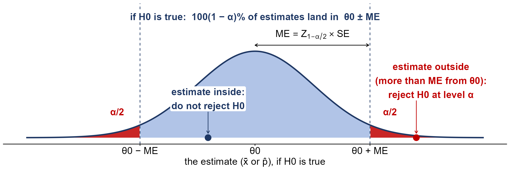
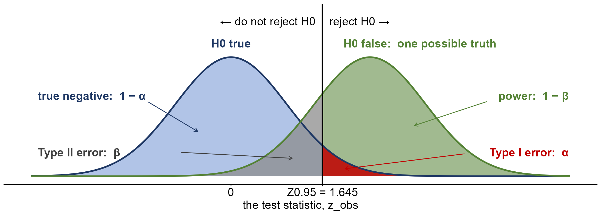
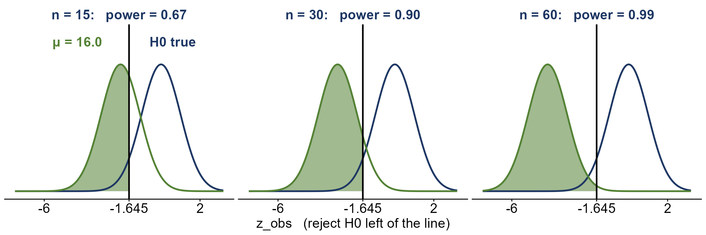
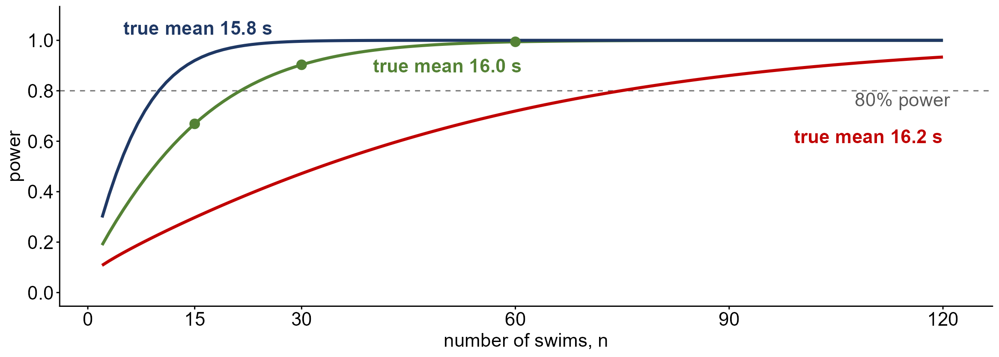
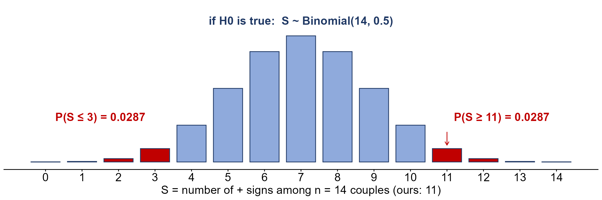

```{r setup, include=FALSE}
knitr::opts_chunk$set(echo = TRUE)
library(knitr)
library(kableExtra)
library(ggplot2)
library(ggthemes)
library(ggpubr)
library(latex2exp)

path = 'Data/'

fmt <- function(x, d = 2) formatC(x, format = 'f', digits = d)
tab <- function(df, ...) kable(df, format = 'html', row.names = FALSE, escape = FALSE, ...) %>%
  kable_classic(full_width = FALSE, html_font = "Cambria") %>%
  kable_styling(bootstrap_options = 'striped')
near <- function(a, b, tol = 5e-4) abs(a - b) < tol
zt <- function(z) round(pnorm(z), 4)     # a z-table lookup, four decimals

NAVY <- "#1F3864"; SHADE <- "#8FAADC"; RED <- "#C00000"; GREEN <- "#548235"
# a label on a white patch, so curves don't run through it
lab <- function(x, y, s, col, hj, face = 'plain', sz = 3.8)
  annotate('label', x = x, y = y, label = s, colour = col, hjust = hj, size = sz, fontface = face,
           fill = 'white', border.colour = NA, label.padding = unit(0.1, 'lines'))
bare <- theme_classic(base_size = 13) +
  theme(axis.text.y = element_blank(), axis.ticks.y = element_blank(), axis.line.y = element_blank(),
        plot.title = element_text(size = 13, face = 'bold', colour = NAVY))
```

```{r lecture25-setup, include=FALSE}
# every number in the Lecture 25 sections is checked here

# the bench press (OpenStax Example 9.15): sigma = 55 known, so z; alpha = 0.025, upper-tailed
bp <- rep(c(205, 215, 225, 241, 252, 265, 275, 313, 316, 338, 341, 345, 368, 385),
          c(3, 3, 1, 2, 2, 2, 2, 2, 5, 2, 1, 2, 2, 1))
xb_bp <- round(mean(bp), 2); se_bp <- round(55 / sqrt(30), 2); z_bp <- round((xb_bp - 275) / se_bp, 2)
stopifnot(length(bp) == 30, sum(bp) == 8585, xb_bp == 286.17, se_bp == 10.04, z_bp == 1.11, zt(1.11) == 0.8665,
          round(1 - zt(1.11), 4) == 0.1335, round(qnorm(0.975), 2) == 1.96,
          near(1 - pnorm((mean(bp) - 275) / (55 / sqrt(30))), 0.1331))


# glass conductivity (OpenStax Example 9.20): sigma unknown, so t with df = 10
gl <- c(1.11, 1.07, 1.11, 1.07, 1.12, 1.08, .98, .98, 1.02, .95, .95)
xb_gl <- round(mean(gl), 2); s_gl <- round(sd(gl), 4); se_gl <- round(s_gl / sqrt(11), 4)
t_gl <- round((xb_gl - 1) / se_gl, 2)
stopifnot(xb_gl == 1.04, s_gl == 0.0659, se_gl == 0.0199, t_gl == 2.01,
          round(qt(0.95, 10), 3) == 1.812, round(qt(0.975, 10), 3) == 2.228,
          round(1 - pt(t_gl, 10), 3) == 0.036)
# the same glass data tested at other values inside H0: mu <= 1
t_mu <- round((xb_gl - c(0.98, 0.99, 1)) / se_gl, 2); p_mu <- round(1 - pt(t_mu, 10), 4)
stopifnot(t_mu == c(3.02, 2.51, 2.01), p_mu[1] < p_mu[2], p_mu[2] < p_mu[3],
          p_mu == c(0.0064, 0.0155, 0.0361))

# the baker's bread (OpenStax Example 9.9): sigma = 0.5 known, n = 10, H0: mu <= 15
se_br <- round(0.5 / sqrt(10), 4); z_br <- round((17 - 15) / se_br, 2)
stopifnot(se_br == 0.1581, z_br == 12.65, 1 - pnorm(z_br) < 1e-10)
# try it (OpenStax Try It 9.9): sigma = 1, n = 36, xbar = 12.5, H0: mu <= 12
stopifnot(1 / sqrt(36) == 1 / 6, round(0.5 / (1 / 6), 2) == 3, round(1 - zt(3), 4) == 0.0013)

# cell phone owners (OpenStax Try It 9.18): 174 of 200, H0: p >= 0.92, alpha = 0.05
se_cp <- round(sqrt(0.92 * 0.08 / 200), 4); z_cp <- round((174 / 200 - 0.92) / se_cp, 2)
stopifnot(174 / 200 == 0.87, 200 * 0.92 >= 15, 200 * 0.08 >= 15, se_cp == 0.0192,
          z_cp == -2.60, zt(-2.60) == 0.0047)

# power: the goggles (OpenStax Example 9.14) if the true mean is 16.0 s; lower-tailed z, alpha = 0.05
se_g <- round(0.8 / sqrt(15), 4); cut_g <- round(16.43 - 1.645 * se_g, 2)
zp_g <- round((cut_g - 16) / se_g, 2); pow_g <- zt(zp_g)
stopifnot(se_g == 0.2066, round(1.645 * se_g, 4) == 0.3399, cut_g == 16.09, zp_g == 0.44,
          pow_g == 0.67, round(1 - pow_g, 2) == 0.33)
se_g30 <- round(0.8 / sqrt(30), 4); cut_g30 <- round(16.43 - 1.645 * se_g30, 2)
zp_g30 <- round((cut_g30 - 16) / se_g30, 2)
stopifnot(se_g30 == 0.1461, cut_g30 == 16.19, zp_g30 == 1.30, zt(1.30) == 0.9032)
# exact power, for the table: n, alpha and the true mean each varied from n = 15, alpha = 0.05, mu = 16
pw <- function(n = 15, a = 0.05, mu = 16) {
  se <- 0.8 / sqrt(n); round(pnorm((16.43 - qnorm(1 - a) * se - mu) / se), 2) }
stopifnot(pw() == 0.67, pw(n = 30) == 0.90, pw(n = 60) == 0.99, pw(a = 0.01) == 0.40,
          pw(a = 0.10) == 0.79, pw(mu = 16.2) == 0.30, pw(mu = 15.8) == 0.92)
```

```{r lecture26-setup, include=FALSE}
# every number in the Lecture 26 sections is checked here (and in assets/make_lecture26_figures.R)

# confidence intervals and two-sided tests: the generic picture uses Z_0.975
stopifnot(round(qnorm(0.975), 2) == 1.96)
# the sign test, large n: the coffee blend (hypothetical), 60 regulars, 6 ties, 38 of 54 prefer the new blend
se_cf <- round(sqrt(54) / 2, 3); z_cf <- round((38 - 27) / se_cf, 2); p_cf_exact <- round(1 - pbinom(37, 54, 0.5), 4)
stopifnot(se_cf == 3.674, z_cf == 2.99, zt(z_cf) == 0.9986, round(1 - zt(z_cf), 4) == 0.0014, p_cf_exact == 0.0019,
          54 / 2 >= 15)
# the couples' mean and SE of S under H0 (n = 14 is too small for z: n/2 = 7 < 15)
se_cpS <- sqrt(14) / 2
stopifnot(round(se_cpS, 2) == 1.87, round((11 - 7) / se_cpS, 1) == 2.1, 14 / 2 < 15)
# the couples (Jarred's 2024 notes): two-sided sign test, 11 of 14 non-zero differences are +
hus <- c(5, 4, 6, 6, 3, 2, 5, 3, 1, 4, 5, 4, 4, 7, 5, 5, 5)
wif <- c(3, 3, 4, 5, 3, 3, 2, 3, 2, 3, 2, 2, 5, 2, 5, 3, 1)
dif <- hus - wif
p_cp1 <- round(470 / 2^14, 4); p_cp2 <- round(2 * 470 / 2^14, 4)
stopifnot(sum(dif > 0) == 11, sum(dif < 0) == 3, sum(dif == 0) == 3, choose(14, 11:14) == c(364, 91, 14, 1),
          p_cp1 == 0.0287, p_cp2 == 0.0574, near(binom.test(11, 14)$p.value, 0.0574))
# the stretching program (hypothetical): upper-tailed sign test, 8 of 9 non-zero differences are +
kn <- c(3, 1, 0, 2, 4, -1, 2, 1, 3, 2)
p_kn <- round(10 / 512, 4)
stopifnot(sum(kn > 0) == 8, sum(kn < 0) == 1, sum(kn == 0) == 1, choose(9, 8:9) == c(9, 1), p_kn == 0.0195,
          near(binom.test(8, 9, alternative = 'greater')$p.value, p_kn))
# power and sample size for the goggles (assets/l26_power_n.png and l26_power_curve.png)
zc_n <- round((16 - 16.43) / (0.8 / sqrt(c(15, 30, 60))), 2)
pwx <- function(n, mu) pnorm((16.43 - qnorm(0.95) * 0.8 / sqrt(n) - mu) / (0.8 / sqrt(n)))
n80 <- sapply(c(15.8, 16.0, 16.2), function(m) min((2:200)[pwx(2:200, m) >= 0.8]))
stopifnot(zc_n == c(-2.08, -2.94, -4.16), n80 == c(10, 22, 75),
          round(pwx(c(15, 30, 60), 16), 2) == c(pw(), pw(n = 30), pw(n = 60)))
```

<!--
  SCOPE OF THIS PAGE (Nov 2 2026). Week 11 per Course_Schedule.Rmd (the date source of truth):
    Mon Nov 2    Lecture 25  the three distributions behind a test (variable, estimate, test
                             statistic) and why z_obs is a z-score if H0 is true (OpenStax 9.15 as
                             the number); composite hypotheses (Table 9.1, the 9.20 glass t-test and
                             the 9.9 bread z-test); types of errors (OpenStax
                             9.5-9.8) and statistical power (the 9.14 goggles at an assumed true
                             mean of 16.0 s). Jarred expects some of this to carry over to Wednesday.
    Wed Nov 4    Lecture 26  confidence intervals and two-sided tests (a generic picture, no example:
                             the null sets theta0 +/- ME; review of Monday's decision rule), then types
                             of errors and power (carried over: Lecture 25 stopped after slide 18, the
                             Try It 9.9 practice); parametric vs non-parametric tests and the sign test
                             (hypotheses, S ~ Binomial(n, 0.5), E(S) = n/2, SE(S) = sqrt(n)/2, the z
                             approximation for n/2 >= 15; the couples' ratings from the 2024 notes,
                             git show 27a60f5:docs/lecturemenu12.Rmd; hypothetical stretching-program
                             and coffee-blend practice)
    Fri Nov 6    Lecture 27  introduction to two-sample tests for independent samples (to be written)
  Jarred moved types of errors and power from Wednesday to Monday, and confidence intervals and
  the sign test from Monday to Wednesday (Nov 2 2026). The sigma known / unknown tests for a mean
  carry over from Lecture 24 but have no section here (Jarred: they are on the Week 10 page).
  Deck: lecture_slides/Week 11/2026/Week11_Lecture25_Slides_11_02_2026.pptx (built from Lecture 24's
  slides as templates; figures from assets/make_lecture25_figures.R): blank Review, sigma known, sigma
  unknown, Marco (Try It 9.14, z), first statistics test (9.16, t), then this page through the composite
  hypotheses; each practice problem has its own story slide. It was 30 slides; after class it was trimmed
  to the 18 delivered (Nov 4 2026), and slides 19-30 moved to Lecture 26.
  Deck: lecture_slides/Week 11/2026/Week11_Lecture26_Slides_11_04_2026.pptx (30 slides; figures from
  assets/make_lecture26_figures.R): a Q&A Review on simple/composite hypotheses and the boundary, the
  CI-and-two-sided-test picture, the carried slides (types of errors, the decision-vs-truth table, a new
  errors-and-power picture on the two distributions, errors in context, cell phone owners, power, two new
  power-vs-n pictures, what raises the power, E. coli, the patient), then the assumptions of the tests so
  far, "When is a t-test a stretch?", parametric vs non-parametric, four sign test slides (definition,
  hypotheses, test statistic with E(S)/SE(S)/z, P-value), the couples' data and example, the binomial
  P-value picture, and the stretching-program and coffee-blend practice.

  This page replaced the 2024 Week 11 page (git show 320f927:docs/lecturemenu11.Rmd), whose
  decision-rule framing, error table and power picture it follows. Textbook: OpenStax
  Introductory Statistics 2e, Sections 9.1-9.5. The notation and five steps match the Week 10 page.
  The power example's true mean of 16.0 s is our assumption, not the book's.
-->

# Three distributions behind every test

Every test so far has quietly used **three different distributions**. Most mistakes with tests come
from mixing them up, so it is worth laying them side by side before going further.

Take two variables measured on each individual in a sample:

* $X$, a **quantitative** variable. For example, $X$ = the most weight a college football player can
  bench press, in pounds.
* $Y$, a **categorical** variable with two outcomes, recorded as $Y = 1$ for a "success" and $Y = 0$
  otherwise. For example, $Y = 1$ if a household has three cell phones.

**1. The distribution of the variable.** This is how the values of $X$ (or $Y$) are spread across the
whole **population**, one individual at a time.

* $X$ has a population mean $\mu$ and a population standard deviation $\sigma$. Its shape can be
  anything: normal, skewed, lumpy. When it is normal, we write
  $$X \sim N(\mu, \sigma) \qquad \text{(normal)}$$
  read "$X$ follows a normal distribution with mean $\mu$ and standard deviation $\sigma$".
* $Y$ has only two values, so its whole distribution is two probabilities:
  $$P(Y = 1) = p, \qquad P(Y = 0) = 1 - p$$
  Recall, this is called a **Bernoulli** distribution, written $Y \sim \text{Bernoulli}(p)$.

**2. The sampling distribution of the estimate.** We estimate $\mu$ with $\bar{x}$ and $p$ with
$\hat{p}$, both computed from a sample of size $n$. A different sample gives a different $\bar{x}$ or
$\hat{p}$, and the sampling distribution (Week 8) describes how they vary from sample to sample.

* The sample mean is
  $$\bar{x} \sim N\left(\mu, \frac{\sigma}{\sqrt{n}}\right) \qquad \text{(normal)}$$
  exactly if $X$ is normal, and approximately when $n \geq 30$ whatever the shape of $X$ (the Central
  Limit Theorem).
* The sample proportion is approximately
  $$\hat{p} \sim N\left(p, \sqrt{\frac{p(1-p)}{n}}\right) \qquad \text{(normal)}$$
  when $np \geq 15$ and $n(1-p) \geq 15$.

**3. The distribution of the test statistic, if $H_0$ is true.** A test standardizes the estimate,
using the **null value** in place of the unknown parameter. If $H_0$ is true, the result has a
distribution we know exactly, so we can say how surprising our sample is:
$$z_{obs} = \frac{\bar{x} - \mu_0}{\sigma/\sqrt{n}} \sim N(0, 1) \qquad z_{obs} = \frac{\hat{p} - p_0}{\sqrt{p_0(1-p_0)/n}} \sim N(0, 1) \qquad \text{(standard normal)}$$
$$t_{obs} = \frac{\bar{x} - \mu_0}{s/\sqrt{n}} \sim t(n - 1) \qquad \text{(Student's } t \text{ with } df = n - 1\text{)}$$
The subscript "obs" (observed) marks the test statistic computed from our sample. It keeps it apart from
a **critical value** such as $Z_{1-\alpha/2}$ (two-sided) or $Z_{1-\alpha}$ (upper-tailed), which comes
from the table and not from the data. For example, $Z_{1-\alpha} = Z_{0.95} = 1.645$ when $\alpha = 0.05$.

```{r, echo=FALSE}
tab(data.frame(
  ` ` = c('**1. the variable** (one individual)', '**2. the estimate** (one sample of size $n$)',
          '**3. the test statistic**, if $H_0$ is true'),
  `Quantitative $X$: the mean` = c('mean $\\mu$, SD $\\sigma$, any shape;<br>if normal, $X \\sim N(\\mu, \\sigma)$ (normal)',
                                   '$\\bar{x} \\sim N(\\mu, \\sigma/\\sqrt{n})$ (normal),<br>if $X$ is normal or $n \\geq 30$',
                                   '$\\sigma$ known: $z_{obs} = \\dfrac{\\bar{x} - \\mu_0}{\\sigma/\\sqrt{n}} \\sim N(0, 1)$ (standard normal)<br>$\\sigma$ unknown: $t_{obs} = \\dfrac{\\bar{x} - \\mu_0}{s/\\sqrt{n}} \\sim t(n - 1)$ (Student\'s $t$)'),
  `Categorical $Y$: the proportion` = c('$Y \\sim \\text{Bernoulli}(p)$:<br>$P(Y = 1) = p$, $P(Y = 0) = 1 - p$',
                                        '$\\hat{p} \\sim N\\left(p, \\sqrt{p(1-p)/n}\\right)$ (normal),<br>if $np \\geq 15$ and $n(1-p) \\geq 15$',
                                        '$z_{obs} = \\dfrac{\\hat{p} - p_0}{\\sqrt{p_0(1-p_0)/n}} \\sim N(0, 1)$ (standard normal)'),
  check.names = FALSE))
```

Here are the three, side by side, for a quantitative $X$ (top row) and a two-outcome $Y$ (bottom row).
The estimate and test-statistic panels are drawn as if $H_0$ is true.

```{r, echo=FALSE, fig.width=11, fig.height=6, fig.align='center', fig.alt = "Six panels in two rows. Top row: first, the distribution of X, a slightly right-skewed curve with its mean mu marked; second, the sampling distribution of the mean, x-bar, a normal curve centred at mu and much narrower than the distribution of X, on the same axis; third, the distribution of the test statistic z_obs, the standard normal curve centred at 0. Bottom row: first, the distribution of Y, Bernoulli with parameter p, two bars, P of Y = 0 equal to 1 minus p and P of Y = 1 equal to p; second, the sampling distribution of the sample proportion, p-hat, a normal curve centred at p; third, the same standard normal curve for z_obs."}
sub_theme <- theme(axis.text.x = element_text(size = 15),
                   plot.subtitle = element_text(size = 14, colour = NAVY))
gen_panel <- function(d, ttl, sub, xl, brk, lbl, m) {
  ggplot(d, aes(x, y)) + geom_area(fill = SHADE, alpha = 0.6) + geom_line(colour = NAVY, linewidth = 1) +
    geom_vline(xintercept = m, colour = NAVY, linetype = 'dashed') +
    scale_x_continuous(breaks = brk, labels = lbl) +
    labs(title = ttl, subtitle = sub, x = xl, y = NULL) + bare + sub_theme
}
gx <- seq(0, 16, length.out = 600)          # X: a gamma with mean 5, a little right-skewed
a1 <- gen_panel(data.frame(x = gx, y = dgamma(gx, shape = 5, rate = 1)),
                '1. Distribution of X', TeX('mean $\\mu$, SD $\\sigma$, any shape'), 'X, one individual', 5, TeX('$\\mu$'), 5)
a2 <- gen_panel(data.frame(x = gx, y = dnorm(gx, 5, sqrt(5 / 30))),
                '2. Sampling distribution of\n    the mean', TeX('$\\bar{x} \\sim N(\\mu, \\sigma / \\sqrt{n})$, normal'),
                'x-bar, the mean of a sample of n', 5, TeX('$\\mu$'), 5)
zx <- seq(-3.5, 3.5, length.out = 400)
zpan <- gen_panel(data.frame(x = zx, y = dnorm(zx)), '3. Distribution of z_obs',
                  TeX('$z_{obs} \\sim N(0, 1)$, standard normal'),
                  'z_obs = (estimate - null value) / SE', -3:3, -3:3, 0)
b1 <- ggplot(data.frame(y = factor(c('0', '1')), p = c(0.7, 0.3)), aes(y, p)) +
  geom_col(fill = SHADE, colour = NAVY, width = 0.5) +
  annotate('text', x = 1:2, y = c(0.7, 0.3) + 0.09, colour = NAVY, size = 5,
           label = c('P(Y = 0) = 1 - p', 'P(Y = 1) = p')) +
  scale_y_continuous(limits = c(0, 0.85)) +
  labs(title = '1. Distribution of Y', subtitle = TeX('$Y \\sim Bernoulli(p)$'),
       x = 'Y, one individual (1 = success)', y = NULL) + bare + sub_theme
px <- seq(0.1, 0.5, length.out = 400)
b2 <- gen_panel(data.frame(x = px, y = dnorm(px, 0.3, sqrt(0.3 * 0.7 / 80))),
                '2. Sampling distribution of\n    the sample proportion', TeX('$\\hat{p} \\sim N(p, \\sqrt{p(1-p)/n})$, normal'),
                'p-hat, the proportion in a sample of n', 0.3, TeX('$p$'), 0.3)
ggarrange(a1, a2, zpan, b1, b2, zpan, ncol = 3, nrow = 2)
```

Three things to notice:

* **The estimate varies much less than the variable.** Panels 1 and 2 of the top row share an axis: one
  individual's $X$ can land far from $\mu$, but the mean of $n$ of them stays close. That is the
  $\sqrt{n}$ in $\sigma/\sqrt{n}$.
* **The variable does not have to be normal.** $X$ is skewed, and $Y$ is two bars, nothing like a bell.
  Their estimates $\bar{x}$ and $\hat{p}$ are still close to normal when $n$ is large (the Central Limit
  Theorem).
* **The last panel is the same in both rows.** Standardizing removes the units and the null value, so
  every $z_{obs}$ ends on the same standard normal curve, and one $z$-table serves them all. A $t_{obs}$
  ends on a $t$ curve instead, which depends only on $df$.

The **P-value is always an area under the third distribution**: the distribution of the test statistic
when $H_0$ is true.

## Why the test statistic is standard normal when $H_0$ is true

Recall the **z-score** from Week 6. To standardize a value, subtract the **mean of its distribution** and
divide by the **standard deviation of its distribution**:
$$z = \frac{\text{value} - \text{mean}}{\text{SD}}$$
If the value comes from a normal distribution, its z-score follows $N(0, 1)$ (standard normal). Every
normal curve turns into the same standard normal curve once we measure in SDs from its centre.

Now look at the test statistic for a mean, one piece at a time.

* The value we standardize is $\bar{x}$. Its distribution is $\bar{x} \sim N(\mu, \sigma/\sqrt{n})$.
* **If $H_0$ is true**, then $\mu = \mu_0$, so $\bar{x} \sim N(\mu_0, \sigma/\sqrt{n})$. The mean of its
  distribution is $\mu_0$, and its SD is $\sigma/\sqrt{n}$.
* So the test statistic is exactly the z-score of $\bar{x}$:
  $$z_{obs} = \frac{\bar{x} - \mu_0}{\sigma/\sqrt{n}} = \frac{\text{value} - \text{its mean if } H_0 \text{ is true}}{\text{its SD}} \sim N(0, 1) \qquad \text{(standard normal)}$$

The proportion works the same way. If $H_0$ is true, $p = p_0$, so $\hat{p} \sim N\left(p_0, \sqrt{p_0(1-p_0)/n}\right)$,
and
$$z_{obs} = \frac{\hat{p} - p_0}{\sqrt{p_0(1-p_0)/n}} \sim N(0, 1) \qquad \text{(standard normal)}$$
is the z-score of $\hat{p}$. This is why the standard error in a test uses $p_0$ and not $\hat{p}$: if
$H_0$ is true, $\sqrt{p_0(1-p_0)/n}$ **is** the SD of $\hat{p}$.

**A number to hold on to: the bench press.** *From
[OpenStax Introductory Statistics 2e, Section 9.5, Example 9.15](https://openstax.org/books/introductory-statistics-2e/pages/9-5-additional-information-and-full-hypothesis-test-examples).*

> A college football coach records the mean weight that his players can bench press as **275 pounds**,
> with a standard deviation of $\sigma = 55$ pounds. Three of the players think the mean is more than
> that. They ask **30** of their teammates for their estimated maximum bench press. The answers range
> from 205 to 385 pounds; the weights, with the number of players giving each in parentheses, are
> 205 (3), 215 (3), 225 (1), 241 (2), 252 (2), 265 (2), 275 (2), 313 (2), 316 (5), 338 (2), 341 (1),
> 345 (2), 368 (2), 385 (1). Using a 2.5% significance level, test whether the mean bench press is
> more than 275 pounds.

The hypotheses are $H_0: \mu = 275$ and $H_A: \mu > 275$, and the 30 weights add up to 8,585 pounds, so
$\bar{x} = 8{,}585/30 \approx `r fmt(xb_bp, 2)`$ pounds.

* **If $H_0$ is true**, the mean of 30 players follows
  $$\bar{x} \sim N\left(275, \frac{55}{\sqrt{30}}\right) = N(275, `r fmt(se_bp, 2)`) \qquad \text{(normal)}$$
* The players' mean, $\bar{x} = `r fmt(xb_bp, 2)`$, sits this many SDs above the centre of that curve:
  $$\frac{`r fmt(xb_bp, 2)` - 275}{`r fmt(se_bp, 2)`} \approx `r fmt(z_bp, 2)`$$
* That z-score **is** the test statistic: $z_{obs} = `r fmt(z_bp, 2)`$, and if $H_0$ is true,
  $z_{obs} \sim N(0, 1)$ (standard normal).

To finish the test, the P-value is $P(Z \geq `r fmt(z_bp, 2)` \mid H_0 \text{ true}) = 1 - `r fmt(zt(1.11), 4)` = `r fmt(1 - zt(1.11), 4)`$
(the book's calculator, without rounding $z_{obs}$, gives 0.1331). Since $`r fmt(1 - zt(1.11), 4)` \geq 0.025$,
**do not reject $H_0$**: at the 2.5% level, the data are not convincing evidence that the mean bench press
is more than 275 pounds.

**What if $H_0$ is false?** Then the true mean $\mu$ is not $\mu_0$, and subtracting $\mu_0$ subtracts the
wrong centre. $z_{obs}$ is still normal with SD 1, but its centre moves to
$(\mu - \mu_0)/(\sigma/\sqrt{n})$, away from 0. That is why a $z_{obs}$ far from 0 is evidence against
$H_0$: it is the kind of value we expect when the curve has shifted. (This shifted curve comes back in the
section on power.)

**Why $t_{obs}$ is not a z-score.** With $\sigma$ unknown, we divide by $s/\sqrt{n}$ instead. But $s$ is
an estimate that changes from sample to sample, so we are not dividing by the true SD of $\bar{x}$. That
extra uncertainty spreads the statistic out, and if $H_0$ is true it follows
$$t_{obs} = \frac{\bar{x} - \mu_0}{s/\sqrt{n}} \sim t(n - 1) \qquad \text{(Student's } t \text{ with } df = n - 1\text{)}$$
which has heavier tails than $N(0, 1)$ and gets closer to it as $n$ grows.

# Composite hypotheses

So far every null hypothesis has named a single value of the parameter: $H_0: \mu = 275$, $H_0: p = 0.5$.
A hypothesis that **completely specifies** the parameter like this is called a **simple** hypothesis.

Often, though, the "nothing interesting" story does not pin the parameter down to one value. If the
claim is that a glass conducts electricity **better** than 1 (the glass example below), then a mean of
exactly 1 is not the only way for the claim to be wrong: 0.99, 0.95 or 0.80 would be just as
disappointing. The null has to include all of them, $H_0: \mu \leq 1$. A hypothesis that allows a whole
**range** of values, because the value of the parameter is not completely specified, is called a
**composite** hypothesis.

```{r, echo=FALSE}
tab(data.frame(
  `If $H_A$ is` = c('$\\theta > \\theta_0$ (upper-tailed)', '$\\theta < \\theta_0$ (lower-tailed)',
                    '$\\theta \\neq \\theta_0$ (two-sided)'),
  `the simple null is` = c('$H_0: \\theta = \\theta_0$', '$H_0: \\theta = \\theta_0$', '$H_0: \\theta = \\theta_0$'),
  `the composite null is` = c('$H_0: \\theta \\leq \\theta_0$', '$H_0: \\theta \\geq \\theta_0$', '(none)'),
  check.names = FALSE))
```

Here $\theta$ stands for whichever parameter we are testing, $\mu$ or $p$. Two rules follow from this
(summarized in OpenStax Table 9.1):

* **$H_0$ always contains the equals sign** ($=$, $\leq$ or $\geq$). **$H_A$ never does** ($\neq$, $>$
  or $<$).
* Together, $H_0$ and $H_A$ cover **every** possible value of the parameter. With $H_A: \mu > 1$, the
  composite null $H_0: \mu \leq 1$ is "everything else".

## When is a composite null the right one?

A composite null is the honest way to write a **one-sided** claim, where the "nothing interesting"
story is a whole range of values, not one point. Listen for the words:

* "**at least**", "**no less than**" $\rightarrow$ $H_0$ uses $\geq$;
* "**at most**", "**no more than**" $\rightarrow$ $H_0$ uses $\leq$.

Some examples (from [OpenStax Section 9.1](https://openstax.org/books/introductory-statistics-2e/pages/9-1-null-and-alternative-hypotheses)
and [Section 9.2](https://openstax.org/books/introductory-statistics-2e/pages/9-2-outcomes-and-the-type-i-and-type-ii-errors)):

For each one, name the parameter in words, then write $H_0$ and $H_A$. (The book gives each claim in one
sentence; the setup around it is ours, so there is a story to test.)

**Voter turnout (Example 9.1).** A county election official reports that **no more than 30%** of the
registered voters in Santa Clara County voted in the primary election. A local newspaper suspects
turnout was **higher**, and surveys a random sample of registered voters.

* *Parameter:* $p$ = the proportion of **all** registered voters in the county who voted in the primary.
* *Hypotheses:* the official's figure, "30% or less", is the null: $H_0: p \leq 0.30$. The newspaper's
  suspicion is the alternative: $H_A: p > 0.30$. Composite, **upper-tailed**, tested at $p_0 = 0.30$.

**Time to graduate (Example 9.3).** College students are often told a degree takes **five years**, on
average. An advising office believes its students finish **faster**, and records how long a random
sample of recent graduates took to graduate.

* *Parameter:* $\mu$ = the mean time to graduate for **all** of the college's students.
* *Hypotheses:* the office's claim, "less than 5 years", is the alternative, $H_A: \mu < 5$. Taking
  exactly 5 years or longer are both "not less than 5", so $H_0: \mu \geq 5$. Composite,
  **lower-tailed**, tested at $\mu_0 = 5$.

**A cure-rate claim (Example 9.8).** A drug company advertises that its experimental drug cures **at
least 75%** of men with prostate cancer. An independent research group suspects the true cure rate is
**lower**, and follows a random sample of patients who took the drug.

* *Parameter:* $p$ = the proportion of **all** men with prostate cancer who are cured by the drug.
* *Hypotheses:* the company's claim, "75% or more", is the null: $H_0: p \geq 0.75$. The research
  group's suspicion is the alternative: $H_A: p < 0.75$. Composite, **lower-tailed**, tested at
  $p_0 = 0.75$.

A two-sided test **never** has a composite null: if $H_A$ is $\theta \neq \theta_0$, the only value left
for $H_0$ is $\theta = \theta_0$.

## Example: the conductivity of glass (a composite null)

*From [OpenStax Introductory Statistics 2e, Section 9.5, Example 9.20](https://openstax.org/books/introductory-statistics-2e/pages/9-5-additional-information-and-full-hypothesis-test-examples).*

> The National Institute of Standards and Technology provides exact data on conductivity properties of
> materials. Following are conductivity measurements for **11** randomly selected pieces of a particular
> type of glass:
>
> 1.11, 1.07, 1.11, 1.07, 1.12, 1.08, 0.98, 0.98, 1.02, 0.95, 0.95
>
> Is there convincing evidence that the average conductivity of this type of glass is **greater than
> one**? Use a significance level of 0.05. Assume the population is normal.

Only the data are given, so $\sigma$ is unknown and this is a $t$-test.

**Question:** At $\alpha = 0.05$, is the mean conductivity of this glass greater than 1?

1. **Assumptions.** A random sample of 11 pieces. $n$ is small, but the population is normal, so the test
   works. $\sigma$ is unknown, so we use a $t$-test.
2. **Hypotheses.** $\mu$ = the mean conductivity of all glass of this type. The claim "greater than 1" is
   the alternative, $H_A: \mu > 1$, and the null is everything else, a composite null:
   $H_0: \mu \leq 1$. The test is **upper-tailed**, and it is done at the boundary, $\mu_0 = 1$ (the next
   section explains why).
3. **Test statistic.** From the data, $\bar{x} = `r fmt(xb_gl, 2)`$ and $s = `r fmt(s_gl, 4)`$.
   $$SE = \frac{s}{\sqrt{n}} = \frac{`r fmt(s_gl, 4)`}{\sqrt{11}} \approx `r fmt(se_gl, 4)`$$
   $$t_{obs} = \frac{\bar{x} - \mu_0}{SE} = \frac{`r fmt(xb_gl, 2)` - 1}{`r fmt(se_gl, 4)`} \approx `r fmt(t_gl, 2)`, \qquad df = 11 - 1 = 10$$
4. **P-value.** In row 10 of the [$t$-table](misc/t_table.html), $1.812 < `r fmt(t_gl, 2)` < 2.228$.
   Those columns have upper-tail areas 0.05 and 0.025, so
   $$0.025 < P(T \geq `r fmt(t_gl, 2)` \mid \mu = 1) < 0.05$$
   Software gives `r fmt(1 - pt(t_gl, 10), 3)`.
5. **Decision.** The P-value is below $\alpha = 0.05$: **reject $H_0$**. The data are convincing evidence
   that the mean conductivity of this glass is greater than 1.

## How do we test a composite null?

There is a catch. To compute a test statistic we need **one** null value, but $H_0: \mu \leq 1$ has
infinitely many: 1, 0.99, 0.98, and so on. Which one goes into the formula?

**Answer: the boundary value, $\mu_0 = 1$.** The test statistic and P-value are computed exactly as if
the null were $H_0: \mu = 1$, as in the glass example. Here is why. The glass data have
$\bar{x} = `r fmt(xb_gl, 2)`$. Look at the P-value for three values that are all inside $H_0: \mu \leq 1$:

```{r, echo=FALSE}
tab(data.frame(
  `if the true mean were` = c('$\\mu = 0.98$', '$\\mu = 0.99$', '$\\mu = 1.00$ (the boundary)'),
  `$t_{obs}$` = paste0('$(', fmt(xb_gl, 2), ' - ', c('0.98', '0.99', '1.00'), ')/', fmt(se_gl, 4), ' = ',
                       fmt(t_mu, 2), '$'),
  `P-value $P(T \\geq t_{obs})$` = fmt(p_mu, 4),
  check.names = FALSE))
```

```{r, echo=FALSE, fig.width=11, fig.height=3.6, fig.align='center', fig.alt = "Three panels, one for each of three true means allowed by H0: mu at most 1, namely 0.98, 0.99 and 1.00. Each shows the t curve for x-bar of the glass, standard error 0.0199, centred at that mean, with a red vertical line at the observed x-bar of 1.04 and the area to its right shaded as the P-value. The shaded area is tiny at 0.98 (P-value 0.0064), larger at 0.99 (0.0155) and largest at 1.00, the boundary (0.0361)."}
mus <- c(0.98, 0.99, 1.00)
gx <- seq(0.92, 1.08, length.out = 600)
gd <- do.call(rbind, lapply(seq_along(mus), function(i)
  data.frame(x = gx, y = dt((gx - mus[i]) / se_gl, 10) / se_gl,
             panel = paste0('if the true mean were ', fmt(mus[i], 2), ':  P-value = ', fmt(p_mu[i], 4)))))
gd$panel <- factor(gd$panel, levels = unique(gd$panel))
ggplot(gd, aes(x, y)) +
  geom_area(data = subset(gd, x >= xb_gl), fill = SHADE, alpha = 0.95) +
  geom_line(colour = NAVY, linewidth = 1) +
  geom_vline(xintercept = xb_gl, colour = RED, linewidth = 1.1) +
  geom_vline(data = data.frame(m = mus, panel = levels(gd$panel)), aes(xintercept = m),
             colour = NAVY, linetype = 'dashed') +
  facet_wrap(~ panel, nrow = 1) +
  scale_x_continuous(breaks = seq(0.94, 1.06, by = 0.04)) +
  labs(x = 'x-bar, the mean conductivity of 11 pieces (red line: ours, 1.04)', y = NULL) + bare +
  theme(strip.background = element_blank(), strip.text = element_text(face = 'bold', colour = NAVY, size = 11))
```

The farther the true mean is **below** 1, the less likely a sample mean as high as 1.04 becomes, so the
P-value shrinks. The **largest** P-value in $H_0$ is at the boundary, $\mu = 1$. So:

* If we reject at the boundary (P-value $< \alpha$ there), the P-value is even smaller for every other
  value in $H_0$, so we reject all of $H_0$ at once.
* The boundary is the **hardest** case to reject, so testing there is the cautious choice. It also means
  the chance of wrongly rejecting is **at most** $\alpha$, whichever value in $H_0$ is the truth.

That is also why many researchers write $H_0: \mu = 1$ even when they mean $H_0: \mu \leq 1$: **the
calculation and the decision are identical.** The composite version says more
honestly what we would conclude if we do not reject: "the mean could be 1 **or less**".

## Example: the baker's bread (a composite null)

*From [OpenStax Introductory Statistics 2e, Section 9.4, Example 9.9](https://openstax.org/books/introductory-statistics-2e/pages/9-4-rare-events-the-sample-decision-and-conclusion).*

> Suppose a baker claims that his bread height is **more than 15 cm**, on average. Several of his
> customers do not believe him. To persuade his customers that he is right, the baker decides to do a
> hypothesis test. He bakes **10** loaves of bread. The mean height of the sample loaves is **17 cm**.
> The baker knows from baking hundreds of loaves of bread that the standard deviation for the height is
> $\sigma = 0.5$ cm, and the distribution of heights is normal.

The book gives no significance level, so we use the usual $\alpha = 0.05$.

**Question:** At $\alpha = 0.05$, do the data back up the baker's claim?

1. **Assumptions.** We treat the 10 loaves as a random sample of his bread. The heights are normal, so
   $n = 10$ is enough. $\sigma = 0.5$ is known, so we use a $z$-test.
2. **Hypotheses.** $\mu$ = the mean height of all of the baker's loaves. The claim "more than 15 cm" is
   the alternative, $H_A: \mu > 15$. The customers' view is everything else, "15 cm **or less**", so the
   null is composite: $H_0: \mu \leq 15$. The test is **upper-tailed**, done at the boundary $\mu_0 = 15$.
3. **Test statistic.**
   $$SE = \frac{\sigma}{\sqrt{n}} = \frac{0.5}{\sqrt{10}} \approx `r fmt(se_br, 4)`$$
   $$z_{obs} = \frac{\bar{x} - \mu_0}{SE} = \frac{17 - 15}{`r fmt(se_br, 4)`} \approx `r fmt(z_br, 2)`$$
   The sample mean is more than 12 standard errors above 15 cm.
4. **P-value.** $P(Z \geq `r fmt(z_br, 2)` \mid \mu = 15)$ is far off the end of the $z$-table:
   **essentially 0**. And that is the largest P-value for any value in $H_0$; if the true mean were
   below 15, a sample mean of 17 would be even less likely.
5. **Decision.** P-value $\approx 0 < 0.05$: **reject $H_0$**. The data are convincing evidence that the
   baker's loaves average more than 15 cm.

## Try it out

*From [OpenStax Introductory Statistics 2e, Section 9.4, Try It 9.9](https://openstax.org/books/introductory-statistics-2e/pages/9-4-rare-events-the-sample-decision-and-conclusion).*

> A normal distribution has a standard deviation of **1**. We want to verify a claim that the mean is
> **greater than 12**. A sample of **36** is taken with a sample mean of **12.5**. The hypotheses are
> $H_0: \mu \leq 12$ and $H_A: \mu > 12$, and the P-value is 0.0013. Draw a graph that shows the P-value.

Check the book's P-value by running the test yourself, and decide at $\alpha = 0.05$ (the book gives no
$\alpha$).

*Answer:* $H_0: \mu \leq 12$ and $H_A: \mu > 12$, tested at the boundary $\mu_0 = 12$.
$SE = 1/\sqrt{36} = 1/6 \approx 0.1667$, so $z_{obs} = (12.5 - 12)/(1/6) = 3.00$. The P-value is
$P(Z \geq 3.00 \mid \mu = 12) = 1 - `r fmt(zt(3), 4)` = `r fmt(1 - zt(3), 4)` < 0.05$: reject $H_0$. The
mean is greater than 12.

# Confidence intervals and two-sided tests

This is the decision rule from Monday seen as an interval. Write $\theta$ for the parameter ($\mu$ or $p$)
and $\hat{\theta}$ for its estimate ($\bar{x}$ or $\hat{p}$).

**The null sets an interval.** If $H_0: \theta = \theta_0$ is true, the sampling distribution of the
estimate is centred at $\theta_0$, and $100(1-\alpha)\%$ of all estimates land within one **margin of
error** of it:
$$\theta_0 \pm ME, \qquad ME = Z_{1-\alpha/2} \times SE$$
(with $t_{n-1,\,1-\alpha/2}$ in place of $Z_{1-\alpha/2}$ when $\sigma$ is unknown). The two tails outside
this interval hold the remaining $\alpha$, $\alpha/2$ on each side.

**An estimate outside it is evidence against $H_0$.** If our estimate lands more than $ME$ from $\theta_0$,
it is in a region that holds only $100\alpha\%$ of the estimates $H_0$ predicts. That is the same as
$|z_{obs}| > Z_{1-\alpha/2}$, so a two-sided test **rejects $H_0$ at level $\alpha$**. An estimate inside the
interval gives no such evidence: **do not reject**.

```{r, echo=FALSE, out.width='100%', fig.align='center', fig.alt = "The sampling distribution of the estimate, x-bar or p-hat, if H0 is true: a bell curve centred at theta0. Dashed lines mark theta0 minus ME and theta0 plus ME, where ME, the margin of error, is Z sub 1 minus alpha over 2 times SE; the region between them is shaded blue and labelled: if H0 is true, 100 times 1 minus alpha percent of estimates land in theta0 plus or minus ME. Each tail beyond the dashed lines is red and labelled alpha over 2. A blue point inside the interval is labelled estimate inside: do not reject H0. A red point in the right tail is labelled estimate outside, more than ME from theta0: reject H0 at level alpha."}

```

**The confidence interval says the same thing.** "$\hat{\theta}$ is more than $ME$ from $\theta_0$" is the
same statement as "$\theta_0$ is more than $ME$ from $\hat{\theta}$", that is, $\theta_0$ lies outside the
$100(1-\alpha)\%$ confidence interval $\hat{\theta} \pm ME$. So a 95% confidence interval is a two-sided test
at $\alpha = 0.05$ of every value at once: values outside it would be rejected, values inside it would not.

Two cautions. The match is for **two-sided** tests; a one-sided test puts all of $\alpha$ in one tail. And
for a **proportion** the match is close but not exact, because the test's $SE$ uses $p_0$ while the
interval's uses $\hat{p}$.

# Types of errors

A test ends in a decision, reject $H_0$ or do not reject it, and it makes that decision **without
ever learning the truth**. So there are four ways it can turn out (OpenStax Table 9.2):

```{r, echo=FALSE}
tab(data.frame(
  ` ` = c('**Do not reject $H_0$**', '**Reject $H_0$**'),
  `$H_0$ is actually true` = c('correct', '**Type I error**<br>probability $\\alpha$'),
  `$H_0$ is actually false` = c('**Type II error**<br>probability $\\beta$', 'correct<br>probability $1 - \\beta$, the **power**'),
  check.names = FALSE))
```

* A **Type I error** is rejecting $H_0$ when it is true: a **false alarm**. Its probability is the
  significance level,
  $$\alpha = P(\text{Type I error}) = P(\text{reject } H_0 \mid H_0 \text{ true})$$
  We choose $\alpha$ before collecting the data, so we decide in advance how often we are willing to
  raise a false alarm.
* A **Type II error** is not rejecting $H_0$ when it is false: a **missed effect**. Its probability is
  $$\beta = P(\text{Type II error}) = P(\text{do not reject } H_0 \mid H_0 \text{ false})$$

The same four outcomes can be read off the distributions of the test statistic. The picture below is a
generic upper-tailed $z$-test at $\alpha = 0.05$: one curve shows where $z_{obs}$ lands if $H_0$ is true,
and the critical value $Z_{0.95} = 1.645$ splits "do not reject" (left) from "reject" (right).

The other curve needs care. "$H_0$ is false" is not one model: the parameter could take any of many
values outside $H_0$, and each one gives its own curve. The picture draws just **one possible truth**,
as the power example below does with a true mean of 16.0 seconds. A test never tells us which of those
values is the truth; rejecting $H_0$ only tells us that the null model is unlikely.

```{r, echo=FALSE, out.width='100%', fig.align='center', fig.alt = "Two bell curves for the test statistic z_obs: the left one, labelled H0 true, is centred at 0, and the right one, labelled H0 false: one possible truth, is centred further right. A vertical line at the critical value Z0.95 = 1.645 separates do not reject H0 on the left from reject H0 on the right. Under the H0 curve, the large area left of the line is blue, labelled true negative, 1 minus alpha, and the small tail right of the line is red, labelled Type I error, alpha. Under the H0 false curve, the area left of the line is grey, labelled Type II error, beta, and the area right of the line is green, labelled power, 1 minus beta."}

```

* **Under the "$H_0$ true" curve** (the world where $H_0$ is true): the area left of the line is a correct
  "do not reject", a **true negative**, with probability $1 - \alpha$; the tail to the right is a
  **Type I error**, with probability $\alpha$.
* **Under the "one possible truth" curve** (a world where $H_0$ is false): the area left of the line is a
  **Type II error**, with probability $\beta$; the area to the right is a correct rejection, the
  **power**, $1 - \beta$.
* Sliding the line to the right shrinks $\alpha$ but grows $\beta$, and sliding it left does the
  opposite. That is the trade-off between the two errors for a fixed sample size.

Back to the courtroom from the Week 10 notes, where $H_0$ is "the defendant is innocent". A Type I error
convicts an innocent person. A Type II error lets a guilty person go free. The legal system sets a high
bar, "beyond reasonable doubt", because it considers the first error worse; the price is more of the
second.

**Which error is worse depends on the situation.** In each example below, write $H_0$ down first; the
errors follow from it.

## Example: errors in context

*From [OpenStax Introductory Statistics 2e, Section 9.2, Examples 9.5, 9.7 and 9.8](https://openstax.org/books/introductory-statistics-2e/pages/9-2-outcomes-and-the-type-i-and-type-ii-errors).*

### Navah's rock climbing equipment (Example 9.5)

Navah is a rock climber. Before a climb she has to decide whether her ropes, harness and anchors are
safe to trust. Because she has used the gear before, her starting assumption, the null hypothesis, is
that it is fine. (The book states only the null hypothesis; this setup is ours.)

> Suppose the null hypothesis, $H_0$, is: **Navah's rock climbing equipment is safe.** State the Type I
> and Type II errors. Which error has the greater consequence?

* *Type I error* (reject a true $H_0$): Navah thinks her rock climbing equipment may **not** be safe when,
  in fact, it really is safe. She retires good gear.
* *Type II error* (do not reject a false $H_0$): Navah thinks her rock climbing equipment **may be safe**
  when, in fact, it is not safe. She goes ahead and climbs on it.
* $\alpha$ = the probability that Navah thinks her equipment may not be safe when it really is;
  $\beta$ = the probability that she thinks it may be safe when it is not.
* The **Type II error** has the greater consequence: if Navah thinks her equipment is safe, she will use
  it, and it can fail. Here we want $\beta$ small, even at the cost of more false alarms.

### Genetic Labs (Example 9.7)

> A company called **Genetic Labs** claims to be able to increase the likelihood that a pregnancy will
> result in a **male** being born. Statisticians want to test the claim. Suppose that the null
> hypothesis, $H_0$, is: **Genetic Labs has no effect on sex outcome.** Describe the Type I and Type II
> errors, and say which has the greater consequence.

* *Type I error:* we conclude that Genetic Labs **does** influence the sex outcome, when in fact it has no
  effect. Its probability is $\alpha$.
* *Type II error:* we conclude that Genetic Labs does **not** influence the sex outcome of a pregnancy
  when, in fact, it does. Its probability is $\beta$.
* The **Type I error** has the greater consequence: people would pay for Genetic Labs' product in the hope
  of having a boy, when it does nothing. Here we want $\alpha$ small.

### A cancer drug (Example 9.8, a composite null)

> A certain experimental drug claims a cure rate of **at least 75%** for males with prostate cancer.
> Describe both the Type I and Type II errors in context. Which error is the more serious?

The claim "at least 75%" is the null, a composite one: $H_0: p \geq 0.75$, and a skeptic tests it against
$H_A: p < 0.75$.

* *Type I error:* a cancer patient believes the cure rate for the drug is **less than 75%** when it
  actually is at least 75%. He may turn down a drug that works.
* *Type II error:* a cancer patient believes the experimental drug has **at least a 75%** cure rate when it
  has a cure rate that is less than 75%. He relies on a drug that works less well than claimed.
* The **Type II error** is more serious: a patient and doctor who believe the drug works at least 75% of
  the time will likely choose it as the treatment.

## Practice: cell phone owners

*From [OpenStax Introductory Statistics 2e, Section 9.5, Try It 9.18](https://openstax.org/books/introductory-statistics-2e/pages/9-5-additional-information-and-full-hypothesis-test-examples).*

> Marketers believe that **92%** of adults in the United States own a cell phone. A cell phone
> manufacturer believes that number is actually **lower**. **200** American adults are surveyed, of
> which **174** report having cell phones. Use a 5% level of significance. State the null and
> alternative hypotheses, find the P-value, state your conclusion, and identify the Type I and Type II
> errors.

The book leaves this one as an exercise; the solution below is ours.

1. **Assumptions.** A random sample of adults: $np_0 = 200(0.92) = 184 \geq 15$ and
   $n(1-p_0) = 200(0.08) = 16 \geq 15$.
2. **Hypotheses.** $p$ = the proportion of all U.S. adults who own a cell phone. The marketers' figure is
   "92% or more", so $H_0: p \geq 0.92$ (composite), and the manufacturer's suspicion is
   $H_A: p < 0.92$: **lower-tailed**, tested at the boundary $p_0 = 0.92$.
3. **Test statistic.** $\hat{p} = 174/200 = 0.87$.
   $$SE = \sqrt{\frac{0.92 \times 0.08}{200}} \approx `r fmt(se_cp, 4)`, \qquad z_{obs} = \frac{0.87 - 0.92}{`r fmt(se_cp, 4)`} \approx `r fmt(z_cp, 2)`$$
4. **P-value.** $P(Z \leq `r fmt(z_cp, 2)` \mid p = 0.92) = `r fmt(zt(-2.60), 4)`$.
5. **Decision.** $`r fmt(zt(-2.60), 4)` < 0.05$: **reject $H_0$**. The data are convincing evidence that
   fewer than 92% of U.S. adults own a cell phone.

*The errors.* A **Type I error** would be concluding that fewer than 92% own a cell phone when really at
least 92% do. A **Type II error** would be concluding that the 92% figure could be right when really fewer
own one. Since we rejected $H_0$, the only error we could have made here is a Type I error.

# Statistical power

The **power** of a test is its chance of catching an effect that is really there:
$$\text{Power} = P(\text{reject } H_0 \mid H_0 \text{ false}) = 1 - \beta$$

A test with low power can easily miss a real effect and end with "do not reject", which is one more
reason that "do not reject" never means "$H_0$ is true". We want power close to 1.

Power has a catch: "$H_0$ is false" is not one situation. It depends on **how** false. A test finds a
big effect more easily than a small one, so a power calculation always starts by assuming a particular
true value of the parameter.

## Example: how often would we catch the goggles working?

Return to Jeffrey and his goggles from Lecture 24, *from
[OpenStax Introductory Statistics 2e, Section 9.5, Example 9.14](https://openstax.org/books/introductory-statistics-2e/pages/9-5-additional-information-and-full-hypothesis-test-examples)*:

> Jeffrey, as an eight-year old, established a mean time of **16.43 seconds** for swimming the 25-yard
> freestyle, with a standard deviation of $\sigma = 0.8$ seconds. His dad, Frank, thought that Jeffrey
> could swim the 25-yard freestyle faster using goggles. Frank bought Jeffrey a new pair of expensive
> goggles and timed Jeffrey for **15** 25-yard freestyle swims. For the 15 swims, Jeffrey's mean time
> was 16 seconds. Frank thought that the goggles helped Jeffrey to swim faster than the 16.43 seconds.
> Conduct a hypothesis test using a preset $\alpha = 0.05$. Assume that the swim times for the 25-yard
> freestyle are normal.

Frank's test is $H_0: \mu = 16.43$ against $H_A: \mu < 16.43$ at $\alpha = 0.05$, a lower-tailed
$z$-test (Week 10 works it: $z_{obs} = -2.08$, reject $H_0$). Power asks a different question, one Frank
could answer **before** timing a single swim.

Suppose the goggles **really do** help, and Jeffrey's true mean in them is **16.0 seconds**. (This value
is our assumption; the book does not give one.) Before Frank collects any data, what is the chance his
test will reject $H_0$?

1. **Find the cutoff.** A lower-tailed test rejects when $z_{obs} \leq Z_{\alpha}$, the lower-tail critical
   value. For $\alpha = 0.05$, $Z_{0.05} = -1.645$. In seconds, with $SE = 0.8/\sqrt{15} \approx `r fmt(se_g, 4)`$, that is a sample mean of
   $$\bar{x} \leq 16.43 - 1.645 \times `r fmt(se_g, 4)` \approx `r fmt(cut_g, 2)` \text{ seconds}$$
   The cutoff comes from $H_0$ alone. If the true mean were 16.43, a sample mean this low would happen only
   5% of the time; that is $\alpha$.
2. **Switch to the truth.** If the true mean is 16.0, the sample mean has a normal distribution centred
   at **16.0**, with the same $SE$. The power is the chance that it lands below the cutoff:
   $$\text{Power} = P(\bar{x} \leq `r fmt(cut_g, 2)` \mid \mu = 16.0) = P\left(Z \leq \frac{`r fmt(cut_g, 2)` - 16.0}{`r fmt(se_g, 4)`}\right) = P(Z \leq `r fmt(zp_g, 2)`) = `r fmt(pow_g, 2)`$$
3. **Interpret.** Even if the goggles really cut Jeffrey's mean to 16.0 seconds, a test with 15 swims
   catches it only about `r round(100 * pow_g)`% of the time. The other $\beta \approx `r fmt(1 - pow_g, 2)`$
   of the time, Frank's test misses it: a **Type II error**.

```{r, echo=FALSE, fig.width=10, fig.height=4.4, fig.align='center', fig.alt = "Two bell curves for Jeffrey's mean swim time with goggles, each with standard error 0.21 seconds. The right curve, labelled H0 true, is centred at 16.43 seconds; the left curve, labelled the truth we assumed, is centred at 16.0 seconds. A vertical line at the cutoff, 16.09 seconds, splits them: the test rejects H0 for sample means to the left of it. Under the H0 curve, the small area left of the cutoff is shaded red and labelled alpha = 0.05. Under the true curve, the area left of the cutoff is shaded green and labelled power = 0.67, and the area right of the cutoff is shaded grey and labelled beta = 0.33."}
gx <- seq(15.2, 17.2, length.out = 800)
d0 <- data.frame(x = gx, y = dnorm(gx, 16.43, se_g)); d1 <- data.frame(x = gx, y = dnorm(gx, 16, se_g))
top <- max(d0$y)
ggplot() +
  geom_area(data = subset(d1, x <= cut_g), aes(x, y), fill = GREEN, alpha = 0.55) +
  geom_area(data = subset(d1, x >= cut_g), aes(x, y), fill = 'grey70', alpha = 0.7) +
  geom_area(data = subset(d0, x <= cut_g), aes(x, y), fill = RED, alpha = 0.75) +
  geom_line(data = d1, aes(x, y), colour = GREEN, linewidth = 1.1) +
  geom_line(data = d0, aes(x, y), colour = NAVY, linewidth = 1.1) +
  geom_vline(xintercept = cut_g, colour = 'black', linewidth = 1) +
  lab(15.95, top * 1.06, 'the truth we assumed: mu = 16.0', GREEN, 1, 'bold') +
  lab(16.5, top * 1.06, 'H0 true: mu = 16.43', NAVY, 0, 'bold') +
  lab(cut_g, top * 1.2, paste0('cutoff ', fmt(cut_g, 2), ' s'), 'black', 0.5, 'bold') +
  lab(15.22, top * 0.75, 'reject H0 when\nx-bar is left of\nthe cutoff', 'black', 0) +
  lab(15.72, top * 0.4, paste0('power\n= ', fmt(pow_g, 2)), GREEN, 0.5, 'bold') +
  lab(16.27, top * 0.14, paste0('beta = ', fmt(1 - pow_g, 2)), 'grey30', 0, 'bold') +
  annotate('segment', x = 15.62, xend = 15.98, y = top * 0.13, yend = top * 0.03, colour = RED,
           arrow = arrow(length = unit(0.2, 'cm'))) +
  lab(15.62, top * 0.15, 'alpha = 0.05', RED, 1, 'bold') +
  scale_x_continuous(breaks = seq(15.2, 17.2, by = 0.2)) +
  coord_cartesian(ylim = c(0, top * 1.25)) +
  labs(x = "Jeffrey's mean time for 15 swims (seconds)", y = NULL) + bare
```

Read the picture from the cutoff line. Everything to its left is "reject $H_0$". Under the $H_0$ curve,
that area is $\alpha$, the false alarms. Under the true curve, it is the power. What is left of the true
curve, to the right of the line, is $\beta$, the misses.

**The same test with more swims.** Now look at it on the scale of the test statistic,
$z_{obs} = (\bar{x} - 16.43)/(0.8/\sqrt{n})$. If $H_0$ is true, $z_{obs} \sim N(0, 1)$ for **every** $n$, and the
cutoff stays at $Z_{0.05} = -1.645$: neither depends on the sample size. But if the true mean is 16.0
seconds, $z_{obs}$ is centred at
$$\frac{16.0 - 16.43}{0.8/\sqrt{n}} = `r fmt(zc_n[1], 2)`,\ `r fmt(zc_n[2], 2)`,\ `r fmt(zc_n[3], 2)` \qquad \text{for } n = 15,\ 30,\ 60$$
The same 0.43-second improvement is divided by a smaller and smaller $SE$, so the curve for this possible
truth slides away from 0 and more of it falls past the cutoff:

```{r, echo=FALSE, out.width='100%', fig.align='center', fig.alt = "Three panels for the goggles test on the z_obs scale, for n = 15, 30 and 60 swims. Each has the H0 true curve, a standard normal centred at 0, and a vertical cutoff line at -1.645; we reject H0 left of the line. A second curve, for a true mean of 16.0 seconds, is centred at -2.08 when n = 15, -2.94 when n = 30 and -4.16 when n = 60, and its area left of the line is shaded green. The panels are titled power = 0.67, 0.90 and 0.99."}

```

Doing this for every sample size gives a **power curve**. Each line below is one possible true mean:

```{r, echo=FALSE, out.width='100%', fig.align='center', fig.alt = "Power plotted against the number of swims, n, from 2 to 120, for three possible true means. The curve for a true mean of 15.8 seconds rises fastest and passes 0.8 near n = 10. The curve for 16.0 seconds passes through the marked points 0.67 at n = 15, 0.90 at n = 30 and 0.99 at n = 60, and crosses 0.8 near n = 22. The curve for 16.2 seconds rises slowly and crosses 0.8 near n = 75. A dashed horizontal line marks 80% power."}

```

* Power climbs toward 1 as $n$ grows, for any true mean outside $H_0$.
* The smaller the real effect, the more data it takes. A common target is **80% power**: with a true mean
  of 16.0 seconds that takes $n = `r n80[2]`$ swims; with 15.8 seconds, $n = `r n80[1]`$; with 16.2 seconds,
  $n = `r n80[3]`$.
* This is how a study is planned: pick the smallest effect worth detecting, then choose $n$ so the power
  for that effect is high enough.

## What raises the power?

Each change below starts from the goggles test ($n = 15$, $\alpha = 0.05$, true mean 16.0 seconds) and
changes **one** thing:

```{r, echo=FALSE}
tab(data.frame(
  Change = c('none (the example above)', 'more swims: $n = 30$', 'more swims: $n = 60$',
             'smaller $\\alpha = 0.01$', 'larger $\\alpha = 0.10$',
             'smaller effect: true mean 16.2 s', 'bigger effect: true mean 15.8 s'),
  Power = fmt(c(pw(), pw(n = 30), pw(n = 60), pw(a = 0.01), pw(a = 0.10), pw(mu = 16.2), pw(mu = 15.8)), 2),
  check.names = FALSE))
```

* **A bigger sample** is the usual fix. More data shrinks $SE = \sigma/\sqrt{n}$, so the two curves
  overlap less. With 30 swims, $SE \approx `r fmt(se_g30, 4)`$, the cutoff moves to
  $16.43 - 1.645(`r fmt(se_g30, 4)`) \approx `r fmt(cut_g30, 2)`$, and the power is
  $P(Z \leq (`r fmt(cut_g30, 2)` - 16)/`r fmt(se_g30, 4)`) = P(Z \leq `r fmt(zp_g30, 2)`) = `r fmt(zt(1.30), 2)`$.
* **A larger $\alpha$** moves the cutoff toward the alternative and raises the power, but only by
  allowing more Type I errors. For a fixed sample size, $\alpha$ and $\beta$ pull against each other:
  making one smaller makes the other larger.
* **A bigger true effect** is easier to detect. We cannot control it, but it matters when planning:
  a study meant to find a small effect needs a large sample.
* **Less variability** (a smaller $\sigma$) works like a bigger sample, since it also shrinks $SE$.

In practice, when the power is too low, statisticians usually **increase the sample size** while keeping
$\alpha$ the same.

## Try it out

* *([OpenStax Chapter 9 Practice](https://openstax.org/books/introductory-statistics-2e/pages/9-practice),
  Section 9.2, Exercise 17.)* The power of a test is 0.981. What is the probability of a Type II error?
  *Answer:* $\beta = 1 - 0.981 = 0.019$.
* *([OpenStax Chapter 9 Practice](https://openstax.org/books/introductory-statistics-2e/pages/9-practice),
  Section 9.2, Exercise 19.)* A microbiologist is testing a water sample for E. coli. Suppose the null
  hypothesis, $H_0$, is: the sample does not contain E. coli. The probability that the sample does not
  contain E. coli, but the microbiologist thinks it does, is 0.012. The probability that the sample does
  contain E. coli, but the microbiologist thinks it does not, is 0.002. What is the power of this test?
  *Answer:* the first probability is $\alpha = 0.012$ (a false alarm) and the second is $\beta = 0.002$
  (a miss). Power $= 1 - \beta = 0.998$.
* *([OpenStax Section 9.2, Try It 9.6](https://openstax.org/books/introductory-statistics-2e/pages/9-2-outcomes-and-the-type-i-and-type-ii-errors).)*
  Suppose the null hypothesis, $H_0$, is: a patient is not sick. Which type of error has the greater
  consequence, Type I or Type II?
  *Answer:* a Type II error, deciding the patient is not sick when they are. A sick patient goes
  untreated.

# Parametric and non-parametric tests

Every test so far has been **parametric**: it assumes a model for the population, written in terms of
its parameters, and takes its P-value from the distribution that model implies. Here are the assumptions
of each one:

```{r, echo=FALSE}
tab(data.frame(
  Test = c('every test so far', '$z$-test for $p$', '$z$-test for $\\mu$ ($\\sigma$ known)',
           '$t$-test for $\\mu$ ($\\sigma$ unknown)'),
  `The population` = c('(any)',
                       'each individual is a success or a failure: $Y \\sim \\text{Bernoulli}(p)$, so the number of successes in the sample is $\\text{Binomial}(n, p)$',
                       'approximately normal, $X \\sim N(\\mu, \\sigma)$, with $\\sigma$ known',
                       'approximately normal, $X \\sim N(\\mu, \\sigma)$'),
  `The sample` = c('a random sample (or a randomized experiment) of independent observations',
                   '$np_0 \\geq 15$ and $n(1-p_0) \\geq 15$, so that $\\hat{p}$ is approximately normal',
                   'any $n$ if the population is normal; otherwise $n \\geq 30$, so the Central Limit Theorem makes $\\bar{x}$ approximately normal',
                   'any $n$ if the population is normal; otherwise $n \\geq 30$'),
  `Then, if H0 is true` = c('', '$z_{obs} \\sim N(0, 1)$', '$z_{obs} \\sim N(0, 1)$', '$t_{obs} \\sim t(n-1)$'),
  check.names = FALSE))
```

If an assumption fails, the curve we read the P-value from is the wrong curve, and the P-value can be
wrong. With a large sample the Central Limit Theorem usually rescues the tests for a mean; with a small
sample from a population we cannot check, nothing does.

When those assumptions are doubtful, and especially when the sample is too small to check them, we need
another option. A **non-parametric** test makes few or no assumptions about the shape of the
population's distribution. It still assumes the data come from a random sample (or a randomized
experiment) and that the observations are independent.

* **Advantages of non-parametric tests**
  1. They may be the only option when the sample is very small and the population's distribution is
     unknown, which is almost always.
  2. They make few assumptions about the population.
  3. They suit crude measurements, such as subjective ratings or rankings (for example, Likert
     responses).
  4. Their computations and interpretations are often simpler.
* **Disadvantage:** they are generally **less powerful** than the parametric test when that test's
  assumptions hold. They throw away some of the information in the data, so they need more evidence to
  reject $H_0$.

## The sign test

The **sign test** is a non-parametric test for **matched pairs**: two measurements on each subject (before
and after a treatment) or on each matched pair (a husband and a wife). For each pair we find the
difference and keep only its **sign**, $+$ or $-$, ignoring its size. A difference of exactly zero has no
sign, so we drop it; $n$ is the number of **non-zero** differences.

### The parameter and the hypotheses

The parameter is
$$p = P(\text{a difference is } +),$$
the proportion of $+$ signs in the population of pairs. If there is no systematic difference between the
two measurements, a $+$ and a $-$ are equally likely, like the two sides of a fair coin, so the null
hypothesis is always
$$H_0: p = 0.5 \qquad \text{(no systematic difference)}$$
The alternative depends on the question:

```{r, echo=FALSE}
tab(data.frame(
  Alternative = c('$H_A: p > 0.5$', '$H_A: p < 0.5$', '$H_A: p \\neq 0.5$'),
  Name = c('upper-tailed', 'lower-tailed', 'two-sided'),
  Meaning = c('the first measurement tends to be larger: more $+$ signs than chance',
              'the first measurement tends to be smaller: more $-$ signs than chance',
              'a systematic difference in either direction'),
  check.names = FALSE))
```

### The test statistic and its distribution

The test statistic is
$$S = \text{the number of } + \text{ signs among the } n \text{ non-zero differences}$$
Recall from Week 7 that the number of successes in $n$ independent trials, each with the same chance of
success, has a binomial distribution. Here each non-zero difference is a trial and a $+$ is a success, so
if $H_0$ is true
$$S \sim \text{Binomial}(n, 0.5), \qquad P(S = k) = \frac{n!}{k!\,(n-k)!}\,(0.5)^k (0.5)^{n-k} = \frac{n!}{k!\,(n-k)!}\,(0.5)^n$$
Like any binomial count, its mean and standard error are $np$ and $\sqrt{np(1-p)}$, with $p = 0.5$:
$$E(S) = \frac{n}{2}, \qquad SE(S) = \sqrt{n \times 0.5 \times 0.5} = \frac{\sqrt{n}}{2}$$
So if $H_0$ is true we expect about half the signs to be $+$, give or take $\sqrt{n}/2$.

**Large samples.** When $n/2 \geq 15$ (the same $np_0 \geq 15$ check as the test for a proportion, with
$p_0 = 0.5$), $S$ is approximately normal and we can standardise it:
$$z_{obs} = \frac{S - n/2}{\sqrt{n}/2} \sim N(0, 1) \text{ if } H_0 \text{ is true}$$
This is exactly the $z$-test for a proportion with $p_0 = 0.5$: dividing the top and bottom by $n$ gives
$z_{obs} = (\hat{p} - 0.5)/\sqrt{0.5 \times 0.5/n}$, with $\hat{p} = S/n$.

**Small samples.** When $n/2 < 15$, use the binomial probabilities exactly.

### The P-value

```{r, echo=FALSE}
tab(data.frame(
  Alternative = c('$H_A: p > 0.5$', '$H_A: p < 0.5$', '$H_A: p \\neq 0.5$'),
  `Exact (small n)` = c('$P(S \\geq s \\mid H_0 \\text{ true})$: add $P(S = k)$ for $k = s, \\ldots, n$',
                        '$P(S \\leq s \\mid H_0 \\text{ true})$: add $P(S = k)$ for $k = 0, \\ldots, s$',
                        '$2 \\times$ the smaller of the two tails'),
  `Large n (z-table)` = c('$P(Z \\geq z_{obs})$', '$P(Z \\leq z_{obs})$', '$2 \\times P(Z \\geq |z_{obs}|)$'),
  check.names = FALSE))
```

### The five steps

1. **Assumptions.** Matched pairs; the pairs are independent of each other. Nothing is assumed about the
   shape of the population.
2. **Hypotheses.** $H_0: p = 0.5$ against $H_A: p > 0.5$, $p < 0.5$ or $p \neq 0.5$, where $p$ is the
   probability of a $+$ sign.
3. **Test statistic.** Find each difference and its sign, drop the zeros, and count $S$, the number of
   $+$ signs among the $n$ that remain. Compare it with $E(S) = n/2$; if $n/2 \geq 15$, also find $z_{obs}$.
4. **P-value.** From $S \sim \text{Binomial}(n, 0.5)$ (or the $z$-table, for large $n$), in the tail(s)
   $H_A$ points to.
5. **Decision.** Reject $H_0$ if the P-value is at most $\alpha$.

## Example: who made the decision?

A study asked married couples who had more say in a recent major financial decision. Each husband and
wife answered separately, on a scale from 1 (the wife had more say) to 7 (the husband had more say). Do
husbands and wives see these decisions the same way, or is there a systematic difference? Here are 17
couples:

```{r, echo=FALSE}
cp <- data.frame(Couple = 1:17, Husband = hus, Wife = wif, Difference = dif,
                 Sign = ifelse(dif > 0, '$+$', ifelse(dif < 0, '$-$', '')))
tab(cp)
```

A $t$-test on the differences would assume they come from a normal population, and that is hard to
believe here: there are only 17 couples, and the ratings are crude, ordered scores from 1 to 7. The sign
test asks only whether each difference is $+$ or $-$.

1. **Assumptions.** Matched pairs (a husband and wife from each couple), and the couples are independent.
2. **Hypotheses.** $p$ = the probability that the husband rates himself as having more say than his wife
   does (a $+$ difference). $H_0: p = 0.5$, no systematic difference; $H_A: p \neq 0.5$, **two-sided**,
   since the question has no direction. Use $\alpha = 0.05$.
3. **Test statistic.** `r sum(dif > 0)` differences are $+$, `r sum(dif < 0)` are $-$, and `r sum(dif == 0)` are zero.
   Dropping the zeros, $n = 14$ and $S = 11$. If $H_0$ is true,
   $$E(S) = \frac{14}{2} = 7, \qquad SE(S) = \frac{\sqrt{14}}{2} \approx `r fmt(se_cpS, 2)`$$
   so 11 is about `r fmt((11 - 7) / se_cpS, 1)` standard errors above what we would expect. But $n/2 = 7 < 15$, so
   the normal approximation is not good enough here; we use the binomial probabilities exactly.
4. **P-value.** If $H_0$ is true, $S \sim \text{Binomial}(14, 0.5)$. The upper tail is
   $$P(S \geq 11) = \frac{\binom{14}{11} + \binom{14}{12} + \binom{14}{13} + \binom{14}{14}}{2^{14}} = \frac{364 + 91 + 14 + 1}{16{,}384} = \frac{470}{16{,}384} \approx `r fmt(p_cp1, 4)`$$
   The test is two-sided, so we double it:
   $$\text{P-value} = 2 \times P(S \geq 11 \mid H_0 \text{ true}) = 2 \times `r fmt(p_cp1, 4)` = `r fmt(p_cp2, 4)`$$
5. **Decision.** $`r fmt(p_cp2, 4)` > 0.05$: **do not reject $H_0$**. Husbands and wives do not differ
   significantly in how much say they think each had, at the 5% level. It is close, though: a one-sided
   test, or a larger sample, might have rejected.

```{r, echo=FALSE, out.width='100%', fig.align='center', fig.alt = "Bar chart of the binomial distribution with n = 14 and p = 0.5: the probability of each number of plus signs, S, from 0 to 14. The bars are symmetric and peak at 7. The bars for 11 through 14 are red, labelled P of S at least 11 = 0.0287, and the bars for 0 through 3 are red, labelled P of S at most 3 = 0.0287. An arrow points to the bar at 11, the observed count."}

```

## Practice: a stretching program

*A hypothetical example.* A physical therapist thinks a six-week stretching program **lowers** knee pain.
Ten patients with chronic knee pain rate their pain from 0 (none) to 10 (worst) before and after the
program. The difference is before $-$ after, so a $+$ means the patient's pain went down:

```{r, echo=FALSE}
tab(data.frame(Patient = 1:10, `Before - after` = kn, Sign = ifelse(kn > 0, '$+$', ifelse(kn < 0, '$-$', '')),
               check.names = FALSE))
```

Carry out a sign test at $\alpha = 0.05$.

*Answer.*

1. **Assumptions.** Matched pairs (each patient before and after); the patients are independent. Pain
   ratings are crude scores and $n$ is small, so the sign test suits them.
2. **Hypotheses.** $p$ = the probability that a patient's pain goes down. $H_0: p = 0.5$ against
   $H_A: p > 0.5$: **upper-tailed**, since the therapist expects more $+$ signs.
3. **Test statistic.** `r sum(kn > 0)` $+$, `r sum(kn < 0)` $-$ and `r sum(kn == 0)` zero, so $n = 9$ and $S = 8$.
   If $H_0$ is true, $E(S) = 4.5$ and $SE(S) = \sqrt{9}/2 = 1.5$; $n/2 = 4.5 < 15$, so use the exact binomial.
4. **P-value.** With $S \sim \text{Binomial}(9, 0.5)$,
   $$P(S \geq 8 \mid H_0 \text{ true}) = \frac{\binom{9}{8} + \binom{9}{9}}{2^9} = \frac{9 + 1}{512} \approx `r fmt(p_kn, 4)`$$
5. **Decision.** $`r fmt(p_kn, 4)` < 0.05$: **reject $H_0$**. The data are evidence that the program lowers
   knee pain for more than half of patients.

## Practice: a new coffee blend

*A hypothetical example.* A coffee shop thinks its regular customers prefer a new blend to the old one.
It asks **60** regulars to taste both and rate each from 1 to 10. The difference is new $-$ old, so a $+$
means the customer rated the new blend higher. **38** differences are $+$, **16** are $-$, and **6** are
ties. Carry out a sign test at $\alpha = 0.05$.

*Answer.*

1. **Assumptions.** Matched pairs (each customer rates both blends); the customers are independent. The
   ratings are crude scores, so the sign test suits them.
2. **Hypotheses.** $p$ = the probability that a regular rates the new blend higher. $H_0: p = 0.5$ against
   $H_A: p > 0.5$: **upper-tailed**, since the shop expects more $+$ signs.
3. **Test statistic.** Drop the 6 ties: $n = 54$ and $S = 38$. If $H_0$ is true,
   $$E(S) = \frac{54}{2} = 27, \qquad SE(S) = \frac{\sqrt{54}}{2} \approx `r fmt(se_cf, 3)`$$
   Now $n/2 = 27 \geq 15$, so we can use the normal approximation:
   $$z_{obs} = \frac{38 - 27}{`r fmt(se_cf, 3)`} \approx `r fmt(z_cf, 2)`$$
4. **P-value.** $P(Z \geq `r fmt(z_cf, 2)` \mid H_0 \text{ true}) = 1 - `r fmt(zt(z_cf), 4)` = `r fmt(1 - zt(z_cf), 4)`$.
   (The exact binomial tail, $P(S \geq 38)$, is `r fmt(p_cf_exact, 4)`; the approximation is close.)
5. **Decision.** $`r fmt(1 - zt(z_cf), 4)` < 0.05$: **reject $H_0$**. The data are evidence that most regulars
   prefer the new blend.

# Sources

* All examples are from OpenStax *Introductory Statistics 2e*, Chapter 9: the bench press (Example 9.15),
  glass conductivity (Example 9.20), the baker's bread
  (Example 9.9 and Try It 9.9), the composite hypotheses (Table 9.1 and Examples 9.1, 9.3 and 9.8), the
  errors (Table 9.2, Examples 9.5, 9.7 and 9.8, Try It 9.6), cell phone owners (Try It 9.18), and the
  goggles (Example 9.14) and Exercises 17 and 19.
* The goggles' true mean of 16.0 seconds in the power example is an assumption for illustration.
* The couples' decision ratings come from the 2024 STAT 251 notes; the stretching program and the
  coffee blend are hypothetical. The textbook does not cover the sign test.
* Textbook: OpenStax *Introductory Statistics 2e*, Sections 9.1&ndash;9.5.
