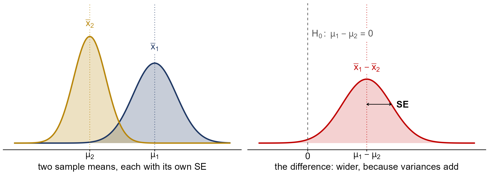
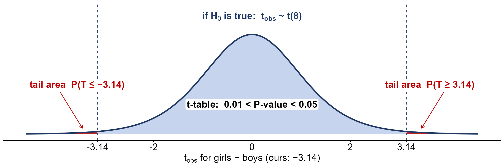
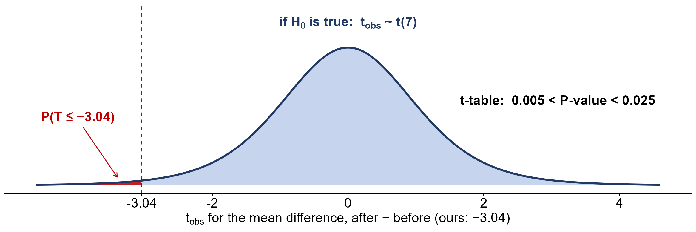

<!--
  SCOPE (Nov 9 2026). Week 12 of Fall 2026. Lecture 28 (Mon Nov 9): a review of the two-proportion test
  and when to pool, the two independent samples t-test, and the matched-pairs t-test (deck:
  lecture_slides/Week 12/2026/Week12_Lecture28_Slides_11_09_2026.pptx; figures and number checks:
  assets/make_lecture28_figures.R). Causal inference was dropped, and every later topic moved one class
  earlier (see the SHIFT note in Course_Schedule.Rmd): Wed Nov 11 is the introduction to analyzing
  categorical variables and Fri Nov 13 is goodness-of-fit and tests of independence. Add those sections
  here when they are written.
  The 2024 Week 12 content that used to be on this page (the sign test, two proportions) is in git history;
  both topics are now on the Week 11 page.
-->

```{r setup, include=FALSE}
knitr::opts_chunk$set(echo = TRUE)
library(knitr)
library(kableExtra)

fmt <- function(x, d = 2) formatC(x, format = 'f', digits = d)
tab <- function(df, ...) kable(df, format = 'html', row.names = FALSE, escape = FALSE, ...) %>%
  kable_classic(full_width = FALSE, html_font = "Cambria") %>%
  kable_styling(bootstrap_options = 'striped')
near <- function(a, b, tol = 5e-4) abs(a - b) < tol
zt <- function(z) round(pnorm(z), 4)                   # a z-table lookup, four decimals
tq <- function(tail, df) round(qt(1 - tail, df), 3)    # a t-table entry: upper-tail area, df
```

```{r lecture28-setup, include=FALSE}
# every number in the Lecture 28 sections is checked here (the deck's numbers are checked again in
# assets/make_lecture28_figures.R)

# review: the hives CI (unpooled) and the electric-vehicle test of a non-zero difference
se_hci <- round(sqrt(0.1 * 0.9 / 200 + 0.06 * 0.94 / 200), 4)
stopifnot(se_hci == 0.0271, round(qnorm(0.995), 3) == 2.576, round(2.576 * se_hci, 4) == 0.0698)
p_y <- round(135 / 1343, 4); p_o <- round(12 / 232, 4)
se_ev <- round(sqrt((135/1343) * (1 - 135/1343) / 1343 + (12/232) * (1 - 12/232) / 232), 4)
stopifnot(p_y == 0.1005, p_o == 0.0517, round(p_y - p_o, 4) == 0.0488, se_ev == 0.0167,
          round((0.0488 - 0.02) / 0.0167, 2) == 1.72, zt(1.72) == 0.9573, round(1 - zt(1.72), 4) == 0.0427)

# two independent means: unpooled SE (4 decimals), t_obs (2 decimals), df = min(n1 - 1, n2 - 1)
t2 <- function(xb1, s1, n1, xb2, s2, n2) {
  se <- round(sqrt(s1^2 / n1 + s2^2 / n2), 4)
  list(se = se, t = round((xb1 - xb2) / se, 2), df = min(n1 - 1, n2 - 1))
}
sp <- t2(2, 0.866, 9, 3.2, 1, 16)        # Example 10.1, two-sided
stopifnot(sp$se == 0.3819, sp$t == -3.14, sp$df == 8, tq(0.025, 8) == 2.306, tq(0.005, 8) == 3.355,
          round(2 * pt(-3.14, 8), 4) == 0.0138)
w_df <- (0.866^2 / 9 + 1 / 16)^2 / ((0.866^2 / 9)^2 / 8 + (1 / 16)^2 / 15)
stopifnot(round(w_df, 2) == 18.85, round(2 * pt(-1.2 / sqrt(0.866^2 / 9 + 1 / 16), w_df), 4) == 0.0054)
mc <- t2(4, 1.5, 11, 3.5, 1, 9)          # Example 10.2, upper-tailed, alpha = 0.01
stopifnot(mc$se == 0.5618, mc$t == 0.89, mc$df == 8, tq(0.2, 8) == 0.889, tq(0.15, 8) == 1.108,
          round(1 - pt(0.89, 8), 4) == 0.1997)
on <- c(67.6, 41.2, 85.3, 55.9, 82.4, 91.2, 73.5, 94.1, 64.7, 64.7, 70.6, 38.2, 61.8, 88.2, 70.6,
        58.8, 91.2, 73.5, 82.4, 35.5, 94.1, 88.2, 64.7, 55.9, 88.2, 97.1, 85.3, 61.8, 79.4, 79.4)
ff <- c(77.9, 95.3, 81.2, 74.1, 98.8, 88.2, 85.9, 92.9, 87.1, 88.2, 69.4, 57.6, 69.4, 67.1, 97.6,
        85.9, 88.2, 91.8, 78.8, 71.8, 98.8, 61.2, 92.9, 90.6, 97.6, 100, 95.3, 83.5, 92.9, 89.4)
ol <- t2(72.85, 16.92, 30, 84.98, 11.71, 30)   # Example 10.3, lower-tailed
stopifnot(length(on) == 30, length(ff) == 30, round(mean(on), 2) == 72.85, round(sd(on), 2) == 16.92,
          round(mean(ff), 2) == 84.98, round(sd(ff), 2) == 11.71,
          ol$se == 3.7568, ol$t == -3.23, ol$df == 29, tq(0.0025, 29) == 3.038, tq(0.0005, 29) == 3.659,
          round(pt(-3.23, 29), 4) == 0.0015)
sc <- c(78, 70, 79, 88, 91, 79, 74, 79, 76, 98, 103, 72, 70, 66, 83)
io <- c(71, 94, 89, 64, 91, 94, 95, 95, 93, 108, 101, 69, 106, 79, 111)
nc <- t2(90.67, 14.21, 15, 80.40, 10.57, 15)   # Iowa vs South Carolina, two-sided
stopifnot(round(mean(io), 2) == 90.67, round(sd(io), 2) == 14.21, round(mean(sc), 2) == 80.40,
          round(sd(sc), 2) == 10.57, nc$se == 4.5727, nc$t == 2.25, nc$df == 14,
          tq(0.025, 14) == 2.145, tq(0.005, 14) == 2.977, round(2 * pt(-2.25, 14), 3) == 0.041)
rt <- t2(5, 1.2, 15, 4.5, 0.8, 20)       # Try It 10.2, upper-tailed
stopifnot(rt$se == 0.3578, rt$t == 1.40, rt$df == 14, tq(0.1, 14) == 1.345, tq(0.075, 14) == 1.523,
          round(1 - pt(1.40, 14), 3) == 0.092)
# pooled SD for the sports example (the aside on pooling)
s_p <- round(sqrt((8 * 0.866^2 + 15 * 1^2) / 23), 4)
stopifnot(s_p == 0.9555, round(s_p * sqrt(1/9 + 1/16), 4) == 0.3981, round(8 * 0.866^2, 3) == 6.000,
          round(sqrt(1/9 + 1/16), 4) == 0.4167, round(-1.2 / 0.3981, 2) == -3.01,
          tq(0.005, 23) == 2.807, tq(0.0025, 23) == 3.104, round(2 * pt(-3.01, 23), 4) == 0.0062)
# the Welch df for the sports data, from the rounded v1, v2 shown in the notes
stopifnot(round(0.866^2 / 9, 4) == 0.0833, 1 / 16 == 0.0625,
          round((0.0833 + 0.0625)^2 / (0.0833^2 / 8 + 0.0625^2 / 15), 2) == 18.85)

# matched pairs: SE = s_d / sqrt(n) (4 decimals), t_obs (2 decimals), df = n - 1
hb <- c(6.6, 6.5, 9.0, 10.3, 11.3, 8.1, 6.3, 11.6); ha <- c(6.8, 2.4, 7.4, 8.5, 8.1, 6.1, 3.4, 2.0)
hd <- round(ha - hb, 1)
stopifnot(identical(hd, c(0.2, -4.1, -1.6, -1.8, -3.2, -2.0, -2.9, -9.6)), near(sum(hd), -25, 1e-9),
          round(sd(hd), 2) == 2.91, round(2.91 / sqrt(8), 4) == 1.0288, round(-3.125 / 1.0288, 2) == -3.04,
          tq(0.025, 7) == 2.365, tq(0.005, 7) == 3.499, round(pt(-3.04, 7), 4) == 0.0094,
          round(sd(hb), 2) == 2.18, round(sd(ha), 2) == 2.61,
          round(sqrt(2.18^2 / 8 + 2.61^2 / 8), 4) == 1.2023, round(-3.125 / 1.2023, 2) == -2.60)
sb <- c(90, 11, -8, -8)                  # Example 10.12, upper-tailed
stopifnot(mean(sb) == 21.25, round(sd(sb), 2) == 46.70, round(46.70 / 2, 4) == 23.35,
          round(21.25 / 23.35, 2) == 0.91, tq(0.25, 3) == 0.765, tq(0.2, 3) == 0.978,
          round(1 - pt(0.91, 3), 3) == 0.215)
sd_ <- c(30, 26, 34, 17, 19, 26, 20) - c(28, 14, 27, 18, 17, 26, 16)   # Example 10.13, two-sided
stopifnot(identical(sd_, c(2, 12, 7, -1, 2, 0, 4)), round(mean(sd_), 2) == 3.71, round(sd(sd_), 2) == 4.50,
          round(4.50 / sqrt(7), 4) == 1.7008, round(3.71 / 1.7008, 2) == 2.18,
          tq(0.05, 6) == 1.943, tq(0.025, 6) == 2.447, round(2 * pt(-2.18, 6), 3) == 0.072)
hus <- c(5, 4, 6, 6, 3, 2, 5, 3, 1, 4, 5, 4, 4, 7, 5, 5, 5)          # the couples (Lecture 26)
wif <- c(3, 3, 4, 5, 3, 3, 2, 3, 2, 3, 2, 2, 5, 2, 5, 3, 1)
cd <- hus - wif
stopifnot(sum(cd) == 23, round(mean(cd), 2) == 1.35, round(sd(cd), 2) == 1.77,
          round(1.77 / sqrt(17), 4) == 0.4293, round((23/17) / 0.4293, 2) == 3.15,
          tq(0.005, 16) == 2.921, tq(0.0025, 16) == 3.252, round(2 * pt(-3.15, 16), 3) == 0.006)
th <- c(120, 111, 135, 140, 125) - c(105, 109, 98, 111, 99)          # Try It 10.13, two-sided
stopifnot(identical(th, c(15, 2, 37, 29, 26)), mean(th) == 21.8, round(sd(th), 2) == 13.59,
          round(13.59 / sqrt(5), 4) == 6.0776, round(21.8 / 6.0776, 2) == 3.59,
          tq(0.025, 4) == 2.776, tq(0.005, 4) == 4.604, round(2 * pt(-3.59, 4), 3) == 0.023)
```

# Lecture 28

Lecture 28 has three parts. It starts with a review of the two-proportion test from Lecture 27, focusing
on one question that trips people up: **when do we pool?** Then it extends the two-sample idea from
proportions to **means**, first for two independent samples and then for matched pairs. The textbook
sections are [OpenStax 10.1](https://openstax.org/books/introductory-statistics-2e/pages/10-1-two-population-means-with-unknown-standard-deviations)
and [OpenStax 10.4](https://openstax.org/books/introductory-statistics-2e/pages/10-4-matched-or-paired-samples).

# Review: when do we pool?

Every test and interval for two proportions uses the same estimate, $\hat{p}_1 - \hat{p}_2$, and an SE of
the form
$$SE(\hat{p}_1 - \hat{p}_2) = \sqrt{\frac{p_1(1-p_1)}{n_1} + \frac{p_2(1-p_2)}{n_2}}$$
We never know $p_1$ and $p_2$, so we have to put something in their place. The choice depends on what
we are assuming:

```{r, echo=FALSE}
tab(data.frame(
  `Null hypothesis or goal` = c('$H_0: p_1 = p_2$ (that is, $p_1 - p_2 = 0$)',
                                '$H_0: p_1 - p_2 = d_0$, with $d_0 \\neq 0$',
                                'a confidence interval for $p_1 - p_2$'),
  `The SE we use` = c('$SE_0 = \\sqrt{\\hat{p}(1-\\hat{p})\\left(\\frac{1}{n_1} + \\frac{1}{n_2}\\right)}, \\quad \\hat{p} = \\frac{X_1 + X_2}{n_1 + n_2}$',
                      '$SE = \\sqrt{\\frac{\\hat{p}_1(1-\\hat{p}_1)}{n_1} + \\frac{\\hat{p}_2(1-\\hat{p}_2)}{n_2}}$',
                      '$(\\hat{p}_1 - \\hat{p}_2) \\pm Z_{1-\\alpha/2} \\sqrt{\\frac{\\hat{p}_1(1-\\hat{p}_1)}{n_1} + \\frac{\\hat{p}_2(1-\\hat{p}_2)}{n_2}}$'),
  `Pool?` = c('**pooled**', '**unpooled**', '**unpooled**'),
  check.names = FALSE))
```

**Why the first row pools.** A test works out what the data would look like *if $H_0$ were true*. If
$H_0: p_1 = p_2$ is true, there is only one proportion, $p$, and both samples estimate it. The best
estimate of one $p$ uses all the data, so we combine the samples: all the successes over all the
observations, $\hat{p} = (X_1 + X_2)/(n_1 + n_2)$. This is the same reason the one-sample test uses $p_0$
in its SE: the SE is built from what $H_0$ says.

**Why the other two rows do not.** If $H_0$ says $p_1 - p_2 = d_0$ with $d_0 \neq 0$, the null itself
says the two proportions are *different*, so there is no common $p$ to estimate, and pooling the samples
would mix two different populations. A confidence interval assumes no hypothesis at all, so again there
is nothing to justify pooling. In both cases we estimate $p_1$ by $\hat{p}_1$ and $p_2$ by $\hat{p}_2$
separately.

The rule in one line: **pool only when $H_0$ says $p_1 = p_2$.**

## Example: a confidence interval for the hives medications

In Lecture 27 we tested the two hives medications (OpenStax Example 10.8): 20 of 200 adults on medication A
and 12 of 200 on medication B still had hives after 30 minutes. With the pooled $SE_0$, $z_{obs} = 1.47$ and
the two-sided P-value was 0.1416, so at $\alpha = 0.01$ we did not reject $H_0: p_A = p_B$.

Now **estimate** the difference with a 99% confidence interval. This time we do not assume $H_0$, so we do
not pool:

1. $\hat{p}_A = 20/200 = 0.10$ and $\hat{p}_B = 12/200 = 0.06$, so $\hat{p}_A - \hat{p}_B = 0.04$.
2. The unpooled SE:
   $$SE = \sqrt{\frac{0.10(0.90)}{200} + \frac{0.06(0.94)}{200}} = \sqrt{0.000450 + 0.000282} \approx 0.0271$$
   (The pooled $SE_0$ was 0.02713; the two are close here because the sample sizes are equal and the
   proportions are similar.)
3. For 99% confidence, $Z_{0.995} = 2.576$, so the margin of error is $2.576 \times 0.0271 \approx 0.0698$.
4. The interval is $0.04 \pm 0.0698$, or $(-0.0298,\ 0.1098)$.

We are 99% confident that the proportion of adults who still have hives is between 2.98 percentage points
*lower* and 10.98 points *higher* on medication A than on medication B. The interval contains 0, which
agrees with the test: the data are consistent with no difference.

## Example: testing a difference that is not zero

In Lecture 27's electric-vehicle practice (OpenStax Example 10.10), 135 of 1,343 younger adults and 12 of
232 older adults owned an EV, and we found that younger adults were more likely to own one. Suppose the
marketing firm makes a stronger claim: **younger adults' ownership rate is more than 2 percentage points
higher** than older adults'. (The 2-point claim is ours, not the book's.) Test it at $\alpha = 0.05$.

1. **Assumptions.** Two independent random samples. Each sample has at least 12 successes and at least
   220 failures, so both are large enough.
2. **Hypotheses.** $p_Y$ and $p_O$ are the proportions of all younger and all older U.S. adults who own an
   EV. The claim is the alternative: $H_A: p_Y - p_O > 0.02$ (upper-tailed). The null is
   $H_0: p_Y - p_O = 0.02$.
3. **Test statistic.** $H_0$ says the proportions differ by 0.02, so there is no common $p$ and we **do not
   pool**. $\hat{p}_Y = 135/1343 \approx 0.1005$ and $\hat{p}_O = 12/232 \approx 0.0517$, a difference of 0.0488.
   $$SE = \sqrt{\frac{0.1005(0.8995)}{1343} + \frac{0.0517(0.9483)}{232}} \approx 0.0167, \qquad
     z_{obs} = \frac{0.0488 - 0.02}{0.0167} \approx 1.72$$
4. **P-value.** $P(Z \geq 1.72 \mid H_0 \text{ true}) = 1 - 0.9573 = 0.0427$.
5. **Decision.** $0.0427 < 0.05$: **reject $H_0$**. The data support the stronger claim, but only just.

The only change from an ordinary two-proportion test is in step 3: the hypothesized difference, 0.02,
replaces the 0 in the numerator, and the SE is unpooled.

# Comparing two independent means

*([OpenStax Section 10.1](https://openstax.org/books/introductory-statistics-2e/pages/10-1-two-population-means-with-unknown-standard-deviations).)*
Lecture 27 compared two populations on a **categorical** response (a proportion). Now the response is
**quantitative**, and we compare the populations' **means**: the average time girls and boys spend playing
sports, or the average final-exam score in online and face-to-face sections. As with proportions, two
sample means will almost never be equal, even when the population means are. The test asks whether the
difference we see is bigger than ordinary sampling variation would produce.

The data are **two independent simple random samples**, one from each population:

```{r, echo=FALSE}
tab(data.frame(
  Population = c('1', '2'),
  `Population mean` = c('$\\mu_1$', '$\\mu_2$'),
  `Population SD` = c('$\\sigma_1$', '$\\sigma_2$'),
  `Sample size` = c('$n_1$', '$n_2$'),
  `Sample mean` = c('$\\bar{x}_1$', '$\\bar{x}_2$'),
  `Sample SD` = c('$s_1$', '$s_2$'),
  check.names = FALSE))
```

The parameter is the **difference in population means**, $\mu_1 - \mu_2$, and its estimate is the
difference in sample means, $\bar{x}_1 - \bar{x}_2$.

## The sampling distribution of $\bar{x}_1 - \bar{x}_2$

* **Centre** $\mu_1 - \mu_2$. Each $\bar{x}$ is centred at its own $\mu$, so on average the difference of
  the estimates is the difference of the parameters.
* **Spread.** From the one-sample case, $\bar{x}_1$ has variance $\sigma_1^2/n_1$ and $\bar{x}_2$ has variance
  $\sigma_2^2/n_2$. Because the samples are **independent, the variances add**, just as they did for
  proportions:
  $$SE(\bar{x}_1 - \bar{x}_2) = \sqrt{\frac{\sigma_1^2}{n_1} + \frac{\sigma_2^2}{n_2}}$$
* **Shape.** Normal if both populations are normal. If they are not, the CLT makes it approximately normal
  when both samples are large (the course's rule is both $n \geq 30$).

Putting these together, $\bar{x}_1 - \bar{x}_2 \sim N\left(\mu_1 - \mu_2,\ \sqrt{\frac{\sigma_1^2}{n_1} + \frac{\sigma_2^2}{n_2}}\right)$.
The picture shows why the variances add. Each sample mean wobbles around its own $\mu$, and their difference
picks up both wobbles, so it is more spread out than either mean on its own.

```{r, echo=FALSE, out.width='100%', fig.align='center', fig.alt = "Two panels. Left: two bell curves, the sampling distributions of x-bar 2 (gold, taller and narrower, centred at mu 2) and of x-bar 1 (navy, centred at mu 1 to its right), labelled two sample means, each with its own SE. Right, on the same height scale: one red bell curve for x-bar 1 minus x-bar 2, centred at mu 1 minus mu 2, lower and wider than either curve on the left, with an arrow marking one SE. A dashed line at 0 is labelled H0: mu 1 minus mu 2 equals 0. The axis label reads: the difference, wider, because variances add."}

```

**Its distribution, in practice.** We do not know $\sigma_1$ and $\sigma_2$, so the SE uses $s_1$ and $s_2$
instead (next section). The difference itself stays approximately normal. What changes is the
**standardized** difference: dividing by an *estimated* SE adds uncertainty, and the result follows,
approximately, a $t$ distribution:
$$\frac{(\bar{x}_1 - \bar{x}_2) - (\mu_1 - \mu_2)}{\sqrt{\frac{s_1^2}{n_1} + \frac{s_2^2}{n_2}}} \ \dot\sim\ t\big(\min(n_1 - 1,\ n_2 - 1)\big)$$
($\dot\sim$ means "approximately follows"). Both the $t$ shape and the df are approximations, as the next
section explains.

## The test statistic

In practice $\sigma_1$ and $\sigma_2$ are unknown, so, as in the one-sample $t$-test, we replace them with
the sample standard deviations:
$$SE = \sqrt{\frac{s_1^2}{n_1} + \frac{s_2^2}{n_2}}$$
Under $H_0$, $\mu_1 - \mu_2 = 0$, so the test statistic is
$$t_{obs} = \frac{(\bar{x}_1 - \bar{x}_2) - 0}{\sqrt{\frac{s_1^2}{n_1} + \frac{s_2^2}{n_2}}}$$
Estimating two standard deviations adds uncertainty, so $t_{obs}$ is compared with a $t$ distribution, not
the standard normal. Unlike the one-sample test, though, **the $t$ distribution here is an approximation**.
With two different SDs in the SE, $t_{obs}$ does not follow any $t$ distribution exactly, so both the curve
and its degrees of freedom are approximate:

* **The Welch df (what software uses).** The best approximation, due to Welch (the textbook calls it the
  Aspin-Welch formula), is the df that makes a $t$ curve match $t_{obs}$ most closely. Writing
  $v_1 = s_1^2/n_1$ and $v_2 = s_2^2/n_2$ (each sample's share of the squared SE),
  $$df = \frac{(v_1 + v_2)^2}{\dfrac{v_1^2}{n_1 - 1} + \dfrac{v_2^2}{n_2 - 1}}$$
  It is usually not a whole number, and it always lies between $\min(n_1 - 1, n_2 - 1)$ and $n_1 + n_2 - 2$.
  For the sports example below, $v_1 = 0.866^2/9 = 0.0833$ and $v_2 = 1.00^2/16 = 0.0625$, so
  $$df = \frac{(0.0833 + 0.0625)^2}{0.0833^2/8 + 0.0625^2/15} \approx 18.85$$
* **In practice, by hand: $df \approx \min(n_1 - 1,\ n_2 - 1)$**, the smaller sample size minus one. This
  is a quick, rough approximation to the Welch df. It is never larger than the Welch df, so its $t$ curve has
  heavier tails and our P-value comes out a little **larger** than software's. That makes the hand method
  **conservative**: if it rejects $H_0$, software will too. For the sports example it gives 8 instead of 18.85.

So, if $H_0$ is true, $t_{obs}$ approximately follows a $t$ distribution, and by hand we use
$\min(n_1 - 1, n_2 - 1)$ degrees of freedom.

## The hypotheses and the P-value

$$H_0: \mu_1 = \mu_2, \qquad \text{which is the same as} \qquad H_0: \mu_1 - \mu_2 = 0$$

```{r, echo=FALSE}
tab(data.frame(
  `Alternative hypothesis` = c('$H_A: \\mu_1 - \\mu_2 > 0$', '$H_A: \\mu_1 - \\mu_2 < 0$', '$H_A: \\mu_1 - \\mu_2 \\neq 0$'),
  Tail = c('upper-tailed', 'lower-tailed', 'two-sided'),
  `In words` = c('population 1 has the larger mean', 'population 1 has the smaller mean',
                 'the means differ, in either direction'),
  `P-value` = c('$P(T \\geq t_{obs} \\mid H_0 \\text{ true})$', '$P(T \\leq t_{obs} \\mid H_0 \\text{ true})$',
                '$2 \\times P(T \\geq |t_{obs}| \\mid H_0 \\text{ true})$'),
  check.names = FALSE))
```

With the [$t$-table](misc/t_table.html) we usually cannot find the P-value exactly; we **bracket** it.
Find the row for our df, find the two entries that $|t_{obs}|$ falls between, and read their upper-tail
areas from the top of the table. For a two-sided test, double both areas.

## Assumptions

1. **Two independent random samples**, one from each population (or two groups formed by random
   assignment). Nothing in one sample is paired with anything in the other.
2. **Normal populations, or large samples.** If both samples have at least 30 observations, the CLT takes
   care of the shape. With smaller samples, both populations should be roughly normal (look for strong
   skew or outliers in the data).

## The five steps

1. **Assumptions.** Independent random samples; normal populations or both $n \geq 30$.
2. **Hypotheses.** Define $\mu_1$ and $\mu_2$ in words, then $H_0: \mu_1 - \mu_2 = 0$ and the alternative.
3. **Test statistic.** The SE, $t_{obs}$, and $df = \min(n_1 - 1, n_2 - 1)$.
4. **P-value.** Bracket it with the $t$-table, using the tail(s) that $H_A$ points to.
5. **Decision.** Reject $H_0$ if the P-value $< \alpha$; state the conclusion in the context of the problem.

## A confidence interval for $\mu_1 - \mu_2$

To estimate the difference rather than test it, use the same SE and df:
$$(\bar{x}_1 - \bar{x}_2) \pm t_{1-\alpha/2} \times \sqrt{\frac{s_1^2}{n_1} + \frac{s_2^2}{n_2}}, \qquad df = \min(n_1 - 1, n_2 - 1)$$
As always, an interval that leaves out 0 matches a two-sided test that rejects $H_0: \mu_1 - \mu_2 = 0$.

## To pool or not (means)

There is a second version of the two-sample $t$-test, the **pooled** $t$-test. If we are willing to assume
the two populations have the **same standard deviation**, $\sigma_1 = \sigma_2 = \sigma$, then both samples
estimate the same $\sigma$, and we combine them into the **pooled standard deviation**:
$$s_p = \sqrt{\frac{(n_1 - 1)s_1^2 + (n_2 - 1)s_2^2}{n_1 + n_2 - 2}}$$
The SE becomes $s_p\sqrt{1/n_1 + 1/n_2}$, and the test statistic follows a $t$ distribution with exactly
$n_1 + n_2 - 2$ degrees of freedom.

```{r, echo=FALSE}
tab(data.frame(
  Situation = c('we assume $\\sigma_1 = \\sigma_2$', '$\\sigma_1, \\sigma_2$ unknown and possibly different (our default)'),
  `The SE we use` = c('$s_p\\sqrt{\\frac{1}{n_1} + \\frac{1}{n_2}}$', '$\\sqrt{\\frac{s_1^2}{n_1} + \\frac{s_2^2}{n_2}}$'),
  df = c('$n_1 + n_2 - 2$', '$\\min(n_1 - 1, n_2 - 1)$ by hand; Welch in software'),
  `Pool?` = c('**pooled**', '**unpooled**'),
  check.names = FALSE))
```

**We do not pool for means.** The textbook is blunt about it: right after the df formula it says "Notice
that the sample variances $(s_1)^2$ and $(s_2)^2$ are not pooled. (If the question comes up, do not pool the
variances.)" (OpenStax p. 513, and again in Example 10.1). The book does not give a reason. Here it is:

* The pooled test is correct **only if** $\sigma_1 = \sigma_2$, and we almost never know that. Testing for
  equal SDs first does not really help, because that test has little power with small samples, which is
  exactly when it matters.
* If the SDs differ, especially when the sample sizes differ too, the pooled test's real Type I error rate
  can be far from $\alpha$: it rejects a true $H_0$ more often (or less often) than we think.
* The unpooled (Welch) test is valid whether or not the SDs are equal, and when they *are* equal it loses
  very little. So it is the safe default, and it is what most software does unless you ask otherwise.

**Compare this with proportions.** There we *must* pool for the test of $H_0: p_1 = p_2$, because for a
proportion the SD is determined by $p$ itself, $\sqrt{p(1-p)}$. A null that says the proportions are equal
automatically says the SDs are equal too. $H_0: \mu_1 = \mu_2$ says nothing at all about $\sigma_1$ and
$\sigma_2$, so it gives us no reason to pool.

### Advantages and disadvantages of pooling

* **When it is reasonable.** The sample SDs are similar (a common rule of thumb: the larger is less than
  about twice the smaller), and the sample sizes are similar too. Pooling is also natural in a randomized
  experiment where the treatment is expected to shift the mean but not the spread.
* **The advantage.** If $\sigma_1 = \sigma_2$ really holds, the pooled $t$ statistic follows a $t$
  distribution *exactly*, with $n_1 + n_2 - 2$ degrees of freedom, more than either the Welch df or our
  $\min(n_1 - 1, n_2 - 1)$. More df means thinner tails, smaller P-values and **more power**. The worked
  example after the sports test below shows this.
* **The disadvantage.** If the SDs differ, especially when the sample sizes differ too, the pooled test's
  real Type I error rate is not $\alpha$. A simulation makes this concrete. Suppose $H_0$ is true (both means
  equal), but sample 1 has $n_1 = 10$ from a population with $\sigma_1 = 3$ and sample 2 has $n_2 = 40$ with
  $\sigma_2 = 1$. Repeating that study 20,000 times:

```{r pool-sim, echo=TRUE}
set.seed(251)
rej <- replicate(20000, {
  x <- rnorm(10, mean = 0, sd = 3)     # small sample, large SD
  y <- rnorm(40, mean = 0, sd = 1)     # large sample, small SD; H0 is true
  c(pooled = t.test(x, y, var.equal = TRUE)$p.value < 0.05,
    welch  = t.test(x, y)$p.value < 0.05)
})
rowMeans(rej)     # how often each 5% test rejects a TRUE null
```

```{r, include=FALSE}
stopifnot(round(mean(rej[1, ]), 2) == 0.26, abs(mean(rej[2, ]) - 0.05) < 0.005)
```

  The "5%" pooled test rejects the true null about **`r round(100 * mean(rej[1, ]))`%** of the time: more than
  five times as many false alarms as promised. Welch's test stays at about 5%. (Swap which sample has the
  larger SD and the pooled test goes the other way, almost never rejecting, which costs power.)
* **Our rule.** We default to the unpooled test. When pooling is justified, it gains a little power; when it
  is not, it can badly mislead, and we rarely know which case we are in.

The textbook does use $s_p$ in one place, in Cohen's $d$, a measure of effect size (p. 518), but never for
the test.

## Example: girls, boys and sports

*From [OpenStax Introductory Statistics 2e, Section 10.1, Example 10.1](https://openstax.org/books/introductory-statistics-2e/pages/10-1-two-population-means-with-unknown-standard-deviations):*

> The average amount of time boys and girls aged seven to 11 spend playing sports each day is believed to
> be the same. A study is done and data are collected, resulting in the data in the table below. Each
> population has a normal distribution.
>
> | | Sample size | Average number of hours playing sports per day | Sample standard deviation |
> |---|---|---|---|
> | Girls | 9 | 2 | 0.866 |
> | Boys | 16 | 3.2 | 1.00 |
>
> Is there a difference in the mean amount of time boys and girls aged seven to 11 play sports each day?
> Test at the 5% level of significance.

1. **Assumptions.** Two independent random samples. The samples are small (9 and 16), but both populations
   are normal, so the $t$-test works.
2. **Hypotheses.** Let $\mu_g$ and $\mu_b$ be the mean daily hours of sports for all girls and all boys aged
   7 to 11. "Believed to be the same" is the null, and the question has no direction, so
   $$H_0: \mu_g - \mu_b = 0 \qquad H_A: \mu_g - \mu_b \neq 0 \quad \text{(two-sided)}$$
3. **Test statistic.**
   $$SE = \sqrt{\frac{0.866^2}{9} + \frac{1.00^2}{16}} = \sqrt{0.0833 + 0.0625} \approx 0.3819, \qquad
     t_{obs} = \frac{2 - 3.2}{0.3819} \approx -3.14$$
   with $df = \min(9 - 1, 16 - 1) = 8$.
4. **P-value.** In row 8 of the $t$-table, $2.306 < 3.14 < 3.355$. Those entries have upper-tail areas 0.025
   and 0.005, so $0.005 < P(T \leq -3.14) < 0.025$. Doubling for two sides,
   $$0.01 < \text{P-value} < 0.05$$
   Software, with df = 8, gives 0.0138.
5. **Decision.** The P-value is below $\alpha = 0.05$: **reject $H_0$**. The data give convincing evidence
   that girls and boys aged 7 to 11 differ in the mean time they spend playing sports each day; the sample
   suggests boys play more.

```{r, echo=FALSE, out.width='100%', fig.align='center', fig.alt = "A t distribution with 8 degrees of freedom, labelled if H0 is true, t obs follows t of 8. Dashed lines mark minus 3.14 and 3.14, and the tiny tail areas beyond them are shaded red. A label in the middle reads: t-table, 0.01 less than P-value less than 0.05."}

```

**Why the book's P-value is smaller.** The book reports a P-value of 0.0054. It uses the Welch df, about
18.85, and our hand method uses df = 8. The $t$ curve with 8 df has heavier tails, so our P-value is larger.
The conclusion is the same. This is the conservative trade-off: when the hand method rejects $H_0$, so does
software.

## Example: math classes at two colleges

*From [OpenStax Introductory Statistics 2e, Section 10.1, Example 10.2](https://openstax.org/books/introductory-statistics-2e/pages/10-1-two-population-means-with-unknown-standard-deviations):*

> A study is done by a community group in two neighboring colleges to determine which one graduates
> students with more math classes. College A samples 11 graduates. Their average is four math classes with a
> standard deviation of 1.5 math classes. College B samples nine graduates. Their average is 3.5 math
> classes with a standard deviation of one math class. The community group believes that a student who
> graduates from college A **has taken more math classes**, on the average. Both populations have a normal
> distribution. Test at a 1% significance level.

1. **Assumptions.** Two independent random samples of graduates; both populations are normal, so the small
   samples are fine. The SDs are unknown, so it is a $t$-test of two means.
2. **Hypotheses.** $\mu_A$ and $\mu_B$ are the mean number of math classes taken by all graduates of colleges
   A and B. The group's belief is the alternative:
   $$H_0: \mu_A - \mu_B = 0 \qquad H_A: \mu_A - \mu_B > 0 \quad \text{(upper-tailed)}$$
   (The book writes the null as $H_0: \mu_A \leq \mu_B$, a composite null; as in Lecture 25, we test it at
   the boundary, $\mu_A - \mu_B = 0$.)
3. **Test statistic.**
   $$SE = \sqrt{\frac{1.5^2}{11} + \frac{1^2}{9}} = \sqrt{0.2045 + 0.1111} \approx 0.5618, \qquad
     t_{obs} = \frac{4 - 3.5}{0.5618} \approx 0.89, \qquad df = \min(10, 8) = 8$$
4. **P-value.** In row 8, $0.889 < 0.89 < 1.108$, with upper-tail areas 0.20 and 0.15, so
   $0.15 < \text{P-value} < 0.20$. Software, with df = 8, gives 0.1997 (the book, with the Welch df, 0.1928).
5. **Decision.** The P-value is far above $\alpha = 0.01$: **do not reject $H_0$**. There is not enough
   evidence that graduates of college A take more math classes, on average, than graduates of college B.

## Example: online and face-to-face final exams

*From [OpenStax Introductory Statistics 2e, Section 10.1, Example 10.3](https://openstax.org/books/introductory-statistics-2e/pages/10-1-two-population-means-with-unknown-standard-deviations):*

> A professor at a large community college wanted to determine whether there is a difference in the means
> of final exam scores between students who took his statistics course online and the students who took his
> face-to-face statistics class. He believed that the mean of the final exam scores for the online class
> would be lower than that of the face-to-face class. Was the professor correct? The randomly selected 30
> final exam scores from each group are listed below. Is the mean of the Final Exam scores of the online
> class lower than the mean of the Final Exam scores of the face-to-face class? Test at a 5% significance
> level.

```{r, echo=FALSE}
tab(data.frame(
  Class = c('Online', '', '', 'Face-to-face', '', ''),
  rbind(matrix(fmt(on, 1), nrow = 3, byrow = TRUE), matrix(fmt(ff, 1), nrow = 3, byrow = TRUE)),
  check.names = FALSE), col.names = c('Class', paste('Score', 1:10)))
```

1. **Assumptions.** Two independent random samples of 30 scores each. Both $n \geq 30$, so we do not need the
   populations to be normal.
2. **Hypotheses.** $\mu_{on}$ and $\mu_{f}$ are the mean final-exam scores of all the professor's online and
   face-to-face students. His belief is the alternative:
   $$H_0: \mu_{on} - \mu_f = 0 \qquad H_A: \mu_{on} - \mu_f < 0 \quad \text{(lower-tailed)}$$
3. **Test statistic.** From the data (a calculator or R does this step): online $\bar{x} = 72.85$,
   $s = 16.92$; face-to-face $\bar{x} = 84.98$, $s = 11.71$.
   $$SE = \sqrt{\frac{16.92^2}{30} + \frac{11.71^2}{30}} \approx 3.7568, \qquad
     t_{obs} = \frac{72.85 - 84.98}{3.7568} \approx -3.23, \qquad df = \min(29, 29) = 29$$
4. **P-value.** In row 29, $3.038 < 3.23 < 3.659$, with upper-tail areas 0.0025 and 0.0005, so
   $0.0005 < \text{P-value} < 0.0025$. Software, with df = 29, gives 0.0015 (the book, with the Welch df,
   0.0011).
5. **Decision.** The P-value is below 0.05: **reject $H_0$**. The professor was right: the data give strong
   evidence that the mean final-exam score is lower for his online students than for his face-to-face
   students. (This is an observational comparison, so it does not show that the online format *causes*
   the lower scores; students chose their section.)

## Example: the 2024 NCAA women's basketball final

On Sunday, April 7, 2024, South Carolina and Iowa met in the NCAA women's basketball championship. The
table gives the points each team scored in its last 15 games before the final (from the 2024 STAT 251
notes).

```{r, echo=FALSE}
tab(data.frame(
  Game = 1:15,
  `South Carolina` = sc,
  Opponent = rev(c('UConn', 'Tennessee', 'Georgia', 'Alabama', 'Kentucky', 'Arkansas', 'Tennessee', 'Texas A&M',
                   'Tennessee', 'LSU', 'Presbyterian', 'UNC', 'Indiana', 'Oregon State', 'NC State')),
  Iowa = io,
  `Opponent ` = rev(c('Penn State', 'Nebraska', 'Michigan', 'Indiana', 'Illinois', 'Minnesota', 'Ohio State',
                      'Penn State', 'Michigan', 'Nebraska', 'Holy Cross', 'West Virginia', 'Colorado', 'LSU', 'UConn')),
  check.names = FALSE))
```

**Question:** At $\alpha = 0.05$, is there a difference between the two teams in mean points scored per game?

1. **Assumptions.** We treat each team's 15 games as a sample of its games that season; the two samples are
   independent (different games). With $n = 15$, we need the points per game to be roughly normal, and the
   data show no strong skew or extreme outliers. (Recent games are not a true random sample, so this is an
   approximation.)
2. **Hypotheses.** $\mu_I$ and $\mu_S$ are the mean points per game for Iowa and South Carolina.
   $$H_0: \mu_I - \mu_S = 0 \qquad H_A: \mu_I - \mu_S \neq 0 \quad \text{(two-sided)}$$
3. **Test statistic.** Iowa: $\bar{x} = 90.67$, $s = 14.21$. South Carolina: $\bar{x} = 80.40$, $s = 10.57$.
   $$SE = \sqrt{\frac{14.21^2}{15} + \frac{10.57^2}{15}} \approx 4.5727, \qquad
     t_{obs} = \frac{90.67 - 80.40}{4.5727} \approx 2.25, \qquad df = 14$$
4. **P-value.** In row 14, $2.145 < 2.25 < 2.977$, with upper-tail areas 0.025 and 0.005; doubling,
   $0.01 < \text{P-value} < 0.05$. Software gives 0.041.
5. **Decision.** $\text{P-value} < 0.05$: **reject $H_0$**, narrowly. Iowa scored significantly more points
   per game. (South Carolina won the final anyway, 87&ndash;75: a test about averages says nothing certain
   about any one game.)

## Practice: who keeps workers longer?

*From [OpenStax Introductory Statistics 2e, Section 10.1, Try It 10.2](https://openstax.org/books/introductory-statistics-2e/pages/10-1-two-population-means-with-unknown-standard-deviations)
(the book gives no solution; the worked solution is ours):*

> A study is done to determine if Company A retains its workers longer than Company B. Company A samples 15
> workers, and their average time with the company is five years with a standard deviation of 1.2. Company
> B samples 20 workers, and their average time with the company is 4.5 years with a standard deviation of
> 0.8. The populations are normally distributed.
>
> a. Are the population standard deviations known?
> b. Conduct an appropriate hypothesis test. At the 5% significance level, what is your conclusion?

<details>
<summary>Solution</summary>

a. No: 1.2 and 0.8 are sample standard deviations, so we use a $t$-test.

b. The five steps:

1. **Assumptions.** Two independent random samples; normal populations, so the small samples are fine.
2. **Hypotheses.** $\mu_A$ and $\mu_B$ are the mean years with the company for all workers at A and B.
   $H_0: \mu_A - \mu_B = 0$ and $H_A: \mu_A - \mu_B > 0$ (upper-tailed).
3. **Test statistic.** $SE = \sqrt{1.2^2/15 + 0.8^2/20} = \sqrt{0.096 + 0.032} \approx 0.3578$, so
   $t_{obs} = (5 - 4.5)/0.3578 \approx 1.40$, with $df = \min(14, 19) = 14$.
4. **P-value.** In row 14, $1.345 < 1.40 < 1.523$, with upper-tail areas 0.10 and 0.075, so
   $0.075 < \text{P-value} < 0.10$. Software gives 0.092.
5. **Decision.** The P-value is above 0.05: **do not reject $H_0$**. There is not enough evidence that
   Company A keeps its workers longer, on average.

</details>

## Example: pooling for girls and boys

Go back to girls, boys and sports (Example 10.1). The sample SDs are close, 0.866 and 1.00 (the larger is
only 1.15 times the smaller), so assuming the two populations have the same SD, $\sigma_g = \sigma_b$, is
reasonable. What changes if we pool?

1. **The pooled SD.** With $n_g = 9$ and $n_b = 16$,
   $$s_p = \sqrt{\frac{(9 - 1)(0.866^2) + (16 - 1)(1.00^2)}{9 + 16 - 2}} = \sqrt{\frac{6.000 + 15}{23}} \approx 0.9555$$
   It lies between the two sample SDs, closer to the boys' because their sample is larger.
2. **The pooled SE and test statistic.**
   $$SE = s_p\sqrt{\frac{1}{9} + \frac{1}{16}} = 0.9555 \times 0.4167 \approx 0.3981, \qquad
     t_{obs} = \frac{2 - 3.2}{0.3981} \approx -3.01, \qquad df = 9 + 16 - 2 = 23$$
3. **P-value.** In row 23, $2.807 < 3.01 < 3.104$, with upper-tail areas 0.005 and 0.0025; doubling,
   $0.005 < \text{P-value} < 0.01$. Software gives 0.0062.
4. **Compare.** The unpooled test gave $t_{obs} = -3.14$ on 8 df and $0.01 < \text{P-value} < 0.05$.
   Pooling made the SE slightly *larger* here (0.3981 against 0.3819), but it nearly tripled the degrees of
   freedom, and the extra df shrink the P-value. That is the payoff of pooling, *when the equal-SD assumption
   is right*: a more powerful test. Both tests reject $H_0$ at the 5% level, so the conclusion is the same.

## A non-parametric alternative: the rank-sum test

The two independent samples $t$-test needs normal populations or large samples. When the samples are
small and the data are clearly skewed, have outliers, or are only ranks or ordered categories (such as
ratings from 1 to 7), the $t$-test's P-value can be wrong. The **Wilcoxon rank-sum test** (also called the
Mann-Whitney test) is the **non-parametric alternative**, just as the sign test was for one sample or for
pairs in Lecture 26:

* It needs two independent random samples, but **no normality assumption**.
* It **ranks** all $n_1 + n_2$ observations together, from smallest to largest, and adds up the ranks
  belonging to each sample. If the two populations have the same centre, the ranks should be well mixed and
  each sample's rank sum should be close to what we would expect from its size. A rank sum that is much too
  large or too small is evidence that one population tends to give larger values.
* Because it uses ranks rather than the values, one extreme outlier counts as just "the largest value", so
  it cannot dominate the test the way it can dominate a mean and an SD.
* The price: when the populations really are normal, the $t$-test is a little more powerful.

For matched pairs, the non-parametric partner of the matched-pairs $t$-test is the **Wilcoxon signed-rank
test**, a stronger cousin of the sign test that also uses the sizes of the differences.

Both tests, with worked examples, are in the extra notes under **Resources → Extras → Non-parametric
Tests**: [Non-parametric tests for two samples](misc/Non-Parametric-Tests-For-Two-Samples.html).

# Matched pairs

*([OpenStax Section 10.4](https://openstax.org/books/introductory-statistics-2e/pages/10-4-matched-or-paired-samples).)*
In Lecture 27 we saw that two samples can be **dependent**: each observation in one sample is paired with
one in the other. The most common designs are

* **the same subjects measured twice**, before and after a treatment (blood pressure before and after a
  drug), or under two conditions (each student's dominant and weaker hand);
* **natural or deliberate pairs**, such as twins, or two plots of land side by side, with one member of each
  pair getting each treatment.

The two-sample $t$-test above would be **wrong** for these data, because it assumes that the samples are
independent. Instead, we use the pairing.

## From two samples to one

For each pair, compute the **difference** $d = x_1 - x_2$ (for example, after $-$ before). The $n$
differences become the data, and the two-sample problem turns into a **one-sample** problem: the parameter
is the **mean difference** $\mu_d$ in the population of pairs, and we test it with the one-sample $t$-test
from Lecture 25.

```{r, echo=FALSE}
tab(data.frame(
  Symbol = c('$d$', '$n$', '$\\mu_d$', '$\\bar{d}$', '$s_d$'),
  Meaning = c('the difference within a pair, $x_1 - x_2$ (always say which way you subtract)',
              'the number of pairs (not the number of measurements)',
              'the population mean difference: the parameter',
              'the mean of the $n$ sample differences: the estimate of $\\mu_d$',
              'the standard deviation of the $n$ sample differences'),
  check.names = FALSE))
```

## The test

* **Hypotheses.** $H_0: \mu_d = 0$, no difference within pairs on average, against $H_A: \mu_d > 0$
  (upper-tailed), $H_A: \mu_d < 0$ (lower-tailed) or $H_A: \mu_d \neq 0$ (two-sided). Which direction is
  "upper" depends on the order of subtraction, so fix $d$ first.
* **Test statistic.**
  $$t_{obs} = \frac{\bar{d} - 0}{s_d / \sqrt{n}}, \qquad df = n - 1$$
  If $H_0$ is true, $t_{obs}$ follows a $t$ distribution with $n - 1$ degrees of freedom.
* **P-value.** From the $t$-table, exactly as for the one-sample test.
* **Confidence interval.** $\bar{d} \pm t_{1-\alpha/2} \times s_d/\sqrt{n}$, with $df = n - 1$.

**Assumptions.**

1. The pairs are a random sample (or the treatment was randomly assigned within each pair), and the pairs
   are independent of one another.
2. The **differences** are approximately normal, or there are at least 30 pairs. The two original
   measurements do not each need to be normal; only the differences matter. With few pairs, look at the
   differences for skew and outliers.

## Why pair?

Pairing removes the variation **between subjects**. People differ a lot in how much pain they feel, how far
they can throw, or how high their blood pressure is. In an independent-samples design, all of that
person-to-person variation goes into $s_1$ and $s_2$, and so into the SE. When each subject is compared with
themself, those differences cancel out of $d$, $s_d$ is smaller, and the test is more powerful: it can detect
a smaller effect with the same number of subjects. The hypnotism example below shows this with numbers.

The sign test from Lecture 26 is also a matched-pairs test. It uses only the **signs** of the differences,
so it needs no normality assumption; the matched-pairs $t$-test uses their **sizes**, so it is more powerful
when the differences really are roughly normal.

## Example: does hypnotism reduce pain?

*From [OpenStax Introductory Statistics 2e, Section 10.4, Example 10.11](https://openstax.org/books/introductory-statistics-2e/pages/10-4-matched-or-paired-samples):*

> A study was conducted to investigate the effectiveness of hypnotism in reducing pain. Results for randomly
> selected subjects are shown in the table below. A lower score indicates less pain. The "before" value is
> matched to an "after" value and the differences are calculated. The differences have a normal
> distribution. Are the sensory measurements, on average, lower after hypnotism? Test at a 5% significance
> level.

```{r, echo=FALSE}
tab(data.frame(Subject = c('Before', 'After', '$d$ = after $-$ before'),
               rbind(fmt(hb, 1), fmt(ha, 1), sub('-', '&minus;', fmt(hd, 1), fixed = TRUE)),
               check.names = FALSE), col.names = c('Subject', LETTERS[1:8]))
```

1. **Assumptions.** Matched pairs: the same 8 subjects were measured before and after hypnotism. The
   subjects were randomly selected, and the differences are normal (given), so the small sample is fine.
2. **Hypotheses.** Let $d$ = after $-$ before, and $\mu_d$ the mean difference for all such subjects. Less
   pain after hypnotism means *negative* differences, so
   $$H_0: \mu_d = 0 \qquad H_A: \mu_d < 0 \quad \text{(lower-tailed)}$$
   (The book writes $H_0: \mu_d \geq 0$; we test it at the boundary, 0.)
3. **Test statistic.** The 8 differences add to $-25.0$, so $\bar{d} = -25.0/8 = -3.125$, and their
   standard deviation is $s_d \approx 2.91$.
   $$SE = \frac{s_d}{\sqrt{n}} = \frac{2.91}{\sqrt{8}} \approx 1.0288, \qquad
     t_{obs} = \frac{-3.125 - 0}{1.0288} \approx -3.04, \qquad df = 8 - 1 = 7$$
4. **P-value.** In row 7, $2.365 < 3.04 < 3.499$, with upper-tail areas 0.025 and 0.005. By symmetry the lower
   tail beyond $-3.04$ has the same area, so
   $$0.005 < P(T \leq -3.04 \mid H_0 \text{ true}) < 0.025$$
   Software gives 0.0094.
5. **Decision.** The P-value is below 0.05: **reject $H_0$**. The data give convincing evidence that pain
   scores are lower after hypnotism, on average.

```{r, echo=FALSE, out.width='100%', fig.align='center', fig.alt = "A t distribution with 7 degrees of freedom, labelled if H0 is true, t obs follows t of 7. A dashed line marks minus 3.04, and the small lower tail to its left is shaded red and labelled P of T at most minus 3.04. A label on the right reads: t-table, 0.005 less than P-value less than 0.025."}

```

**What if we had ignored the pairing?** Treat the before and after scores as two independent samples of 8:
before $\bar{x} = 8.71$, $s = 2.18$; after $\bar{x} = 5.59$, $s = 2.61$. The unpooled SE is
$$\sqrt{\frac{2.18^2}{8} + \frac{2.61^2}{8}} \approx 1.2023, \qquad t_{obs} = \frac{-3.125}{1.2023} \approx -2.60$$
The estimate is the same, $-3.125$, but the SE is larger (1.2023 against 1.0288), so $t_{obs}$ is smaller.
Subjects who start with a high pain score tend to stay relatively high, and the independent-samples SE
counts that person-to-person spread as noise. The paired analysis removes it. Ignoring the pairing is not
just less powerful; it is the **wrong test**, because the two samples are not independent.

## Example: the softball strength class

*From [OpenStax Introductory Statistics 2e, Section 10.4, Example 10.12](https://openstax.org/books/introductory-statistics-2e/pages/10-4-matched-or-paired-samples):*

> A college softball coach was interested in whether the college's strength development class increased
> their players' maximum lift (in pounds). Four players participated in the study. The amount of weight they
> could each lift was recorded before they took the strength development class. After completing the class,
> the amount of weight they could each lift was again measured. The data are as follows:
>
> | Weight (in pounds) | Player 1 | Player 2 | Player 3 | Player 4 |
> |---|---|---|---|---|
> | Amount of weight lifted prior to the class | 205 | 241 | 338 | 368 |
> | Amount of weight lifted after the class | 295 | 252 | 330 | 360 |
>
> The coach wants to know if the strength development class makes the players stronger, on average.

The book does not give $\alpha$; we use 0.05, as the book's solution does.

1. **Assumptions.** Matched pairs (the same 4 players, before and after). The book assumes the differences
   are normal; we come back to that below.
2. **Hypotheses.** $d$ = after $-$ before, so "stronger" means positive differences:
   $H_0: \mu_d = 0$ and $H_A: \mu_d > 0$ (upper-tailed).
3. **Test statistic.** The differences are $90, 11, -8, -8$. So $\bar{d} = 85/4 = 21.25$ and $s_d \approx 46.70$.
   $$SE = \frac{46.70}{\sqrt{4}} = 23.35, \qquad t_{obs} = \frac{21.25}{23.35} \approx 0.91, \qquad df = 3$$
4. **P-value.** In row 3, $0.765 < 0.91 < 0.978$, with upper-tail areas 0.25 and 0.20, so
   $0.20 < \text{P-value} < 0.25$. Software (and the book) give 0.215.
5. **Decision.** **Do not reject $H_0$**. There is not enough evidence that the class makes players
   stronger, on average.

**A caution.** Look at the differences: three of the four players lifted about the same or *less* after the
class, and one player's 90-pound gain makes $\bar{d}$ positive. With 4 pairs and one possible outlier, the
assumption that the differences are normal is very doubtful, and so is any conclusion. The coach needs more
players.

## Example: shot-put with each hand

*From [OpenStax Introductory Statistics 2e, Section 10.4, Example 10.13](https://openstax.org/books/introductory-statistics-2e/pages/10-4-matched-or-paired-samples):*

> Seven eighth graders at Kennedy Middle School measured how far they could push the shot-put with their
> dominant (writing) hand and their weaker (non-writing) hand. They thought that they could push equal
> distances with either hand. The data were collected and recorded in the table below.
>
> | Distance (in feet) using | Student 1 | Student 2 | Student 3 | Student 4 | Student 5 | Student 6 | Student 7 |
> |---|---|---|---|---|---|---|---|
> | Dominant hand | 30 | 26 | 34 | 17 | 19 | 26 | 20 |
> | Weaker hand | 28 | 14 | 27 | 18 | 17 | 26 | 16 |
>
> Conduct a hypothesis test to determine whether the mean difference in distances between the children's
> dominant versus weaker hands is significant.

The book assumes the differences are normal and uses $\alpha = 0.05$.

1. **Assumptions.** Matched pairs: each student used both hands. The differences are assumed normal.
2. **Hypotheses.** $d$ = dominant $-$ weaker. "Equal distances with either hand" is the null, and the
   question has no direction: $H_0: \mu_d = 0$ and $H_A: \mu_d \neq 0$ (two-sided).
3. **Test statistic.** The differences are $2, 12, 7, -1, 2, 0, 4$. So $\bar{d} = 26/7 \approx 3.71$ and
   $s_d \approx 4.50$.
   $$SE = \frac{4.50}{\sqrt{7}} \approx 1.7008, \qquad t_{obs} = \frac{3.71}{1.7008} \approx 2.18, \qquad df = 6$$
4. **P-value.** In row 6, $1.943 < 2.18 < 2.447$, with upper-tail areas 0.05 and 0.025; doubling,
   $0.05 < \text{P-value} < 0.10$. Software gives 0.072 (the book: 0.0716).
5. **Decision.** The P-value is above 0.05: **do not reject $H_0$**. There is not enough evidence of a mean
   difference between the students' dominant and weaker hands. Six of the seven students pushed at least
   as far with their dominant hand, so a larger study might well find a difference.

## Example: who made the decision? (a $t$-test instead of the sign test)

In Lecture 26 we used the **sign test** on 17 couples' ratings of who had more say in a major financial
decision (1 = the wife, 7 = the husband), and found a two-sided P-value of 0.0574: not significant at the 5%
level. What does the matched-pairs $t$-test say about the same data?

The differences $d$ = husband $-$ wife add to 23, so $\bar{d} = 23/17 \approx 1.35$, and $s_d \approx 1.77$.
$$SE = \frac{1.77}{\sqrt{17}} \approx 0.4293, \qquad t_{obs} = \frac{1.35}{0.4293} \approx 3.15, \qquad df = 16$$
In row 16, $2.921 < 3.15 < 3.252$, with upper-tail areas 0.005 and 0.0025; doubling, $0.005 < \text{P-value} < 0.01$.
Software gives 0.006. The $t$-test **rejects** $H_0$, and the sign test did not.

Which one should we believe? The $t$-test uses the sizes of the differences, so it has more power, **if** its
assumption holds. But these are crude 1-to-7 ratings from only 17 couples, and it is hard to believe the
differences come from a normal population. The sign test makes no such assumption. That is why we used it
in Lecture 26. When the assumption behind a test is doubtful, a more powerful-looking P-value is not more
trustworthy. Here the honest summary is "suggestive but not conclusive".

## Practice: throwing with each hand

*From [OpenStax Introductory Statistics 2e, Section 10.4, Try It 10.13](https://openstax.org/books/introductory-statistics-2e/pages/10-4-matched-or-paired-samples)
(the book gives no solution; the worked solution is ours, assuming the differences are normal):*

> Five ball players think they can throw the same distance with their dominant hand (throwing) and off-hand
> (catching hand). The data were collected and recorded in the table below. Conduct a hypothesis test to
> determine whether the mean difference in distances between the dominant and off-hand is significant. Test
> at the 5% level.
>
> | | Player 1 | Player 2 | Player 3 | Player 4 | Player 5 |
> |---|---|---|---|---|---|
> | Dominant hand | 120 | 111 | 135 | 140 | 125 |
> | Off-hand | 105 | 109 | 98 | 111 | 99 |

<details>
<summary>Solution</summary>

1. **Assumptions.** Matched pairs (each player threw with both hands); we assume the differences are normal.
2. **Hypotheses.** $d$ = dominant $-$ off-hand. $H_0: \mu_d = 0$ and $H_A: \mu_d \neq 0$ (two-sided).
3. **Test statistic.** The differences are $15, 2, 37, 29, 26$, so $\bar{d} = 109/5 = 21.8$ and $s_d \approx 13.59$.
   $SE = 13.59/\sqrt{5} \approx 6.0776$ and $t_{obs} = 21.8/6.0776 \approx 3.59$, with $df = 4$.
4. **P-value.** In row 4, $2.776 < 3.59 < 4.604$, with upper-tail areas 0.025 and 0.005; doubling,
   $0.01 < \text{P-value} < 0.05$. Software gives 0.023.
5. **Decision.** The P-value is below 0.05: **reject $H_0$**. The players throw significantly farther, on
   average, with their dominant hand.

</details>

# Choosing a test

The first question is always **what kind of response** (categorical or quantitative), and the second is
**how the samples are related** (one sample, two independent samples, or matched pairs).

```{r, echo=FALSE}
tab(data.frame(
  Parameter = c('$p$', '$p_1 - p_2$', '$\\mu$', '$\\mu_1 - \\mu_2$', '$\\mu_d$'),
  Design = c('one sample', 'two independent samples', 'one sample', 'two independent samples', 'matched pairs'),
  Response = c('categorical', 'categorical', 'quantitative', 'quantitative', 'quantitative'),
  `Test statistic` = c('$z_{obs} = \\frac{\\hat{p} - p_0}{\\sqrt{p_0(1-p_0)/n}}$',
                       '$z_{obs} = \\frac{\\hat{p}_1 - \\hat{p}_2}{\\sqrt{\\hat{p}(1-\\hat{p})\\left(\\frac{1}{n_1} + \\frac{1}{n_2}\\right)}}$ (pooled $\\hat{p}$)',
                       '$t_{obs} = \\frac{\\bar{x} - \\mu_0}{s/\\sqrt{n}}$',
                       '$t_{obs} = \\frac{\\bar{x}_1 - \\bar{x}_2}{\\sqrt{s_1^2/n_1 + s_2^2/n_2}}$',
                       '$t_{obs} = \\frac{\\bar{d}}{s_d/\\sqrt{n}}$'),
  Distribution = c('$N(0, 1)$', '$N(0, 1)$', '$t(n - 1)$', '$t(\\min(n_1 - 1, n_2 - 1))$', '$t(n - 1)$'),
  `Confidence interval` = c('$\\hat{p} \\pm Z_{1-\\alpha/2}\\sqrt{\\hat{p}(1-\\hat{p})/n}$',
                            '$(\\hat{p}_1 - \\hat{p}_2) \\pm Z_{1-\\alpha/2}\\sqrt{\\frac{\\hat{p}_1(1-\\hat{p}_1)}{n_1} + \\frac{\\hat{p}_2(1-\\hat{p}_2)}{n_2}}$',
                            '$\\bar{x} \\pm t_{1-\\alpha/2}\\, s/\\sqrt{n}$',
                            '$(\\bar{x}_1 - \\bar{x}_2) \\pm t_{1-\\alpha/2}\\sqrt{s_1^2/n_1 + s_2^2/n_2}$',
                            '$\\bar{d} \\pm t_{1-\\alpha/2}\\, s_d/\\sqrt{n}$'),
  check.names = FALSE))
```

Some quick checks:

* **The blood pressure of 30 patients before and after a drug:** the same patients twice, so matched pairs.
* **Mean nightly sleep for random samples of 40 first-years and 40 seniors:** two separate samples and a
  quantitative response, so the two independent samples $t$-test.
* **The share of 200 dog owners and 200 cat owners who exercise daily:** two independent samples and a
  yes/no response, so the two-proportion $z$-test.

# Sources

* The two-sample examples are from OpenStax *Introductory Statistics 2e*, Chapter 10: sports hours
  (Example 10.1), math classes (Example 10.2), online and face-to-face exams (Example 10.3), worker
  retention (Try It 10.2), hypnotism (Example 10.11), the softball strength class (Example 10.12), the
  shot-put (Example 10.13) and throwing distance (Try It 10.13). The "do not pool" quotation is from p. 513,
  and Cohen's $d$ is on p. 518. The hives and electric-vehicle data are Examples 10.8 and 10.10; the 2-point
  claim tested in the electric-vehicle example is ours.
* The NCAA basketball scores and the couples' decision ratings come from the 2024 STAT 251 notes.
* Textbook: OpenStax *Introductory Statistics 2e*, Sections 10.1, 10.3 and 10.4.
