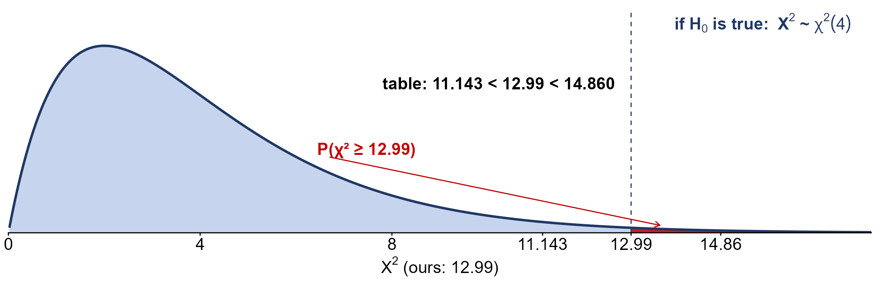
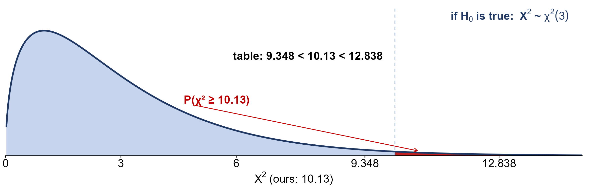
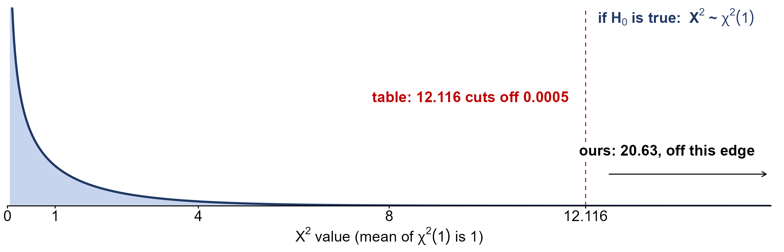

<!--
  SCOPE (Nov 16 2026). Week 13 of Fall 2026. Rewritten from scratch: the 2024 content that used to be on this
  page (two means, paired t, goodness of fit, independence) is in git history and is covered on the Week 12 page.
  Mon Nov 16 (Lecture 31; deck lecture_slides/Week 13/2026/Week13_Lecture31_Slides_11_16_2026.pptx; figures and
  number checks: assets/make_lecture30_figures.R and assets/make_lecture31_figures.R) opened with a short
  goodness-of-fit recap (Lecture 30 stopped after its Pew example), then covered the test of independence, the
  test for homogeneity and McNemar's test. The independence and homogeneity sections were moved here from the
  Week 12 page. Wed Nov 18 is Cramer's V, measures of association and the Pearson correlation test - add those
  sections after McNemar's test. Fisher's exact test is not taught; it is written up under Resources -> Extras
  (misc/Fisher-Exact-Test.Rmd).
  House rules for this page: topic sections only (no lecture numbers or class days in the prose), every book
  example quoted in full with a link, every number asserted in the setup chunk, decisions compare the P-value
  with alpha.
-->

```{r setup, include=FALSE}
knitr::opts_chunk$set(echo = TRUE)
library(knitr)
library(kableExtra)

fmt <- function(x, d = 2) formatC(x, format = 'f', digits = d)
tab <- function(df, ...) kable(df, format = 'html', row.names = FALSE, escape = FALSE, ...) %>%
  kable_classic(full_width = FALSE, html_font = "Cambria") %>%
  kable_styling(bootstrap_options = 'striped')
near <- function(a, b, tol = 5e-4) abs(a - b) < tol
```

```{r two-way-setup, include=FALSE}
# every number on this page is checked here (the deck's numbers are checked again in
# assets/make_lecture30_figures.R and assets/make_lecture31_figures.R). P-values are bracketed with the site's
# chi-square table (misc/chisq_table.Rmd); the exact value from software is quoted beside the bracket.
tails <- c(0.25, 0.2, 0.15, 0.125, 0.1, 0.075, 0.05, 0.025, 0.005, 0.0025, 0.0005)
crit <- function(df) round(qchisq(1 - tails, df), 3)                  # one row of the chi-square table
bracket <- function(x, df) { cr <- crit(df)                           # c(larger tail, smaller tail)
  c(if (any(cr <= x)) tails[max(which(cr <= x))] else NA, if (any(cr > x)) tails[min(which(cr > x))] else NA) }
pv <- function(x, df) pchisq(x, df, lower.tail = FALSE)
gof <- function(O, p) { E <- sum(O) * p; list(O = O, E = E, terms = (O - E)^2 / E, X2 = sum((O - E)^2 / E), df = length(O) - 1) }
indep <- function(M) { E <- outer(rowSums(M), colSums(M)) / sum(M)
  list(O = M, E = E, terms = (M - E)^2 / E, X2 = sum((M - E)^2 / E), df = (nrow(M) - 1) * (ncol(M) - 1)) }
neg <- function(s) sub('-', '&minus;', s, fixed = TRUE)
# the O / E / O - E / (O - E)^2 / E table for a goodness-of-fit test (d = decimals for the last column)
gof_tab <- function(g, labels, first = 'Category', d = 2, dE = 2)
  tab(data.frame(c(labels, '**Total**'), c(g$O, sum(g$O)), c(fmt(g$E, dE), fmt(sum(g$E), dE)),
                 c(neg(fmt(g$O - g$E, dE)), ''), c(fmt(g$terms, d), paste0('**', fmt(g$X2, 2), '**'))),
      col.names = c(first, 'Observed $O$', 'Expected $E$', '$O - E$', '$(O - E)^2/E$'), align = 'l')
# a two-way table of observed counts with its totals, or of expected counts / contributions
two_way <- function(M, rows, cols, first, d = 0, totals = TRUE) {
  body <- if (d == 0) M else matrix(fmt(M, d), nrow(M))
  df <- data.frame(rows, body, check.names = FALSE)
  if (totals) { df <- data.frame(df, rowSums(M), check.names = FALSE)
    df <- rbind(df, c('**Column total**', colSums(M), paste0('**', sum(M), '**'))) }
  tab(df, col.names = c(first, cols, if (totals) 'Row total'), align = 'l')
}

# OpenStax Example 11.5: speeding and cell phones
stopifnot(round(70 * 305 / 755, 1) == 28.3)

# OpenStax Example 11.6: volunteers and hours
vo <- indep(matrix(c(111, 96, 48, 96, 133, 61, 91, 150, 53), 3, byrow = TRUE))
stopifnot(identical(round(vo$E, 2), matrix(c(90.57, 115.19, 49.24, 103, 131, 56, 104.42, 132.81, 56.77), 3, byrow = TRUE)),
          round(sum(round(vo$terms, 3)), 2) == 12.99, round(vo$X2, 2) == 12.99, vo$df == 4,
          identical(bracket(vo$X2, 4), c(0.025, 0.005)), crit(4)[8:9] == c(11.143, 14.860),
          round(pv(vo$X2, 4), 4) == 0.0113, round(min(vo$E), 2) == 49.24)

# OpenStax Example 11.7: anxiety and the need to succeed (the book gives two expected counts; the test is ours)
an <- indep(matrix(c(35, 42, 53, 15, 10, 18, 48, 63, 33, 31, 4, 5, 11, 15, 17), 3, byrow = TRUE))
stopifnot(round(an$E[1, 1], 2) == 22.09, round(an$E[3, 4], 2) == 8.19, round(min(an$E), 2) == 7.41,
          round(sum(round(an$terms, 3)), 2) == 48.42, round(an$X2, 2) == 48.42, an$df == 8,
          crit(8)[11] == 27.868, pv(an$X2, 8) < 0.0005, round(an$terms[3, 5], 2) == 11.87,
          round(an$terms[1, 1], 2) == 7.55)

# OpenStax Example 11.8: living arrangements (homogeneity)
li <- indep(matrix(c(72, 84, 49, 45, 91, 86, 88, 35), 2, byrow = TRUE))
stopifnot(identical(round(li$E, 2), matrix(c(74.09, 77.27, 62.27, 36.36, 88.91, 92.73, 74.73, 43.64), 2, byrow = TRUE)),
          round(sum(round(li$terms, 3)), 2) == 10.13, round(li$X2, 2) == 10.13, li$df == 3,
          identical(bracket(li$X2, 3), c(0.025, 0.005)), crit(3)[8:9] == c(9.348, 12.838),
          round(pv(li$X2, 3), 4) == 0.0175, identical(round(c(49 / 250, 88 / 300), 3), c(0.196, 0.293)),
          identical(round(c(45 / 250, 35 / 300), 3), c(0.18, 0.117)))

# OpenStax Example 11.9: voters before and after an earthquake (homogeneity)
qk <- indep(matrix(c(167, 128, 135, 214, 197, 225), 2, byrow = TRUE))
stopifnot(identical(round(qk$E, 2), matrix(c(153.69, 131.1, 145.22, 227.31, 193.9, 214.78), 2, byrow = TRUE)),
          round(sum(round(qk$terms, 3)), 2) == 3.26, round(qk$X2, 2) == 3.26, qk$df == 2,
          identical(bracket(qk$X2, 2), c(0.2, 0.15)), crit(2)[2:3] == c(3.219, 3.794), round(pv(qk$X2, 2), 4) == 0.1959)

# McNemar's test (two measurements per subject)
mc <- function(a, b, c, d) list(n = a + b + c + d, p1 = (a + b) / (a + b + c + d), p2 = (a + c) / (a + b + c + d),
                                X2 = (b - c)^2 / (b + c), z = (b - c) / sqrt(b + c))
# de Oliveira et al. (2021), Table 1, protocol T: saliva (rows) vs oro/nasopharyngeal swab (columns)
sa <- mc(119, 5, 33, 243)
stopifnot(sa$n == 400, sa$p1 == 0.31, sa$p2 == 0.38, round(sa$p1 - sa$p2, 2) == -0.07, (5 - 33) / 400 == -0.07,
          round(sa$X2, 2) == 20.63, round(sa$z, 2) == -4.54, near(sa$z^2, sa$X2, 1e-12), 784 / 38 == sa$X2,
          crit(1)[11] == 12.116, pv(sa$X2, 1) < 0.0005, signif(pv(sa$X2, 1), 2) == 5.6e-06,
          round(unname(mcnemar.test(matrix(c(119, 33, 5, 243), 2), correct = FALSE)$statistic), 2) == 20.63,
          round((abs(5 - 33) - 1)^2 / 38, 2) == 19.18, round(sqrt(38) / 2, 2) == 3.08)
# what the (wrong) test of independence on the same table would say
sa_ind <- indep(matrix(c(119, 5, 33, 243), 2, byrow = TRUE))
stopifnot(round(sa_ind$X2, 1) == 256.3, round(min(sa_ind$E), 2) == 47.12,
          signif(2 * pbinom(5, 38, 0.5), 2) == 4.3e-06)
# Bouska et al. (2022), Table 2: gargle lavage (rows) vs nasopharyngeal swab (columns)
ga <- mc(255, 20, 20, 199)
stopifnot(ga$n == 494, ga$p1 == ga$p2, round(ga$p1, 3) == 0.557, ga$X2 == 0, pv(0, 1) == 1, 255 + 199 == 454,
          round(454 / 494, 3) == 0.919)
```

This chapter studies data in which **two categorical variables** are recorded for the same individuals and
summarized in a two-way table. The test of independence asks whether two variables measured on one sample
are related. The test for homogeneity asks whether several populations share one distribution. McNemar's
test handles the special case where a yes/no variable is measured **twice on the same subjects**. All three
compare observed counts with the counts a null hypothesis predicts, and all three end in a chi-square
P-value. The textbook sections are
[OpenStax 11.3&ndash;11.5](https://openstax.org/books/introductory-statistics-2e/pages/11-3-test-of-independence).
McNemar's test is not in the textbook.

The tools carry over from the Week 12 chapter on
[the chi-square statistic](lecturemenu12.html#the-chi-square-statistic) and the
[goodness-of-fit test](lecturemenu12.html#the-chi-square-goodness-of-fit-test). Each test compares observed
counts $O$ with expected counts $E$ through
$$X^2_{obs} = \sum \frac{(O - E)^2}{E},$$
and finds the P-value in the upper tail of a chi-square distribution. Chi-square P-values in these notes are
bracketed with the [course chi-square table](misc/chisq_table.html), and the exact value from software is given
beside each bracket.

# The chi-square test of independence

## The setup

A **test of independence** asks whether **two categorical variables**, measured on the **same** individuals
from **one** random sample, are related. The data form a two-way (contingency) table with $r$ rows and $c$
columns.

* **The hypotheses** are stated in words:
  $$H_0: \text{the two variables are independent} \qquad H_A: \text{the two variables are not independent (they are associated)}$$
  Independent means the conditional distribution of one variable is the same in every row (or column) of
  the other, which is what the "do the rows look alike?" comparison in the Week 12 section on [two-way tables](lecturemenu12.html#two-way-tables) checked.

**Where the expected counts come from.** Recall from probability that events $A$ and $B$ are independent
when $P(A \text{ and } B) = P(A)\,P(B)$. The book's Example 11.5 makes this concrete:

> Suppose, in a study of drivers who received speeding violations in the last year, and who used cell phone
> while driving, that 755 people were surveyed. Out of the 755, 70 had a speeding violation and 685 did not;
> 305 used cell phones while driving and 450 did not.

If having a speeding violation and using a cell phone while driving are independent, then
$$P(\text{violation and cell phone}) = \frac{70}{755} \times \frac{305}{755},$$
and the expected *number* of the 755 drivers in that cell is
$$E = 755 \times \frac{70}{755} \times \frac{305}{755} = \frac{70 \times 305}{755} = 28.3.$$
One 755 cancels, and what is left is the rule for every cell of a two-way table:
$$E_{ij} = \frac{(\text{row } i \text{ total}) \times (\text{column } j \text{ total})}{n}$$

* **The test statistic** adds a term for **every cell**, all $r \times c$ of them:
  $$X^2_{obs} = \sum_{i=1}^{r} \sum_{j=1}^{c} \frac{(O_{ij} - E_{ij})^2}{E_{ij}}$$
* **The degrees of freedom** are
  $$df = (r - 1)(c - 1)$$
  The row and column totals are fixed. Fill in the table one cell at a time: once $c - 1$ cells of a row are
  known, its last cell is forced by the row total, and once $r - 1$ rows are known, the last row is forced by
  the column totals. Only $(r - 1)(c - 1)$ cells are free.
* **The P-value** is again the upper tail, $P(\chi^2 \geq X^2_{obs} \mid H_0 \text{ true})$.
* **The conditions.** One random sample, each individual classified on both variables; every expected count
  at least 5.

In general, the observed table and its totals look like this:

```{r, echo=FALSE}
tab(data.frame(c('Row 1', 'Row 2', '$\\vdots$', 'Row $r$', '**Column total**'),
               c('$O_{11}$', '$O_{21}$', '$\\vdots$', '$O_{r1}$', 'column 1 total'),
               c('$O_{12}$', '$O_{22}$', '$\\vdots$', '$O_{r2}$', 'column 2 total'),
               c('$\\cdots$', '$\\cdots$', '$\\ddots$', '$\\cdots$', '$\\cdots$'),
               c('$O_{1c}$', '$O_{2c}$', '$\\vdots$', '$O_{rc}$', 'column $c$ total'),
               c('row 1 total', 'row 2 total', '$\\vdots$', 'row $r$ total', '$n$')),
    col.names = c('', 'Column 1', 'Column 2', '$\\cdots$', 'Column $c$', 'Row total'))
```

## Example: volunteers and hours

*From [OpenStax Introductory Statistics 2e, Section 11.3, Example 11.6](https://openstax.org/books/introductory-statistics-2e/pages/11-3-test-of-independence):*
the volunteer table from the Week 12 section on [two-way tables](lecturemenu12.html#two-way-tables). A sample of 839 adult volunteers was classified by **type of volunteer**
and **hours volunteered per week**. Is the number of hours volunteered independent of the type of
volunteer? (No $\alpha$ is given, so use 0.05.)

```{r, echo=FALSE}
vol_rows <- c('Community college students', 'Four-year college students', 'Nonstudents')
vol_cols <- c('1&ndash;3 hours', '4&ndash;6 hours', '7&ndash;9 hours')
two_way(vo$O, vol_rows, vol_cols, 'Type of volunteer')
```

**Step 1: the expected counts.** Each cell is (row total)(column total)/839. For community college students
working 1&ndash;3 hours,
$$E_{11} = \frac{255 \times 298}{839} = 90.57.$$
The whole table:

```{r, echo=FALSE}
Ev <- matrix(sprintf('$\\frac{%d \\times %d}{839} = %s$', rep(rowSums(vo$O), 3), rep(colSums(vo$O), each = 3),
                     fmt(vo$E, 2)), 3)
tab(data.frame(vol_rows, Ev), col.names = c('Expected $E$', vol_cols))
```

Check: each row of expected counts adds to its row total (for example, $90.57 + 115.19 + 49.24 = 255$),
and the smallest expected count is 49.24, well above 5.

**Step 2: the contributions $(O - E)^2/E$.** For the top-left cell, $(111 - 90.57)^2/90.57 = 4.607$.

```{r, echo=FALSE}
two_way(vo$terms, vol_rows, vol_cols, '$(O - E)^2/E$', d = 3, totals = FALSE)
```

Now the five steps.

1. **Assumptions.** One random sample of 839 volunteers, each classified on both variables; every expected
   count is at least 5.

2. **Hypotheses.** $H_0$: the number of hours volunteered is independent of the type of volunteer.
   $H_A$: the number of hours volunteered depends on the type of volunteer.

3. **Test statistic.** Add all nine contributions:
   $$X^2_{obs} = 4.607 + 3.197 + 0.031 + 0.476 + 0.030 + 0.447 + 1.726 + 2.225 + 0.250 = 12.99$$
   $$df = (3 - 1)(3 - 1) = 4$$

4. **P-value.** In the $df = 4$ row, $11.143 < 12.99 < 14.860$, with upper tails 0.025 and 0.005, so
   $$0.005 < P(\chi^2 \geq 12.99 \mid H_0 \text{ true}) < 0.025$$
   Software gives 0.0113.

5. **Decision.** $0.005 < \text{P-value} < 0.025 < \alpha = 0.05$ (software: $0.0113 < 0.05$): **reject $H_0$**. There is convincing evidence that the number
   of hours volunteered is related to the type of volunteer.

```{r, echo=FALSE, out.width='100%', fig.align='center', fig.alt = "A chi-square distribution with 4 degrees of freedom, labelled if H0 is true, X squared follows chi-square with 4 degrees of freedom. A dashed line marks 12.99, far into the right tail, and the thin sliver of area to its right is shaded red and labelled P of chi-square at least 12.99. A label reads: table, 11.143 is less than 12.99, which is less than 14.860."}

```

**How are they related?** The largest contributions are community college students working 1&ndash;3 hours
(4.607: 111 observed, 90.57 expected) and 4&ndash;6 hours (3.197: 96 observed, 115.19 expected), and
nonstudents working 4&ndash;6 hours (2.225: 150 observed, 132.81 expected). Community college students volunteer
fewer hours than independence predicts and nonstudents more, which is what the conditional distributions in
the Week 12 section on [two-way tables](lecturemenu12.html#two-way-tables) suggested.

## Practice: anxiety and the need to succeed

*From [OpenStax Introductory Statistics 2e, Section 11.3, Example 11.7](https://openstax.org/books/introductory-statistics-2e/pages/11-3-test-of-independence):*

> De Anza College is interested in the relationship between anxiety level and the need to succeed in
> school. A random sample of 400 students took a test that measured anxiety level and need to succeed in
> school. The table shows the results. De Anza College wants to know if anxiety level and need to succeed in
> school are independent events.

```{r, echo=FALSE}
anx_rows <- c('High need', 'Medium need', 'Low need')
anx_cols <- c('High anxiety', 'Med-high anxiety', 'Medium anxiety', 'Med-low anxiety', 'Low anxiety')
two_way(an$O, anx_rows, anx_cols, 'Need to succeed')
```

**(a)** How many high-anxiety students are expected to have a high need to succeed, if the variables are
independent? **(b)** How many are expected to have a low need to succeed and med-low anxiety? **(c)** Test whether
anxiety level and the need to succeed are independent at $\alpha = 0.05$.

**Solution.**

**(a)** $E = \dfrac{155 \times 57}{400} = 22.09$, about 22 students. **(b)** $E = \dfrac{52 \times 63}{400} = 8.19$,
about 8 students.

**(c)** The full table of expected counts, then the contributions:

```{r, echo=FALSE}
two_way(an$E, anx_rows, anx_cols, 'Expected $E$', d = 2, totals = FALSE)
two_way(an$terms, anx_rows, anx_cols, '$(O - E)^2/E$', d = 3, totals = FALSE)
```

1. **Assumptions.** A random sample of 400 students; the smallest expected count is 7.41 (low need, high
   anxiety), so every expected count is at least 5.

2. **Hypotheses.** $H_0$: anxiety level and the need to succeed are independent. $H_A$: they are not
   independent.

3. **Test statistic.** The 15 contributions add to $X^2_{obs} = 48.42$, with $df = (3 - 1)(5 - 1) = 8$.

4. **P-value.** The largest entry in the $df = 8$ row is 27.868 (0.0005), and $48.42 > 27.868$, so
   $P(\chi^2 \geq 48.42 \mid H_0 \text{ true}) < 0.0005$.

5. **Decision.** $\text{P-value} < 0.0005 < \alpha = 0.05$: **reject $H_0$.** Anxiety level and the need to succeed in school are related. The largest
   contributions are low need with low anxiety (11.87: 17 observed, 7.54 expected) and high need with high
   anxiety (7.55: 35 observed, 22.09 expected): students with a higher need to succeed tend to report higher
   anxiety.

# The chi-square test for homogeneity

## The setup

A **test for homogeneity** asks whether **two or more populations** have the **same distribution** of one
categorical variable. The data come from a **separate random sample from each population**, and each person
is classified on that one variable. The table has a row for each population and a column for each category
of the response.

$$H_0: \text{the populations have the same distribution of the variable}$$
$$H_A: \text{the distributions are not all the same}$$

**The arithmetic is identical to the test of independence:**
$$E_{ij} = \frac{(\text{row } i \text{ total}) \times (\text{column } j \text{ total})}{n}, \qquad
X^2_{obs} = \sum_{\text{all cells}} \frac{(O_{ij} - E_{ij})^2}{E_{ij}}, \qquad df = (r - 1)(c - 1),$$
the P-value is the upper tail, and every expected count must be at least 5.

**So what is the difference?** The **design**, and therefore the question:

* **Independence:** *one* sample, and *two* variables measured on each person. The row totals and column
  totals are both random. Question: are the two variables related?
* **Homogeneity:** *several* samples, one per population, and *one* variable. The row totals (the sample
  sizes) are fixed by the researcher. Question: do the populations have the same distribution?

It is the categorical version of the jump from a one-sample test to a two-sample test: the rows are the
groups we compare. With two rows, it extends the test of $p_1 = p_2$ to a response with more than two
categories.

*A note on the textbook:* Section 11.4 of the book writes the homogeneity df as "number of columns $-$ 1",
because all of its examples compare exactly two populations. With $r = 2$ rows that is the same as
$(r - 1)(c - 1) = (2 - 1)(c - 1) = c - 1$. Use $(r - 1)(c - 1)$; it works for any number of populations,
and it is the formula in the book's Formula Review.

## Example: living arrangements of men and women

*From [OpenStax Introductory Statistics 2e, Section 11.4, Example 11.8](https://openstax.org/books/introductory-statistics-2e/pages/11-4-test-for-homogeneity):*

> Do men and women college students have the same distribution of living arrangements? Use a level of
> significance of 0.05. Suppose that 250 randomly selected men college students and 300 randomly selected
> women college students were asked about their living arrangements: dormitory, apartment, with parents,
> other. The results are shown in the table. Do male and female college students have the same distribution
> of living arrangements?

```{r, echo=FALSE}
liv_rows <- c('Men', 'Women'); liv_cols <- c('Dormitory', 'Apartment', 'With parents', 'Other')
two_way(li$O, liv_rows, liv_cols, '')
```

Two separate random samples (250 men, 300 women) and one variable (living arrangement), so this is a test
for **homogeneity**.

**Expected counts.** For men in a dormitory, $E = \dfrac{250 \times 163}{550} = 74.09$. The rest:

```{r, echo=FALSE}
two_way(li$E, liv_rows, liv_cols, 'Expected $E$', d = 2, totals = FALSE)
two_way(li$terms, liv_rows, liv_cols, '$(O - E)^2/E$', d = 3, totals = FALSE)
```

1. **Assumptions.** Independent random samples of men and women; the smallest expected count is 36.36,
   well above 5.

2. **Hypotheses.** $H_0$: the distribution of living arrangements is the same for men and women college
   students. $H_A$: the distributions are not the same.

3. **Test statistic.**
   $$X^2_{obs} = 0.059 + 0.586 + 2.829 + 2.051 + 0.049 + 0.488 + 2.357 + 1.709 = 10.13$$
   $$df = (2 - 1)(4 - 1) = 3$$

4. **P-value.** In the $df = 3$ row, $9.348 < 10.13 < 12.838$, with upper tails 0.025 and 0.005, so
   $$0.005 < P(\chi^2 \geq 10.13 \mid H_0 \text{ true}) < 0.025$$
   Software gives 0.0175.

5. **Decision.** $0.005 < \text{P-value} < 0.025 < \alpha = 0.05$ (software: $0.0175 < 0.05$): **reject $H_0$**. There is convincing evidence that men and women
   college students do not have the same distribution of living arrangements.

```{r, echo=FALSE, out.width='100%', fig.align='center', fig.alt = "A chi-square distribution with 3 degrees of freedom, labelled if H0 is true, X squared follows chi-square with 3 degrees of freedom. A dashed line marks 10.13 in the right tail, and the thin sliver of area to its right is shaded red and labelled P of chi-square at least 10.13. A label reads: table, 9.348 is less than 10.13, which is less than 12.838."}

```

As the book points out, the test itself only says the distributions differ, not how. The contributions
show where: "with parents" (2.829 and 2.357) and "other" (2.051 and 1.709). Women are more likely to live
with their parents ($88/300 = 0.293$ against $49/250 = 0.196$ of men) and less likely to have some other
arrangement ($35/300 = 0.117$ against $45/250 = 0.180$).

## Practice: voters before and after an earthquake

*From [OpenStax Introductory Statistics 2e, Section 11.4, Example 11.9](https://openstax.org/books/introductory-statistics-2e/pages/11-4-test-for-homogeneity):*

> Both before and after a recent earthquake, surveys were conducted asking voters which of the three
> candidates they planned on voting for in the upcoming city council election. Has there been a change since
> the earthquake? Use a level of significance of 0.05.

```{r, echo=FALSE}
qk_rows <- c('Before', 'After'); qk_cols <- c('Perez', 'Chung', 'Stevens')
two_way(qk$O, qk_rows, qk_cols, '')
```

**Solution.** The two surveys are separate samples of voters taken at two times, with one variable
(candidate preference): a test for homogeneity.

1. **Assumptions.** Two independent random samples (430 before, 636 after). The smallest expected count is
   $430 \times 325 / 1066 = 131.10$, so all are at least 5.

2. **Hypotheses.** $H_0$: the distribution of voter preferences was the same before and after the
   earthquake. $H_A$: it was not the same.

3. **Test statistic.** The expected counts and contributions are

```{r, echo=FALSE}
two_way(qk$E, qk_rows, qk_cols, 'Expected $E$', d = 2, totals = FALSE)
two_way(qk$terms, qk_rows, qk_cols, '$(O - E)^2/E$', d = 3, totals = FALSE)
```

   $$X^2_{obs} = 1.153 + 0.073 + 0.719 + 0.780 + 0.049 + 0.486 = 3.26, \qquad df = (2 - 1)(3 - 1) = 2$$

4. **P-value.** In the $df = 2$ row, $3.219 < 3.26 < 3.794$, with upper tails 0.2 and 0.15, so
   $0.15 < P(\chi^2 \geq 3.26 \mid H_0 \text{ true}) < 0.2$. Software gives 0.1959.

5. **Decision.** $\text{P-value} = 0.1959 > \alpha = 0.05$: **fail to reject $H_0$**. The data do not give convincing evidence
   that the distribution of voter preferences changed after the earthquake.

# McNemar's test for paired categorical data

## Two answers from the same subjects

Every chi-square test so far has counted each individual **once**. Often, though, a yes/no variable is
recorded **twice on the same subjects**:

* the same voters asked whether they support a candidate before and after a debate;
* the same patients tested for an infection with two different tests;
* the same students asked whether they can solve a type of problem before and after a unit.

These are **paired** (dependent) data, just like the [matched pairs](lecturemenu12.html#matched-pairs) of
Week 12, except that the response is categorical instead of quantitative. Neither the test of independence
nor the test for homogeneity applies:

* **Not homogeneity.** The "before" and "after" answers are not separate samples. They come from the same
  people, so the two samples are dependent.
* **Not independence (as a test of change).** A test of independence on the paired table asks whether a
  subject's first answer predicts their second answer. It almost always does, since people tend to answer the
  same way twice. That is not the question we care about. We want to know whether the **proportion** answering
  "yes" changed.

## The paired table

With $n$ subjects each measured twice, every subject falls into exactly one of four cells:

```{r, echo=FALSE}
tab(data.frame(c('First: yes', 'First: no', '**Total**'), c('$a$', '$c$', '$a + c$'), c('$b$', '$d$', '$b + d$'),
               c('$a + b$', '$c + d$', '$n$')),
    col.names = c('', 'Second: yes', 'Second: no', 'Total'))
```

* $a$ and $d$ are the **concordant** pairs: the subject gave the same answer both times.
* $b$ and $c$ are the **discordant** pairs: $b$ said yes the first time and no the second, and $c$ the reverse.

The proportions answering "yes" the first and second time are
$$\hat{p}_1 = \frac{a + b}{n}, \qquad \hat{p}_2 = \frac{a + c}{n}, \qquad\text{so}\qquad
\hat{p}_1 - \hat{p}_2 = \frac{(a + b) - (a + c)}{n} = \frac{b - c}{n}.$$

**The difference between the two proportions depends only on the discordant pairs.** The $a + d$ subjects who
answered the same way twice cancel out. They tell us nothing about change, however many of them there are.

## The test

* **The parameters.** $p_1$ and $p_2$, the population proportions answering "yes" the first and the second
  time.
* **The hypotheses.**
  $$H_0: p_1 = p_2 \qquad H_A: p_1 \neq p_2$$
  Since $p_1 - p_2$ is driven by the discordant pairs, $H_0$ says that a subject who changes their answer is
  **equally likely to change in either direction**.
* **The test statistic.** If $H_0$ is true, each of the $b + c$ discordant pairs is a coin flip between "yes
  then no" and "no then yes". So $b$ behaves like the number of heads in $b + c$ tosses of a fair coin, with mean
  $(b + c)/2$ and standard deviation $\sqrt{b + c}/2$. Standardizing $b$:
  $$z_{obs} = \frac{b - \frac{b + c}{2}}{\frac{\sqrt{b + c}}{2}} = \frac{b - c}{\sqrt{b + c}},
  \qquad\qquad X^2_{obs} = z_{obs}^2 = \frac{(b - c)^2}{b + c}$$
* **The null distribution.** If $H_0$ is true, $X^2_{obs}$ approximately follows a $\chi^2(1)$ distribution, so
  $$df = 1.$$
  This is the same fact as in the two-category [goodness-of-fit aside](lecturemenu12.html#aside-two-categories)
  of Week 12: a $\chi^2(1)$ variable is the square of a standard normal variable.
* **The P-value.** The upper tail, $P(\chi^2 \geq X^2_{obs} \mid H_0 \text{ true})$. This counts differences in
  either direction, because squaring removes the sign. For a one-sided $H_A$, use $z_{obs}$ and the standard
  normal table instead.
* **The conditions.** The subjects are a random sample, and there are **at least 10 discordant pairs**
  ($b + c \geq 10$). With fewer, the normal approximation is poor. Use the exact
  [sign test](lecturemenu11.html#the-sign-test) on $b$ out of $b + c$ instead.

**McNemar's test is the sign test.** Each discordant pair is a "+" (yes then no) or a "&minus;" (no then yes),
and the concordant pairs are ties, which the sign test drops. McNemar's statistic is the large-sample version of
the sign test on those signs.

### The five steps

1. **Assumptions.** One random sample of subjects, each measured twice on the same yes/no variable;
   $b + c \geq 10$.
2. **Hypotheses.** Define $p_1$ and $p_2$ in words; $H_0: p_1 = p_2$ and $H_A: p_1 \neq p_2$.
3. **Test statistic.** Read $b$ and $c$ from the table; $X^2_{obs} = (b - c)^2/(b + c)$ with $df = 1$.
4. **P-value.** Bracket $P(\chi^2 \geq X^2_{obs} \mid H_0 \text{ true})$ in the $df = 1$ row of the chi-square table.
5. **Decision.** Compare the P-value with $\alpha$, and state the conclusion in context, saying which direction
   the change went.

## Example: is saliva as good as a swab?

A nose-and-throat swab collected by a nurse is the standard sample for a COVID-19 PCR test. Spitting into a tube
is easier, cheaper and safer for the nurse. But does saliva find the virus as often as the swab does?

> In October and November 2020, 403 adults came to a laboratory in Florian&oacute;polis, Brazil, for a routine
> COVID-19 PCR test. Each gave a nurse-collected oro/nasopharyngeal swab and then, right afterwards, their own
> saliva sample. Both samples were tested by PCR. Three saliva results were invalid, leaving 400 patients with a
> result on both samples.

*Source: de Oliveira et al. (2021),
["SARS-CoV-2 saliva testing is a useful tool for Covid-19 diagnosis"](https://doi.org/10.1016/j.jviromet.2021.114241),
Journal of Virological Methods 296: 114241, Table 1 (saliva protocol T).*

```{r, echo=FALSE}
tab(data.frame(c('Saliva positive', 'Saliva negative', '**Total**'), c(119, 33, '**152**'), c(5, 243, '**248**'),
               c('**124**', '**276**', '**400**')),
    col.names = c('', 'Swab positive', 'Swab negative', 'Total'))
```

These are **paired** data: there are 800 test results but only 400 patients, and each patient's two results
belong together. A patient with a high viral load tends to test positive on both. Here "yes" means a positive
test, measurement 1 is saliva and measurement 2 is the swab, so
$$b = 5 \text{ (saliva positive, swab negative)}, \qquad c = 33 \text{ (saliva negative, swab positive)}.$$

**The two proportions.**
$$\hat{p}_1 = \frac{119 + 5}{400} = \frac{124}{400} = 0.31 \text{ (saliva)}, \qquad
\hat{p}_2 = \frac{119 + 33}{400} = \frac{152}{400} = 0.38 \text{ (swab)}$$
and $\hat{p}_1 - \hat{p}_2 = (5 - 33)/400 = -0.07$. Saliva found 7 percentage points fewer positives. Could a
difference this large happen by chance if the two samples were equally sensitive?

1. **Assumptions.** We treat the 400 patients as a random sample of people seeking a COVID test. Each was tested
   twice (paired), and $b + c = 5 + 33 = 38 \geq 10$.
2. **Hypotheses.** Let $p_1$ and $p_2$ be the proportions of such patients who would test positive by saliva and
   by swab.
   $$H_0: p_1 = p_2 \qquad H_A: p_1 \neq p_2$$
   In words, $H_0$ says that among patients whose two results disagree, saliva-only and swab-only positives are
   equally likely.
3. **Test statistic.** Only the 38 discordant patients enter:
   $$X^2_{obs} = \frac{(b - c)^2}{b + c} = \frac{(5 - 33)^2}{5 + 33} = \frac{(-28)^2}{38} = \frac{784}{38} = 20.63,
   \qquad df = 1$$
   Equivalently, $z_{obs} = (5 - 33)/\sqrt{38} = -28/6.16 = -4.54$, and $(-4.54)^2 = 20.63$. If $H_0$ were true,
   we would expect about $38/2 = 19$ of each kind of disagreement, give or take $\sqrt{38}/2 = 3.08$. Five is 14
   below 19, about 4.5 standard deviations.
4. **P-value.** The largest entry in the $df = 1$ row of the chi-square table is 12.116 (upper tail 0.0005), and
   $20.63 > 12.116$, so
   $$P(\chi^2 \geq 20.63 \mid H_0 \text{ true}) < 0.0005$$
   Software gives 0.0000056.
5. **Decision.** $\text{P-value} < 0.0005 < \alpha = 0.05$: **reject $H_0$**. The data give convincing evidence
   that saliva and the swab do not detect COVID-19 equally often. Saliva missed 33 infections that the swab
   caught and caught only 5 that the swab missed, so **saliva is the less sensitive sample**.

```{r, echo=FALSE, out.width='100%', fig.align='center', fig.alt = "A chi-square distribution with 1 degree of freedom, labelled if H0 is true, X squared follows chi-square with 1 degree of freedom, drawn from 0 to 16. The curve is highest at 0 and falls quickly. A red dashed line at 12.116 is labelled: table, 12.116 cuts off 0.0005. A label and arrow at the right edge read: ours, 20.63, off this edge."}

```

**Two things this example shows.**

* **Agreement is not the question.** The two samples agree for $119 + 243 = 362$ of the 400 patients (90.5%).
  The paper calls saliva "useful" for exactly that reason. McNemar's test ignores those 362 patients and asks
  only whether the disagreements are lopsided. They are, 33 to 5.
* **The wrong test gives a wrong-looking answer.** A test of independence on the same table gives
  $X^2 = 256.3$, because a patient's saliva result strongly predicts their swab result. That tells us the
  two tests agree, not whether one finds more positives than the other.

**A note on software.** Many programs, including R's `mcnemar.test()`, use a continuity correction by default:
$(|b - c| - 1)^2/(b + c) = 27^2/38 = 19.18$. It makes little difference when $b + c$ is large, and our
conclusion is the same. In this course we use the uncorrected formula.

## Example: a gargle instead of a swab

A second study compared a self-collected **gargle** sample with the nurse-collected swab.

> Between 15 and 28 April 2021, patients referred for COVID-19 testing at University Hospital Olomouc, Czech
> Republic, gave a nasopharyngeal swab and a self-collected gargle lavage sample. Both were tested by PCR,
> giving 494 paired results.

*Source: Bouska et al. (2022),
["Evaluation of non-invasive gargle lavage sampling for the detection of SARS-CoV-2 using rRT-PCR or antigen assay"](https://doi.org/10.3390/v14122829),
Viruses 14(12): 2829, Table 2.*

```{r, echo=FALSE}
tab(data.frame(c('Gargle positive', 'Gargle negative', '**Total**'), c(255, 20, '**275**'), c(20, 199, '**219**'),
               c('**275**', '**219**', '**494**')),
    col.names = c('', 'Swab positive', 'Swab negative', 'Total'))
```

Test at $\alpha = 0.05$ whether the gargle and the swab detect COVID-19 equally often.

**Solution.**

1. **Assumptions.** 494 patients, each tested both ways (paired); $b + c = 20 + 20 = 40 \geq 10$.
2. **Hypotheses.** With $p_1$ and $p_2$ the proportions testing positive by gargle and by swab,
   $H_0: p_1 = p_2$ and $H_A: p_1 \neq p_2$.
3. **Test statistic.** Here $\hat{p}_1 = \hat{p}_2 = 275/494 = 0.557$, and
   $$X^2_{obs} = \frac{(20 - 20)^2}{20 + 20} = 0, \qquad df = 1$$
4. **P-value.** $X^2_{obs} = 0$ is the smallest value possible, so the P-value is
   $P(\chi^2 \geq 0 \mid H_0 \text{ true}) = 1$.
5. **Decision.** $1 > \alpha = 0.05$: **fail to reject $H_0$**. Each sample caught 20 infections the other
   missed, so there is no evidence that one finds more positives than the other.

These counts are real: the paper reports exactly 20 positives on each side. Contrast this with the saliva study,
where the discordant pairs were split 33 to 5.

# Which test for categorical data?

*([OpenStax Section 11.5](https://openstax.org/books/introductory-statistics-2e/pages/11-5-comparison-of-the-chi-square-tests).)*
All four tests compute an $X^2$ and use the upper tail of a chi-square distribution. To choose between them,
ask **how many samples** there are, **how many variables** were measured, and whether each subject was
**measured twice**.

```{r, echo=FALSE}
tab(data.frame(
  Test = c('**Goodness of fit**', '**Independence**', '**Homogeneity**', '**McNemar**'),
  Design = c('one sample, one categorical variable', 'one sample, two categorical variables on each individual',
             'a separate sample from each of two or more populations, one categorical variable',
             'one sample, the same yes/no variable measured twice on each individual (paired)'),
  `$H_0$` = c('the population fits the claimed distribution ($p_i = p_{i,0}$ for every category)',
              'the two variables are independent', 'the populations have the same distribution',
              '$p_1 = p_2$: the proportion answering "yes" is the same both times'),
  Statistic = c('$\\sum (O - E)^2/E$ with $E = n\\,p_{i,0}$',
                '$\\sum (O - E)^2/E$ with $E = \\text{row} \\times \\text{column} / n$',
                '$\\sum (O - E)^2/E$ with $E = \\text{row} \\times \\text{column} / n$',
                '$(b - c)^2/(b + c)$'),
  `$df$` = c('$k{-}1$', '$(r{-}1)(c{-}1)$', '$(r{-}1)(c{-}1)$', '$1$'), check.names = FALSE),
  align = 'l')
```

The three chi-square tests need every expected count to be at least 5. McNemar's test needs at least 10
discordant pairs.

**Practice: which test?** For each study, name the test.

1. A random sample of 500 voters is asked both their age group (18&ndash;29, 30&ndash;49, 50&ndash;64, 65+) and
   their preferred news source (TV, print, online, social media). Are age group and news source related?
2. A candy company says its bags are 20% red, 20% orange, 20% yellow, 20% green and 20% blue. You count the
   colors in a random sample of 300 pieces.
3. Separate random samples of 200 first-year students and 200 seniors are asked how they usually get to
   campus (walk, bike, bus, drive). Do the two classes commute the same way?
4. 150 randomly chosen students are asked whether they support a new student fee, then asked again after a
   campus debate on it. Did support change?

**Answers.** (1) Independence: one sample, two variables measured on each voter. (2) Goodness of fit: one
variable compared with a claimed distribution, with $E = 300 \times 0.2 = 60$ for each color and $df = 4$.
(3) Homogeneity: two separately sampled populations, one variable, with $df = (2 - 1)(4 - 1) = 3$.
(4) McNemar: the same 150 students answer the same yes/no question twice, so the answers are paired. Only the
students who changed their minds enter the statistic.

*Fisher's exact test*, for a $2 \times 2$ table whose expected counts are too small for the chi-square test, is
written up as optional reading under **Resources &rarr; Extras &rarr;
[Fisher's Exact Test](misc/Fisher-Exact-Test.html)**.

# Sources

* Textbook: OpenStax *Introductory Statistics 2e*, Sections 11.3&ndash;11.5.
* The test of independence uses OpenStax Examples 11.5 (speeding and cell phones, p. 575), 11.6 (volunteers,
  p. 575) and 11.7 (anxiety and the need to succeed, p. 578). The test for homogeneity uses Examples 11.8 (living
  arrangements, p. 579) and 11.9 (voters and the earthquake, p. 580). The comparison table follows Section 11.5
  (p. 582). The book gives only two expected counts for Example 11.7; the test that finishes it is ours.
* The McNemar examples are real paired data, checked against the published tables:
  C. M. de Oliveira, L. Brochi, L. C. Scarpelli, A. C. W. Lopes and J. E. Levi (2021), "SARS-CoV-2 saliva testing
  is a useful tool for Covid-19 diagnosis," *Journal of Virological Methods* 296: 114241, Table 1 (protocol T);
  and O. Bouska et al. (2022), "Evaluation of non-invasive gargle lavage sampling for the detection of
  SARS-CoV-2 using rRT-PCR or antigen assay," *Viruses* 14(12): 2829, Table 2. The McNemar statistics are our
  computations: the first paper reports only "P < 0.001", and the second does not test this table.
* McNemar's test: A. Agresti (2007), *An Introduction to Categorical Data Analysis*, 2nd ed., Section 8.1.
